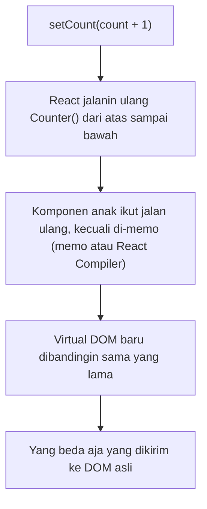
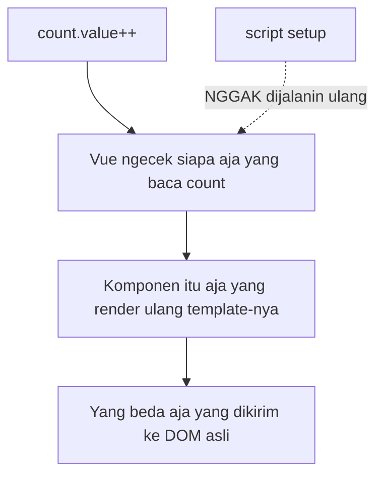
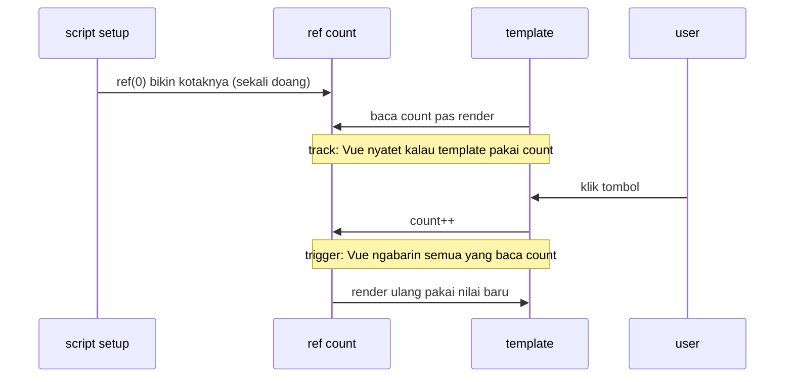
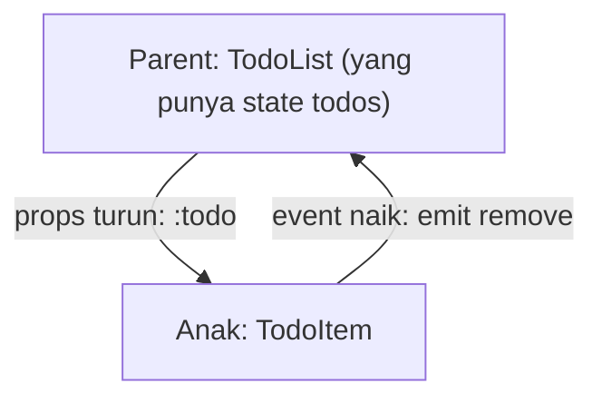
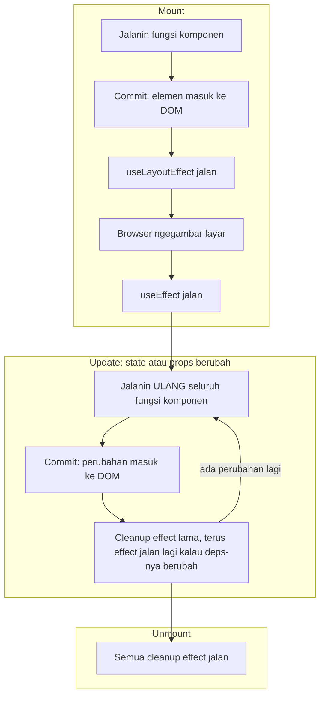
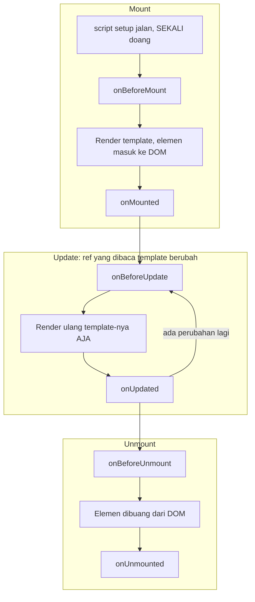

Minggu lalu saya nulis soal [pindah dari Next.js ke SvelteKit](/blog/nextjs-to-sveltekit). Sekarang giliran **Vue**. Vue ini salah satu framework frontend paling populer, dan banyak anak React yang ujung-ujungnya "kecemplung" di project Vue gara-gara kantor, klien, atau tim barunya udah pakai Vue duluan.

Jujur aja, **saya juga gitu.** Sebelum nulis ini, saya belum pernah ngoding Vue sama sekali. Jadi anggap aja ini catatan belajar saya: tiap konsep Vue saya jejerin sama kode React yang udah biasa saya tulis.

Kalau kamu udah nyaman pakai React tapi masih nol banget soal Vue, tulisan ini pas buat kamu. Kita bahas **Vue-nya aja** ya: komponen, state, sama pola-pola yang kepakai sehari-hari. 💚

> Versi yang saya pakai: **React 19** dan **Vue 3.5**, dengan Composition API dan `<script setup>`. Kalau nemu tutorial yang masih pakai `export default { data() { ... } }` atau `this.something`, itu gaya lama (Options API atau Vue 2). Lewatin dulu aja.

## Kenalan singkat sama Vue

- **Vue** dipakai buat bikin UI, sama kayak **React**. Aplikasinya juga disusun dari komponen.
- Komponennya ditulis di file `.vue`, namanya **Single File Component (SFC)**. Dalam satu file ada template (HTML), script (JS/TS), dan style (CSS).
- Vue itu **reaktif**. Ubah nilainya, bagian halaman yang pakai nilai itu langsung ikut berubah. Nggak ada `setState`.
- Project Vue dibangun pakai **Vite** (buatan Evan You, pembuat Vue juga), yang kemungkinan udah sering kamu pakai.

Bikin project baru:

```bash
npm create vue@latest my-app
cd my-app
npm install
npm run dev
```

Nanti kamu ditanya-tanya dulu (TypeScript, Router, Pinia, Vitest, ESLint...). TypeScript pilih aja. Sisanya terserah kebutuhan.

## Gambaran besarnya

| Topik | React | Vue |
| --- | --- | --- |
| File komponen | `.tsx` (JSX) | `.vue` (`<template>` + `<script setup>` + `<style>`) |
| Cara UI berubah | Fungsi komponen dijalanin ulang | Vue mantau state, cuma komponen yang pakai state itu yang dirender ulang |
| State | `useState` | `ref` |
| Nilai turunan | `useMemo` (atau variabel biasa) | `computed` |
| Side effect | `useEffect` | `watch`, `watchEffect`, `onMounted` |
| Anak → parent | Callback props | Event (`emit`) |
| Input form | `value` + `onChange` | `v-model` |
| `children` | Prop `children` | `<slot />` |
| Logic yang dipakai ulang | Custom hooks | Composable |
| Styling | CSS Modules, Tailwind, dll. | `<style scoped>` udah bawaan, Tailwind juga bisa |

## 1. Cara mikirnya: setup cuma jalan sekali

Di React, komponen itu fungsi yang **dijalanin ulang** tiap kali state berubah. Gara-gara itu kita butuh `useMemo`, `useCallback`, dependency array, sama `React.memo`.

Di Vue beda. Kode di `<script setup>` cuma jalan **sekali**, pas komponennya dibuat. State-nya ditaruh di "kotak" reaktif (`ref`). Vue hafal **siapa baca kotak yang mana**. Jadi pas isi kotaknya berubah, yang di-update cuma bagian yang baca kotak itu.

Biar kebayang, ini yang terjadi pas kamu klik tombol "+1" di React dan di Vue:





Hasil akhirnya sama: DOM cuma diubah di bagian yang berubah. Bedanya di **berapa banyak kodemu yang dijalanin ulang** sebelum sampai ke situ. React jalanin ulang seluruh fungsi komponen (plus anak-anaknya). Vue cuma render ulang template komponen yang beneran pakai nilai itu.

Efeknya buat kamu:

- **Nggak ada dependency array.** Vue ngelacak sendiri.
- **Nggak perlu `useCallback`.** Fungsinya cuma dibuat sekali, jadi udah stabil.
- **Nggak ada stale closure.** Nilai yang kamu baca pasti yang paling baru.
- **Nggak perlu `React.memo`.** Komponen anak cuma render ulang kalau props atau state-nya sendiri beneran berubah.

## 2. Komponen pertama

**React**

```tsx
// Counter.tsx
import { useState } from "react";

export function Counter({ start = 0 }: { start?: number }) {
  const [count, setCount] = useState(start);
  const double = count * 2;

  return (
    <button className="btn" onClick={() => setCount(count + 1)}>
      {count} (double: {double})
    </button>
  );
}
```

**Vue**

```vue
<!-- Counter.vue -->
<script setup lang="ts">
import { computed, ref } from "vue";

const { start = 0 } = defineProps<{ start?: number }>();

const count = ref(start);
const double = computed(() => count.value * 2);
</script>

<template>
  <button class="btn" @click="count++">
    {{ count }} (double: {{ double }})
  </button>
</template>

<style scoped>
.btn {
  padding: 0.5rem 1rem;
}
</style>
```

Kita bongkar satu per satu:

- **`<script setup>`** tempat naruh logic. Apa pun yang kamu bikin di sini langsung bisa dipakai di template. Nggak perlu `return` atau `export`.
- **`defineProps`** buat nulis props-nya. Tinggal kasih tipe TypeScript biasa, nggak usah di-import.
- **`ref(start)`** itu `useState(start)`-nya Vue. Hasilnya kotak. Di script, isinya dibaca dan diubah lewat **`.value`**.
- **`computed`** mirip `useMemo`, tapi nggak pakai dependency array. Begitu `count` berubah, dia ngitung ulang sendiri.
- **`{{ count }}`** sama kayak `{count}` di JSX. Di template **nggak usah** pakai `.value`, Vue yang bukain kotaknya (khusus ref yang ada di level teratas).
- **`@click`** itu `onClick`. Terus `count++` langsung jalan, karena ubah state di Vue ya tinggal di-assign.
- **`<style scoped>`** cuma ngaruh ke komponen ini. Nggak butuh CSS Modules.
- Tulisnya `class`, bukan `className`. Template-nya HTML biasa.

Bagian ini intinya Vue, jadi kita pelan-pelan. Pas template baca `count`, Vue **nyatet (track)**. Pas kamu ubah `count`, Vue **ngabarin (trigger)** semua yang tadi baca:



Makenya juga nggak asing:

```vue
<script setup lang="ts">
import Counter from "./Counter.vue";
</script>

<template>
  <Counter :start="5" />
</template>
```

Lihat ada `:` di `:start="5"`? Kita bahas di bagian berikutnya.

## 3. Sintaks template

Di JSX apa-apa pakai JavaScript: `&&`, ternary, `.map()`. Di Vue ada **directive**, atribut spesial yang depannya `v-`:

**React**

```tsx
<>
  {user ? <p>Hi, {user.name}</p> : <a href="/login">Log in</a>}

  <ul>
    {todos.map((todo) => (
      <li key={todo.id} className={todo.done ? "done" : ""}>
        {todo.title}
      </li>
    ))}
  </ul>
</>
```

**Vue**

```vue
<template>
  <p v-if="user">Hi, {{ user.name }}</p>
  <a v-else href="/login">Log in</a>

  <ul>
    <li v-for="todo in todos" :key="todo.id" :class="{ done: todo.done }">
      {{ todo.title }}
    </li>
  </ul>
</template>
```

Contekannya:

| React (JSX) | Vue (template) |
| --- | --- |
| `{cond && <A />}` | `<A v-if="cond" />` |
| `{cond ? <A /> : <B />}` | `<A v-if="cond" />` + `<B v-else />` |
| `{items.map(i => <li key={i.id}>...)}` | `<li v-for="i in items" :key="i.id">` |
| `className={...}` | `:class="..."` (bisa object dan array, mirip `clsx`) |
| `style={{ color }}` | `:style="{ color }"` |
| `onClick={handler}` | `@click="handler"` |
| `onSubmit={(e) => { e.preventDefault(); ... }}` | `@submit.prevent="..."` |
| `disabled={isLoading}` | `:disabled="isLoading"` |
| `dangerouslySetInnerHTML` | `v-html` |
| `<>...</>` (Fragment) | Nggak perlu, template boleh punya banyak elemen root |

Yang paling penting diinget: **`:` artinya "isinya JavaScript"**. `:count="5"` ngirim angka `5`, sedangkan `count="5"` ngirim string `"5"`. Lupa naruh `:` itu bug paling klasik di hari pertama.

## 4. Props dan event

Props-nya sama persis kayak di React: data turun **ke bawah**, dari parent ke anak.

Yang beda itu pas anak mau "ngomong" **balik ke parent**. Di React kamu oper callback (`onRemove`). Di Vue, anak **ngirim event (emit)**, terus parent dengerin pakai `@`:

**React**

```tsx
function TodoItem({ todo, onRemove }: { todo: Todo; onRemove: (id: string) => void }) {
  return (
    <li>
      {todo.title}
      <button onClick={() => onRemove(todo.id)}>×</button>
    </li>
  );
}

<TodoItem todo={todo} onRemove={removeTodo} />;
```

**Vue**

```vue
<!-- TodoItem.vue -->
<script setup lang="ts">
defineProps<{ todo: Todo }>();
const emit = defineEmits<{ remove: [id: string] }>();
</script>

<template>
  <li>
    {{ todo.title }}
    <button @click="emit('remove', todo.id)">×</button>
  </li>
</template>
```

```vue
<TodoItem :todo="todo" @remove="removeTodo" />
```

`defineEmits` isinya daftar event yang bisa dikirim komponen ini, plus tipe argumennya. Rasanya kayak callback prop yang ditulis beda aja, dan emang sebenarnya gitu.

Alurnya tetap satu arah, sama kayak di React:



Sama kayak di React juga, **jangan ubah props langsung** dari komponen anak. Kirim event aja, biar parent yang ngubah state-nya sendiri.

## 5. Form: `v-model`

Di React, input yang controlled butuh dua: `value` sama `onChange`. Di Vue, cukup `v-model`:

**React**

```tsx
const [name, setName] = useState("");

<input value={name} onChange={(e) => setName(e.target.value)} />;
```

**Vue**

```vue
<script setup lang="ts">
import { ref } from "vue";

const name = ref("");
</script>

<template>
  <input v-model="name" />
  <p>Hello, {{ name }}</p>
</template>
```

Bisa dipakai di input teks, textarea, checkbox, radio, sama select.

Komponen bikinan sendiri juga bisa pakai `v-model`, caranya pakai `defineModel()` (Vue 3.4+):

```vue
<!-- SearchBox.vue -->
<script setup lang="ts">
const query = defineModel<string>({ default: "" });
</script>

<template>
  <input v-model="query" placeholder="Search..." />
</template>
```

```vue
<SearchBox v-model="search" />
```

Kalau di React, kamu harus nulis `<SearchBox value={search} onChange={setSearch} />` terus nyambungin dua-duanya sendiri. Di Vue, `defineModel` yang beresin.

## 6. `children` jadi slot

Di React kamu render `children`. Di Vue, taruh `<slot />` di tempat isinya mau muncul:

**React**

```tsx
function Card({ title, children }: { title: string; children: React.ReactNode }) {
  return (
    <section className="card">
      <h2>{title}</h2>
      {children}
    </section>
  );
}
```

**Vue**

```vue
<!-- Card.vue -->
<script setup lang="ts">
defineProps<{ title: string }>();
</script>

<template>
  <section class="card">
    <h2>{{ title }}</h2>
    <slot />
  </section>
</template>
```

```vue
<Card title="Hello">
  <p>This is the content.</p>
</Card>
```

Butuh lebih dari satu "lubang", misalnya buat footer? Pakai **named slot**:

```vue
<!-- di dalam Card.vue -->
<footer><slot name="footer" /></footer>
```

```vue
<Card title="Hello">
  <p>This is the content.</p>

  <template #footer>
    <button>Save</button>
  </template>
</Card>
```

Kalau di React, ini kayak ngoper JSX lewat prop `footer`.

## 7. Lifecycle komponen

Semua komponen pasti lewat tiga fase: **mount** (muncul di halaman), **update** (datanya berubah), sama **unmount** (hilang). React dan Vue sama-sama bisa jalanin kode di tiap fase itu, tapi caranya beda.

**React**



**Vue**



Coba lihat kotak **update**-nya. Di React, tiap update **seluruh fungsimu** dijalanin lagi, jadi semua `const` dan fungsi di dalamnya dibikin ulang. Itu sebabnya effect butuh dependency array. Di Vue, `<script setup>` cuma ada di kotak **mount**. Pas update, yang dirender ulang cuma template-nya, variabel sama fungsimu tetap yang itu-itu juga.

Biar gampang, ini padanannya:

| Kapan | React | Vue |
| --- | --- | --- |
| Sebelum render pertama | Isi fungsi komponen (jalan tiap render) | `<script setup>` (jalan sekali) |
| Udah masuk DOM | `useEffect(() => {...}, [])` | `onMounted` |
| Sebelum layar digambar | `useLayoutEffect` | `onMounted` (jalannya udah sebelum browser ngegambar) |
| Tiap habis update | `useEffect(() => {...})` tanpa deps | `onUpdated` (tapi nggak jalan pas mount) |
| Pas komponen hilang | Cleanup yang di-return `useEffect` | `onBeforeUnmount` / `onUnmounted` |

Praktiknya, yang bakal sering kamu pakai cuma `onMounted` sama `onUnmounted`. Sisanya jarang kepakai, sama kayak `useLayoutEffect` di React.

> Pas development, Strict Mode di React jalanin tiap effect **dua kali** (mount, unmount, mount lagi) buat nangkep cleanup yang kelupaan. Vue nggak gitu, jadi jangan heran kalau `onMounted` kamu cuma nge-log sekali.

## 8. Side effect: `useEffect` vs `watch` dan `onMounted`

`useEffect` di React itu kerjaannya banyak banget. Di Vue, kerjaannya dibagi-bagi:

| Mau ngapain | React | Vue |
| --- | --- | --- |
| Jalan sekali pas komponen muncul | `useEffect(() => {...}, [])` | `onMounted(() => {...})` |
| Beres-beres pas komponen hilang | Return fungsi dari `useEffect` | `onUnmounted(() => {...})` |
| Jalan tiap ada nilai yang berubah | `useEffect(() => {...}, [x])` | `watch(x, (newX) => {...})` |
| Jalan tiap apa pun yang dibaca berubah | (nggak ada yang persis) | `watchEffect(() => {...})` |
| Ngitung nilai dari nilai lain | `useMemo` / variabel | `computed` (jangan `watch`!) |

Contoh yang paling sering ketemu: fetch data user tiap prop `id` ganti.

**React**

```tsx
function UserCard({ id }: { id: string }) {
  const [user, setUser] = useState<User | null>(null);

  useEffect(() => {
    fetch(`/api/users/${id}`)
      .then((res) => res.json())
      .then(setUser);
  }, [id]);

  return user ? <p>{user.name}</p> : <p>Loading...</p>;
}
```

**Vue**

```vue
<!-- UserCard.vue -->
<script setup lang="ts">
import { ref, watch } from "vue";

const props = defineProps<{ id: string }>();
const user = ref<User | null>(null);

watch(
  () => props.id,
  async (id) => {
    const res = await fetch(`/api/users/${id}`);
    user.value = await res.json();
  },
  { immediate: true },
);
</script>

<template>
  <p v-if="user">{{ user.name }}</p>
  <p v-else>Loading...</p>
</template>
```

- `() => props.id` itu "apa yang dipantau". Fungsinya sama kayak dependency array.
- `{ immediate: true }` bikin dia langsung jalan sekali pas komponen dibuat. Tanpa opsi ini, `watch` baru jalan di perubahan **berikutnya**. Beda sama `useEffect` yang selalu jalan pas mount.

Satu tips yang cukup ngebantu saya: **kalau kamu ngubah state di dalam `watch` cuma buat ngitung sesuatu, mending pakai `computed`.** Sama kayak saran "you might not need an effect" di React.

## 9. Custom hooks jadi composable

Nah, di sini anak React bakal ngerasa paling betah. **Composable** itu fungsi yang pakai reaktivitas Vue terus ngembaliin state. Intinya ya custom hook, namanya aja sama-sama `useX`.

**React**

```tsx
// useMouse.ts
import { useEffect, useState } from "react";

export function useMouse() {
  const [pos, setPos] = useState({ x: 0, y: 0 });

  useEffect(() => {
    const update = (e: MouseEvent) => setPos({ x: e.pageX, y: e.pageY });
    window.addEventListener("mousemove", update);
    return () => window.removeEventListener("mousemove", update);
  }, []);

  return pos;
}
```

**Vue**

```ts
// useMouse.ts
import { onMounted, onUnmounted, ref } from "vue";

export function useMouse() {
  const x = ref(0);
  const y = ref(0);

  function update(e: MouseEvent) {
    x.value = e.pageX;
    y.value = e.pageY;
  }

  onMounted(() => window.addEventListener("mousemove", update));
  onUnmounted(() => window.removeEventListener("mousemove", update));

  return { x, y };
}
```

```vue
<script setup lang="ts">
import { useMouse } from "./useMouse";

const { x, y } = useMouse();
</script>

<template>
  <p>Mouse at {{ x }}, {{ y }}</p>
</template>
```

Enaknya lagi: **aturannya jauh lebih sedikit dari rules of hooks**. Karena `<script setup>` cuma jalan sekali, urutan pemanggilan nggak penting. Mau panggil composable di dalam `if` juga boleh, dan nggak ada dependency array yang bisa salah tulis. Aturannya cuma satu: panggil composable **secara sinkron** di `<script setup>`, jangan di dalam event handler atau setelah `await`. Soalnya lifecycle hook kayak `onMounted` perlu tahu dia punya komponen yang mana.

Sebelum bikin sendiri, intip dulu **[VueUse](https://vueuse.org)**. Isinya 200+ composable siap pakai (`useMouse`, `useLocalStorage`, `useDebounceFn`, `useDark`...). Mirip `usehooks-ts`, tapi jauh lebih lengkap.

## 10. Hooks lainnya

| React | Vue |
| --- | --- |
| `useState(0)` | `const count = ref(0)` |
| `useMemo(() => a * b, [a, b])` | `const total = computed(() => a.value * b.value)` |
| `useEffect` | `watch`, `watchEffect`, `onMounted`, `onUnmounted` |
| `useRef` buat elemen DOM | `useTemplateRef("input")` + `ref="input"` di template |
| `useRef` buat nyimpen nilai | Cukup variabel `let` biasa (toh script-nya cuma jalan sekali) |
| `useContext` / `createContext` | `provide` / `inject` |
| `useId` | `useId()` (Vue 3.5+) |
| `createPortal` | `<Teleport to="body">` |
| `<Suspense>` | `<Suspense>` (di Vue masih eksperimental) |
| `useCallback`, `React.memo` | Nggak perlu |

Contoh ref ke elemen DOM, misalnya biar input langsung ke-focus:

```vue
<script setup lang="ts">
import { onMounted, useTemplateRef } from "vue";

const input = useTemplateRef<HTMLInputElement>("input");

onMounted(() => input.value?.focus());
</script>

<template>
  <input ref="input" />
</template>
```

## 11. Library penggantinya

Buka `package.json` kamu, terus cocokin sama tabel ini:

| Di React | Di Vue |
| --- | --- |
| React Router | [Vue Router](https://router.vuejs.org) (resmi) |
| Zustand, Redux | [Pinia](https://pinia.vuejs.org) (resmi) |
| TanStack Query | `@tanstack/vue-query` |
| React Hook Form, Formik | [VeeValidate](https://vee-validate.logaretm.com) |
| shadcn/ui | [shadcn-vue](https://www.shadcn-vue.com) |
| Radix UI | [Reka UI](https://reka-ui.com) |
| MUI | [Vuetify](https://vuetifyjs.com) |
| Ant Design | [Ant Design Vue](https://antdv.com) |
| Mantine, Chakra UI | [PrimeVue](https://primevue.org), Element Plus, Naive UI |
| Motion (dulu Framer Motion) | `<Transition>` bawaan, atau Motion for Vue (`motion-v`) |
| `usehooks-ts`, `react-use` | [VueUse](https://vueuse.org) |
| react-i18next | `vue-i18n` |
| lucide-react | `@lucide/vue` |
| sonner | `vue-sonner` |
| TanStack Table | `@tanstack/vue-table` |
| React Testing Library | `@testing-library/vue`, atau `@vue/test-utils` |
| React DevTools | [Vue DevTools](https://devtools.vuejs.org) |

Library yang nggak ada urusannya sama React (Zod, date-fns, Axios, Tailwind) bisa langsung dipakai di Vue, nggak perlu diganti.

## Jebakan di minggu pertama

1. **Lupa `.value`.** Di `<script>`, `ref` harus pakai `.value`. Di `<template>` nggak usah. Kalau ada yang "kok nggak ke-update", cek ini dulu.
2. **Lupa `:`.** `:count="5"` itu angka, `count="5"` itu string. Sama juga buat `:disabled`, `:items`, pokoknya semua yang bukan string biasa.
3. **Destructuring bisa bikin reaktivitasnya ilang.** Kalau `const state = reactive({ count: 0 })`, nulis `const { count } = state` cuma nyalin nilainya sekali. Mending akses langsung (`state.count`), atau pakai `toRefs(state)`. Destructuring `defineProps` aman sejak Vue 3.5, tapi kalau mau `watch` prop hasil destructuring, bungkus pakai getter: `watch(() => id, ...)`.
4. **Pakai `ref` atau `reactive`?** `ref` aja di mana-mana. Bisa buat semua tipe data, dan dokumentasi Vue juga nyaranin gitu.
5. **`v-if` sama `v-for` di elemen yang sama.** `v-if` jalan duluan, jadi dia belum kenal variabel loop-nya. Pindahin `v-for` ke pembungkus `<template>`, atau filter list-nya pakai `computed`.
6. **`tsc` nggak ngecek file `.vue`.** Pakai `vue-tsc`. Kalau pas `npm create vue` kamu pilih TypeScript, project-nya udah punya script `npm run type-check` buat ini.
7. **Tutorial jadul di mana-mana.** Options API (`data()`, `methods`, `this.`), Vue 2, sama Vuex itu gaya lama. Cari yang udah pakai `<script setup>`.

## Mulai dari mana?

1. **Kerjain [tutorial resmi Vue](https://vuejs.org/tutorial/)**, pilih "Composition" dan "SFC" di bagian atas. Satu sore juga kelar.
2. **Bikin ulang komponen React kecil yang udah kamu hafal**, misalnya todo list atau search box. Bandingin dua versinya, dijamin lebih nempel daripada baca artikel doang.
3. **Pasang Vue DevTools** di browser. Ngelihat state berubah secara live bikin konsep reaktivitasnya lebih cepat nyantol.

Kesan pertama saya sebagai anak React: Vue kerasa akrab banget. Composable itu custom hooks dengan aturan yang jauh lebih sedikit. `computed` itu `useMemo` yang nggak bisa basi. `v-model` ngilangin banyak kode form yang ngebosenin. Katanya sih `.value` bakal bikin kesel di minggu pertama. Saya masih di minggu itu. 😅

Selamat belajar! 💚

## Referensi

- [Dokumentasi Vue](https://vuejs.org/guide/introduction.html), resmi
- [Tutorial interaktif Vue](https://vuejs.org/tutorial/)
- [Reactivity fundamentals](https://vuejs.org/guide/essentials/reactivity-fundamentals.html), dokumentasi Vue
- [Template syntax](https://vuejs.org/guide/essentials/template-syntax.html) dan [List rendering](https://vuejs.org/guide/essentials/list.html), dokumentasi Vue
- [Props](https://vuejs.org/guide/components/props.html), [Events](https://vuejs.org/guide/components/events.html), [Component v-model](https://vuejs.org/guide/components/v-model.html), dan [Slots](https://vuejs.org/guide/components/slots.html), dokumentasi Vue
- [Watchers](https://vuejs.org/guide/essentials/watchers.html) dan [Lifecycle hooks](https://vuejs.org/guide/essentials/lifecycle.html), dokumentasi Vue
- [Lifecycle of reactive effects](https://react.dev/learn/lifecycle-of-reactive-effects), dokumentasi React
- [Composables](https://vuejs.org/guide/reusability/composables.html), dokumentasi Vue
- [Composition API FAQ](https://vuejs.org/guide/extras/composition-api-faq.html), dokumentasi Vue. Ada perbandingannya sama React hooks
- [VueUse](https://vueuse.org), [Pinia](https://pinia.vuejs.org), dan [Vue Router](https://router.vuejs.org)
