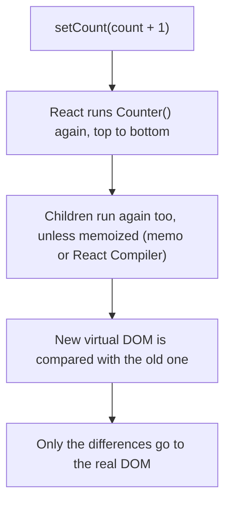
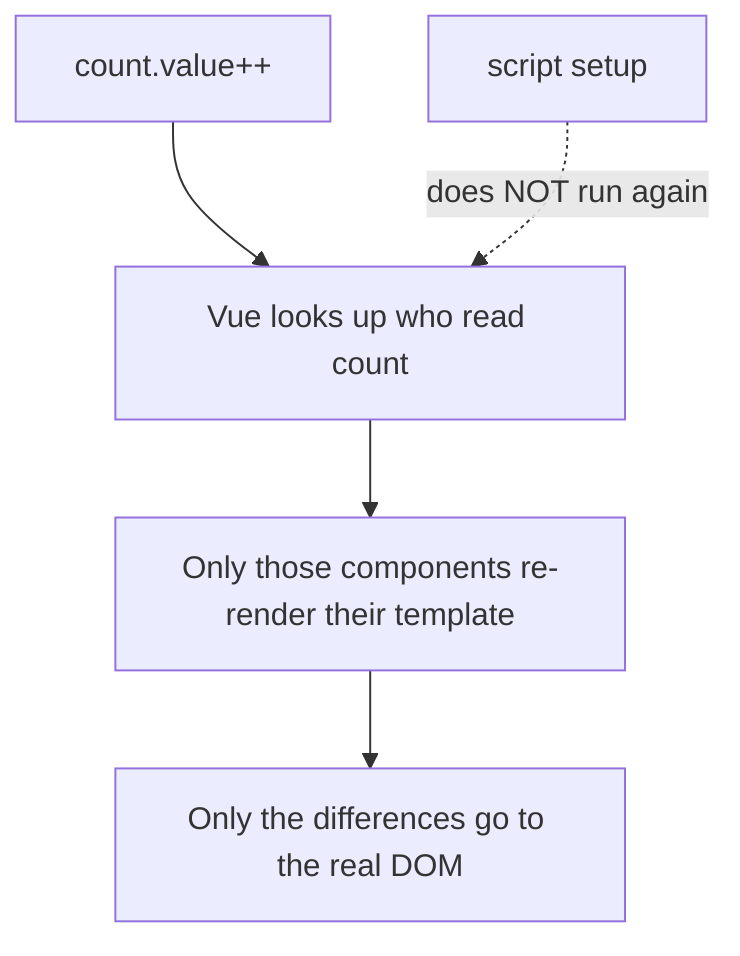
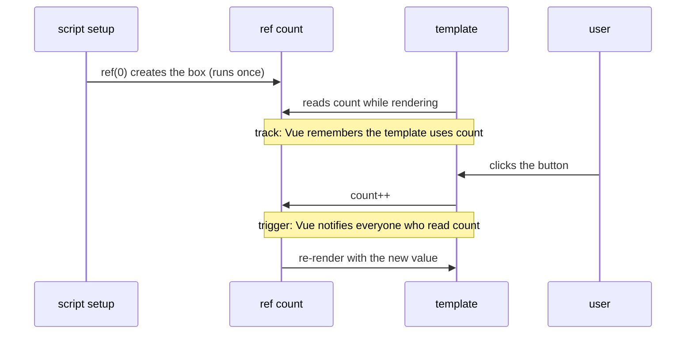
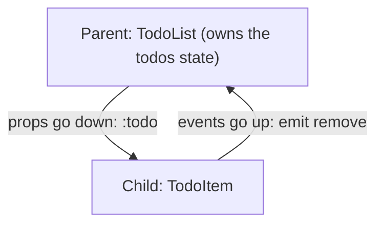
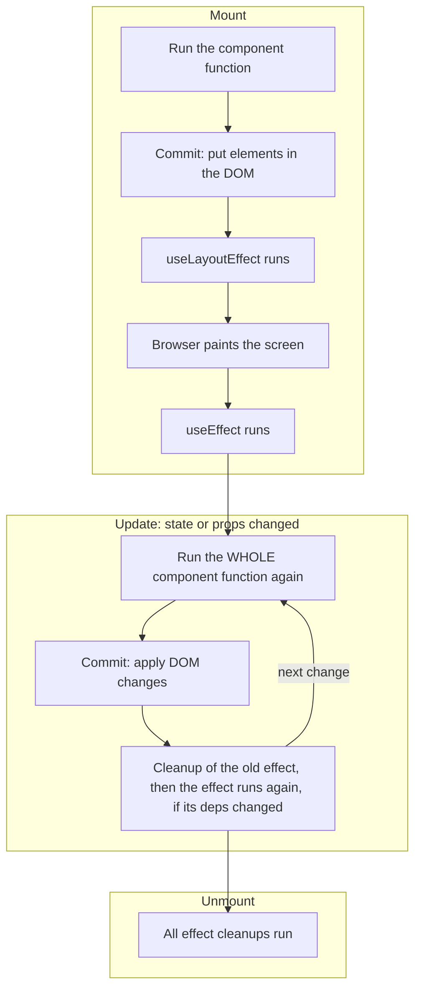
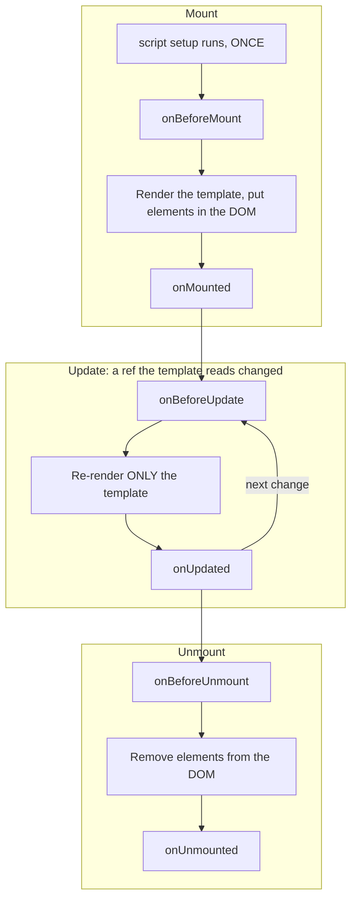

Last week I wrote about [moving from Next.js to SvelteKit](/blog/nextjs-to-sveltekit). Next on my list: **Vue**. It's one of the most popular frontend frameworks around, and plenty of React developers end up on a Vue project because their new job, client, or team already chose it.

Full disclosure: **I'm one of those React developers.** Before this post, I had never written a line of Vue. So this is the guide I wanted while learning it: every Vue idea next to the React code I already knew.

If you know React well and are just as new to Vue as I am, this post is for you. We'll stick to **Vue itself**: components, state, and the everyday patterns. 💚

> Versions in this post: **React 19** and **Vue 3.5** with the Composition API and `<script setup>`. If you find an old tutorial using `export default { data() { ... } }` or `this.something`, that's the older Options API (or Vue 2). Skip it for now.

## Vue in one minute

- **Vue** is for building UIs, just like **React**. You build your app out of components.
- Components live in `.vue` files, called **Single File Components (SFCs)**. One file holds the template (HTML), the script (JS/TS), and the styles (CSS).
- Vue is **reactive**. You change a value, and the parts of the page that use it update. No `setState`.
- Vue projects are built with **Vite** (created by Evan You, who also created Vue), which you probably already know.

Starting a project:

```bash
npm create vue@latest my-app
cd my-app
npm install
npm run dev
```

The setup asks you a few questions (TypeScript, Router, Pinia, Vitest, ESLint...). Say yes to TypeScript. For the rest, pick what you need.

## The big picture

| Topic | React | Vue |
| --- | --- | --- |
| Component file | `.tsx` (JSX) | `.vue` (`<template>` + `<script setup>` + `<style>`) |
| How the UI updates | Re-runs your component function | Tracks state, re-renders only the components that use it |
| State | `useState` | `ref` |
| Computed values | `useMemo` (or just a variable) | `computed` |
| Side effects | `useEffect` | `watch`, `watchEffect`, `onMounted` |
| Child → parent | Callback props | Events (`emit`) |
| Form inputs | `value` + `onChange` | `v-model` |
| `children` | `children` prop | `<slot />` |
| Reusable logic | Custom hooks | Composables |
| Styles | CSS Modules, Tailwind, etc. | `<style scoped>` built in, Tailwind works too |

## 1. The mental model: setup runs once

In React, your component is a function that **runs again** every time state changes. That's why we have `useMemo`, `useCallback`, dependency arrays, and `React.memo`.

In Vue, the code in `<script setup>` runs **once**, when the component is created. Your state lives in reactive "boxes" (`ref`). Vue remembers **who reads which box**, and when a box changes, only the parts that read it update.

Here's what happens when you click a "+1" button in each one:





Both end up updating only what changed in the DOM. The difference is **how much of your code runs again** to get there. In React, it's the whole component function (and its children). In Vue, it's just the template of the components that actually use the value.

What that means for you:

- **No dependency arrays.** Vue tracks dependencies by itself.
- **No `useCallback`.** Functions are created once, so they're already stable.
- **No stale closures.** You always read the current value.
- **No `React.memo`.** A child only re-renders when its own props or state actually change.

## 2. Your first component

**React**

```tsx
// Counter.tsx
import { useState } from "react";

export function Counter({ start = 0 }: { start?: number }) {
  const [count, setCount] = useState(start);
  const double = count * 2;

  return (
    <button className="btn" onClick={() => setCount(count + 1)}>
      {count} (double: {double})
    </button>
  );
}
```

**Vue**

```vue
<!-- Counter.vue -->
<script setup lang="ts">
import { computed, ref } from "vue";

const { start = 0 } = defineProps<{ start?: number }>();

const count = ref(start);
const double = computed(() => count.value * 2);
</script>

<template>
  <button class="btn" @click="count++">
    {{ count }} (double: {{ double }})
  </button>
</template>

<style scoped>
.btn {
  padding: 0.5rem 1rem;
}
</style>
```

Let's go through it:

- **`<script setup>`** is where your logic goes. Everything you declare here is available in the template. No `return`, no `export`.
- **`defineProps`** declares the props. It takes a normal TypeScript type. You don't need to import it.
- **`ref(start)`** is `useState(start)`. It returns a box. You read and write it with **`.value`** in the script.
- **`computed`** is like `useMemo`, but without a dependency array. It re-calculates when `count` changes.
- **`{{ count }}`** is `{count}` in JSX. In the template, you **don't** write `.value`. Vue unwraps top-level refs for you.
- **`@click`** is `onClick`. And `count++` just works: you change state by assigning to it.
- **`<style scoped>`** only applies to this component. No CSS Modules needed.
- It's `class`, not `className`. The template is plain HTML.

This is the heart of Vue, so here it is step by step. When the template reads `count`, Vue **tracks** it. When you write to `count`, Vue **triggers** an update for everyone who read it:



Using it looks familiar:

```vue
<script setup lang="ts">
import Counter from "./Counter.vue";
</script>

<template>
  <Counter :start="5" />
</template>
```

Note the `:` in `:start="5"`. More on that next.

## 3. Template syntax

JSX uses JavaScript for everything: `&&`, ternaries, `.map()`. Vue uses **directives**, special attributes that start with `v-`:

**React**

```tsx
<>
  {user ? <p>Hi, {user.name}</p> : <a href="/login">Log in</a>}

  <ul>
    {todos.map((todo) => (
      <li key={todo.id} className={todo.done ? "done" : ""}>
        {todo.title}
      </li>
    ))}
  </ul>
</>
```

**Vue**

```vue
<template>
  <p v-if="user">Hi, {{ user.name }}</p>
  <a v-else href="/login">Log in</a>

  <ul>
    <li v-for="todo in todos" :key="todo.id" :class="{ done: todo.done }">
      {{ todo.title }}
    </li>
  </ul>
</template>
```

The cheat sheet:

| React (JSX) | Vue (template) |
| --- | --- |
| `{cond && <A />}` | `<A v-if="cond" />` |
| `{cond ? <A /> : <B />}` | `<A v-if="cond" />` + `<B v-else />` |
| `{items.map(i => <li key={i.id}>...)}` | `<li v-for="i in items" :key="i.id">` |
| `className={...}` | `:class="..."` (accepts objects and arrays, like `clsx`) |
| `style={{ color }}` | `:style="{ color }"` |
| `onClick={handler}` | `@click="handler"` |
| `onSubmit={(e) => { e.preventDefault(); ... }}` | `@submit.prevent="..."` |
| `disabled={isLoading}` | `:disabled="isLoading"` |
| `dangerouslySetInnerHTML` | `v-html` |
| `<>...</>` (Fragment) | Not needed, a template can have many root elements |

The most important rule: **`:` means "this is JavaScript"**. `:count="5"` passes the number `5`. `count="5"` passes the string `"5"`. Forgetting the `:` is a classic first-day bug.

## 4. Props and events

Props work like in React: data goes **down** from parent to child.

The difference is how a child talks **back up**. In React, you pass a callback prop (`onRemove`). In Vue, the child **emits an event**, and the parent listens with `@`:

**React**

```tsx
function TodoItem({ todo, onRemove }: { todo: Todo; onRemove: (id: string) => void }) {
  return (
    <li>
      {todo.title}
      <button onClick={() => onRemove(todo.id)}>×</button>
    </li>
  );
}

<TodoItem todo={todo} onRemove={removeTodo} />;
```

**Vue**

```vue
<!-- TodoItem.vue -->
<script setup lang="ts">
defineProps<{ todo: Todo }>();
const emit = defineEmits<{ remove: [id: string] }>();
</script>

<template>
  <li>
    {{ todo.title }}
    <button @click="emit('remove', todo.id)">×</button>
  </li>
</template>
```

```vue
<TodoItem :todo="todo" @remove="removeTodo" />
```

`defineEmits` lists the events this component can send, with the types of their arguments. It feels like a callback prop with a different syntax, and that's basically what it is.

The data flow is the same "one-way" idea you know from React:



Just like in React, **don't change props directly** inside the child. Emit an event and let the parent change its own state.

## 5. Forms: `v-model`

In React, a controlled input needs two things: `value` and `onChange`. In Vue, `v-model` does both:

**React**

```tsx
const [name, setName] = useState("");

<input value={name} onChange={(e) => setName(e.target.value)} />;
```

**Vue**

```vue
<script setup lang="ts">
import { ref } from "vue";

const name = ref("");
</script>

<template>
  <input v-model="name" />
  <p>Hello, {{ name }}</p>
</template>
```

It works on text inputs, textareas, checkboxes, radios, and selects.

Your own components can support `v-model` too, with `defineModel()` (Vue 3.4+):

```vue
<!-- SearchBox.vue -->
<script setup lang="ts">
const query = defineModel<string>({ default: "" });
</script>

<template>
  <input v-model="query" placeholder="Search..." />
</template>
```

```vue
<SearchBox v-model="search" />
```

In React you'd write `<SearchBox value={search} onChange={setSearch} />` and wire both sides by hand. Here, `defineModel` does the wiring.

## 6. `children` becomes slots

In React, you render `children`. In Vue, you put a `<slot />` where the children go:

**React**

```tsx
function Card({ title, children }: { title: string; children: React.ReactNode }) {
  return (
    <section className="card">
      <h2>{title}</h2>
      {children}
    </section>
  );
}
```

**Vue**

```vue
<!-- Card.vue -->
<script setup lang="ts">
defineProps<{ title: string }>();
</script>

<template>
  <section class="card">
    <h2>{{ title }}</h2>
    <slot />
  </section>
</template>
```

```vue
<Card title="Hello">
  <p>This is the content.</p>
</Card>
```

Need more than one "hole", like a footer? Use a **named slot**:

```vue
<!-- inside Card.vue -->
<footer><slot name="footer" /></footer>
```

```vue
<Card title="Hello">
  <p>This is the content.</p>

  <template #footer>
    <button>Save</button>
  </template>
</Card>
```

In React, you'd pass JSX through a `footer` prop. Same idea.

## 7. The component lifecycle

Every component goes through the same three phases: it **mounts** (appears on the page), **updates** (when its data changes), and **unmounts** (disappears). Both libraries let you run code at those moments, but the way they get there is different.

**React**



**Vue**



The key difference is in the **update** box. In React, an update runs your **whole function** again, so every `const` and every function inside it is created again. That's why effects need dependency arrays. In Vue, `<script setup>` is only in the **mount** box. Updates only re-render the template, and your variables and functions stay the same.

Here's how the moments line up:

| Moment | React | Vue |
| --- | --- | --- |
| Before the first render | The function body (runs every render) | `<script setup>` (runs once) |
| After it's in the DOM | `useEffect(() => {...}, [])` | `onMounted` |
| Before the screen paints | `useLayoutEffect` | `onMounted` (it already runs before the browser paints) |
| After every update | `useEffect(() => {...})` with no deps | `onUpdated` (but it doesn't run on mount) |
| When it disappears | Cleanup returned from `useEffect` | `onBeforeUnmount` / `onUnmounted` |

In practice, you'll use `onMounted` and `onUnmounted` most of the time. The others are rare, just like `useLayoutEffect` in React.

> In development, React's Strict Mode runs every effect **twice** (mount, unmount, mount again) to catch missing cleanups. Vue doesn't do that, so don't be surprised when your `onMounted` only logs once.

## 8. Side effects: `useEffect` vs `watch` and `onMounted`

`useEffect` does a lot of jobs in React. Vue splits them up:

| What you want | React | Vue |
| --- | --- | --- |
| Run once when the component appears | `useEffect(() => {...}, [])` | `onMounted(() => {...})` |
| Clean up when it disappears | Return a function from `useEffect` | `onUnmounted(() => {...})` |
| React to a value changing | `useEffect(() => {...}, [x])` | `watch(x, (newX) => {...})` |
| React to whatever it reads | (no direct equivalent) | `watchEffect(() => {...})` |
| Compute a value from other values | `useMemo` / a variable | `computed` (not `watch`!) |

A common example: fetch a user when the `id` prop changes.

**React**

```tsx
function UserCard({ id }: { id: string }) {
  const [user, setUser] = useState<User | null>(null);

  useEffect(() => {
    fetch(`/api/users/${id}`)
      .then((res) => res.json())
      .then(setUser);
  }, [id]);

  return user ? <p>{user.name}</p> : <p>Loading...</p>;
}
```

**Vue**

```vue
<!-- UserCard.vue -->
<script setup lang="ts">
import { ref, watch } from "vue";

const props = defineProps<{ id: string }>();
const user = ref<User | null>(null);

watch(
  () => props.id,
  async (id) => {
    const res = await fetch(`/api/users/${id}`);
    user.value = await res.json();
  },
  { immediate: true },
);
</script>

<template>
  <p v-if="user">{{ user.name }}</p>
  <p v-else>Loading...</p>
</template>
```

- `() => props.id` is "what to watch". It plays the role of the dependency array.
- `{ immediate: true }` runs it once right away, when the component is created. Without it, `watch` only runs on the **next** change, unlike `useEffect`, which always runs on mount.

A tip that helped me: **if you're setting state inside a `watch` just to compute something, use `computed` instead.** It's the same advice as "you might not need an effect" in React.

## 9. Custom hooks become composables

This is the part where React developers feel at home. A **composable** is a function that uses Vue's reactivity and returns some state. It's a custom hook, with the same `useX` naming:

**React**

```tsx
// useMouse.ts
import { useEffect, useState } from "react";

export function useMouse() {
  const [pos, setPos] = useState({ x: 0, y: 0 });

  useEffect(() => {
    const update = (e: MouseEvent) => setPos({ x: e.pageX, y: e.pageY });
    window.addEventListener("mousemove", update);
    return () => window.removeEventListener("mousemove", update);
  }, []);

  return pos;
}
```

**Vue**

```ts
// useMouse.ts
import { onMounted, onUnmounted, ref } from "vue";

export function useMouse() {
  const x = ref(0);
  const y = ref(0);

  function update(e: MouseEvent) {
    x.value = e.pageX;
    y.value = e.pageY;
  }

  onMounted(() => window.addEventListener("mousemove", update));
  onUnmounted(() => window.removeEventListener("mousemove", update));

  return { x, y };
}
```

```vue
<script setup lang="ts">
import { useMouse } from "./useMouse";

const { x, y } = useMouse();
</script>

<template>
  <p>Mouse at {{ x }}, {{ y }}</p>
</template>
```

And the best part: **far fewer rules than hooks**. Since `<script setup>` runs once, there's no call order to protect, so you can call a composable inside an `if`, and there are no dependency arrays to get wrong. The one rule: call it **synchronously** in `<script setup>`, not inside an event handler or after an `await`. Lifecycle hooks like `onMounted` need to know which component they belong to.

Before writing your own, check **[VueUse](https://vueuse.org)**. It has 200+ ready-made composables (`useMouse`, `useLocalStorage`, `useDebounceFn`, `useDark`...). It's like `usehooks-ts`, but bigger.

## 10. Everything else from the hooks list

| React | Vue |
| --- | --- |
| `useState(0)` | `const count = ref(0)` |
| `useMemo(() => a * b, [a, b])` | `const total = computed(() => a.value * b.value)` |
| `useEffect` | `watch`, `watchEffect`, `onMounted`, `onUnmounted` |
| `useRef` for a DOM element | `useTemplateRef("input")` + `ref="input"` in the template |
| `useRef` for a value | A plain `let` variable (the script runs once anyway) |
| `useContext` / `createContext` | `provide` / `inject` |
| `useId` | `useId()` (Vue 3.5+) |
| `createPortal` | `<Teleport to="body">` |
| `<Suspense>` | `<Suspense>` (experimental in Vue) |
| `useCallback`, `React.memo` | Not needed |

A DOM ref, for example, to focus an input:

```vue
<script setup lang="ts">
import { onMounted, useTemplateRef } from "vue";

const input = useTemplateRef<HTMLInputElement>("input");

onMounted(() => input.value?.focus());
</script>

<template>
  <input ref="input" />
</template>
```

## 11. Your library stack

Open your `package.json` and go through it with this table:

| You use in React | Use in Vue |
| --- | --- |
| React Router | [Vue Router](https://router.vuejs.org) (official) |
| Zustand, Redux | [Pinia](https://pinia.vuejs.org) (official) |
| TanStack Query | `@tanstack/vue-query` |
| React Hook Form, Formik | [VeeValidate](https://vee-validate.logaretm.com) |
| shadcn/ui | [shadcn-vue](https://www.shadcn-vue.com) |
| Radix UI | [Reka UI](https://reka-ui.com) |
| MUI | [Vuetify](https://vuetifyjs.com) |
| Ant Design | [Ant Design Vue](https://antdv.com) |
| Mantine, Chakra UI | [PrimeVue](https://primevue.org), Element Plus, Naive UI |
| Motion (formerly Framer Motion) | Built-in `<Transition>`, or Motion for Vue (`motion-v`) |
| `usehooks-ts`, `react-use` | [VueUse](https://vueuse.org) |
| react-i18next | `vue-i18n` |
| lucide-react | `@lucide/vue` |
| sonner | `vue-sonner` |
| TanStack Table | `@tanstack/vue-table` |
| React Testing Library | `@testing-library/vue`, or `@vue/test-utils` |
| React DevTools | [Vue DevTools](https://devtools.vuejs.org) |

Anything that isn't tied to React (Zod, date-fns, Axios, Tailwind) works in Vue as-is.

## Gotchas that bite you in week one

1. **Forgetting `.value`.** In `<script>`, a `ref` needs `.value`. In `<template>`, it doesn't. If something "doesn't update", check this first.
2. **Forgetting the `:`.** `:count="5"` is a number, `count="5"` is a string. Same for `:disabled`, `:items`, everything that isn't a plain string.
3. **Destructuring can break reactivity.** With `const state = reactive({ count: 0 })`, writing `const { count } = state` copies the value once. Keep the object (`state.count`), or use `toRefs(state)`. Destructuring `defineProps` is fine since Vue 3.5, but to `watch` a destructured prop, wrap it in a getter: `watch(() => id, ...)`.
4. **`ref` or `reactive`?** Just use `ref` everywhere. It works for every type, and it's what the Vue docs recommend.
5. **`v-if` and `v-for` on the same element.** `v-if` runs first, so it can't see the loop variable. Put the `v-for` on a `<template>` wrapper, or filter the list with `computed`.
6. **`tsc` doesn't check `.vue` files.** Use `vue-tsc` instead. If you picked TypeScript in `npm create vue`, the project already has an `npm run type-check` script for that.
7. **Old tutorials are everywhere.** Options API (`data()`, `methods`, `this.`), Vue 2, and Vuex are from an older era. Look for `<script setup>`.

## Where to start

1. **Do the [official Vue tutorial](https://vuejs.org/tutorial/)**, with "Composition" and "SFC" selected at the top. It takes an afternoon.
2. **Rebuild a small React component you know well**, like a todo list or a search box. Comparing the two versions teaches more than any article.
3. **Install Vue DevTools** in your browser. Seeing your state change live helps the reactivity model click.

My first impression, coming from React: Vue feels very familiar. Composables are custom hooks with far fewer rules. `computed` is `useMemo` that can't go stale. `v-model` removes a lot of form boilerplate. People say `.value` is annoying for the first week or so. I'm still in that week. 😅

Happy learning! 💚

## References

- [Vue docs](https://vuejs.org/guide/introduction.html), official
- [Interactive Vue tutorial](https://vuejs.org/tutorial/)
- [Reactivity fundamentals](https://vuejs.org/guide/essentials/reactivity-fundamentals.html), Vue docs
- [Template syntax](https://vuejs.org/guide/essentials/template-syntax.html) and [List rendering](https://vuejs.org/guide/essentials/list.html), Vue docs
- [Props](https://vuejs.org/guide/components/props.html), [Events](https://vuejs.org/guide/components/events.html), [Component v-model](https://vuejs.org/guide/components/v-model.html), and [Slots](https://vuejs.org/guide/components/slots.html), Vue docs
- [Watchers](https://vuejs.org/guide/essentials/watchers.html) and [Lifecycle hooks](https://vuejs.org/guide/essentials/lifecycle.html), Vue docs
- [Lifecycle of reactive effects](https://react.dev/learn/lifecycle-of-reactive-effects), React docs
- [Composables](https://vuejs.org/guide/reusability/composables.html), Vue docs
- [Composition API FAQ](https://vuejs.org/guide/extras/composition-api-faq.html), Vue docs. Includes a comparison with React hooks
- [VueUse](https://vueuse.org), [Pinia](https://pinia.vuejs.org), and [Vue Router](https://router.vuejs.org)
