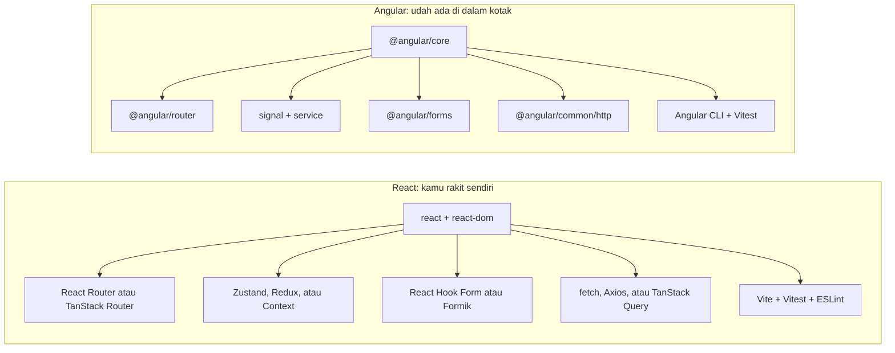
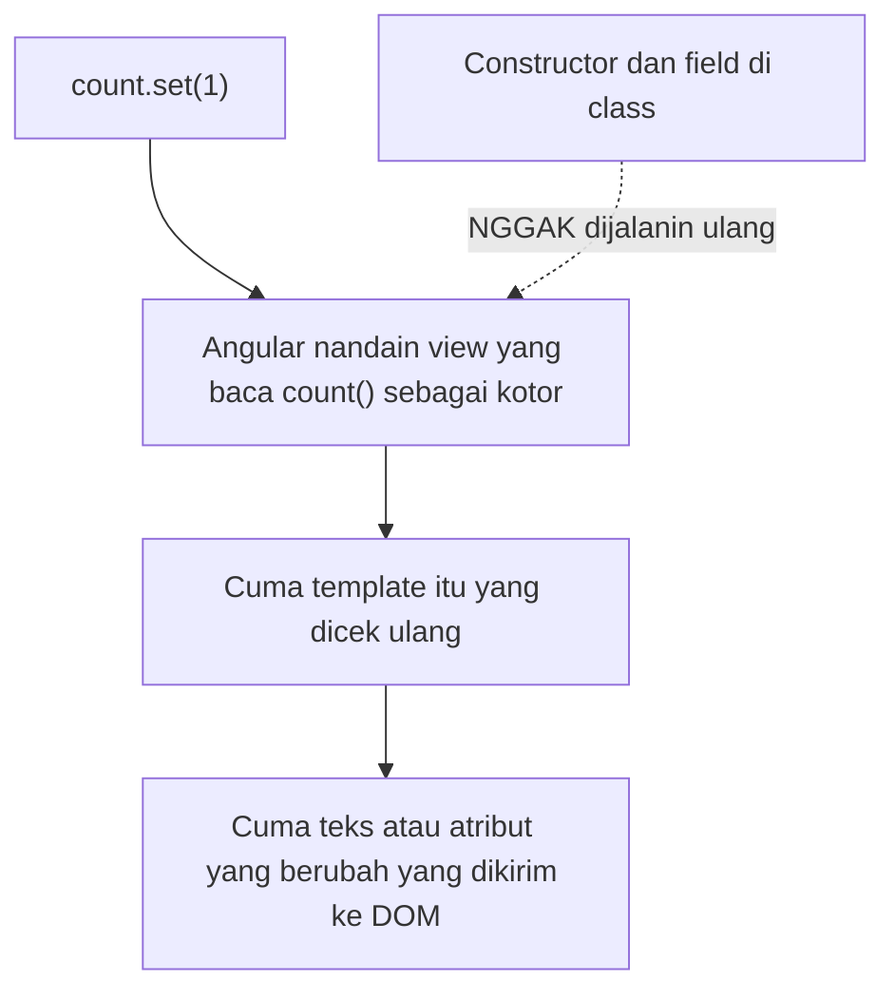
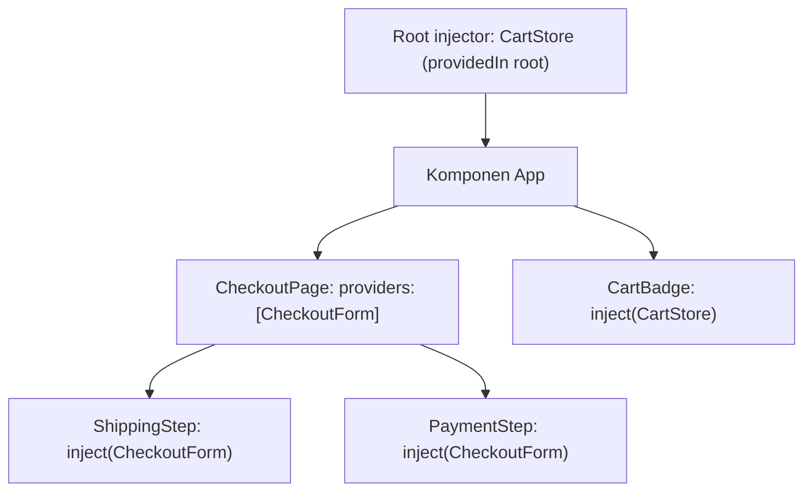

Ini persinggahan ketiga saya keluar dari "gelembung" React. Pertama [SvelteKit](/blog/nextjs-to-sveltekit), terus [Vue](/blog/react-to-vue). Sekarang giliran **Angular**.

Di kalangan anak React, Angular punya reputasi: "berat", "boilerplate-nya banyak", "isinya class sama decorator semua". Dulu sih sebagian ada benarnya. Tapi Angular yang sekarang udah beda jauh. Udah ada signal, standalone component, sama syntax template baru. Banyak perusahaan (bank, software enterprise, instansi pemerintah) masih pakai Angular, jadi kemungkinan besar suatu saat kamu bakal ketemu juga.

Tulisan ini isinya **hal-hal yang pengin saya tahu sebelum buka project Angular pertama**: konsep yang beneran baru, sama kebiasaan React yang perlu dilupain dulu. Tiap konsep saya jejerin sama kode React yang udah kamu kenal. 🅰️

> Versi yang saya pakai: **React 19** dan **Angular 21**, dengan standalone component dan signal. Angular rilis versi major baru tiap enam bulan, jadi cek [angular.dev](https://angular.dev) buat yang lebih baru. Satu peringatan dari awal: **AngularJS** (1.x) itu framework yang beda total dan udah mati. Kalau ada tutorial yang pakai `$scope` atau `ng-controller`, tutup aja tab-nya.

## Kenalan singkat sama Angular

- **React itu library, Angular itu framework.** React cuma ngasih komponen, sisanya kamu pilih sendiri. Angular udah sepaket: router, form, HTTP client, dependency injection, testing, i18n, sama CLI, semuanya dari tim yang sama.
- **TypeScript itu wajib.** Semua project Angular pakai TypeScript.
- **Komponennya berupa class** yang dikasih decorator (`@Component`). Template-nya HTML plus syntax Angular, bukan JSX.
- **Signal** itu wadah state reaktifnya. Bayangin `useState` + `useMemo`, tapi dependency-nya dilacak otomatis.
- **Dependency injection (DI)** itu cara Angular berbagi kode dan state. Ini konsep paling baru buat anak React.
- **RxJS** (Observable) muncul di HTTP client, router, sama form. Nggak harus jago di hari pertama, tapi juga nggak bisa dihindari.
- **Opinionated.** Biasanya cuma ada satu "cara Angular" buat ngerjain sesuatu. Justru itu tujuannya: tim gede nulis kode yang bentuknya seragam di mana-mana.

Bikin project baru:

```bash
npm install -g @angular/cli
ng new my-app
cd my-app
ng serve
```

CLI-nya bakal nanya beberapa hal (format stylesheet, SSR...). Pilih CSS atau SCSS, SSR lewatin dulu aja.

## Gambaran besarnya

| Topik | React | Angular |
| --- | --- | --- |
| Jenisnya | Library UI | Framework lengkap |
| Komponen | Fungsi yang return JSX | Class dengan `@Component` + template HTML |
| Cara UI berubah | Fungsi komponen dijalanin ulang | Signal ngasih tahu Angular view mana aja yang berubah |
| State | `useState` | `signal` |
| Nilai turunan | `useMemo` (atau variabel biasa) | `computed` |
| Side effect | `useEffect` | `effect`, lifecycle hook |
| Props | Object props | `input()` |
| Anak → parent | Callback props | `output()` |
| Input form | `value` + `onChange` | `[(ngModel)]` atau Reactive Forms |
| `children` | Prop `children` | `<ng-content />` |
| Logic & state bersama | Custom hooks, Context, Zustand | Service + dependency injection |
| Ambil data | `fetch`, TanStack Query | `HttpClient` (hasilnya Observable) |
| Routing | React Router (pilih sendiri) | `@angular/router` (bawaan) |
| Tooling | Vite, ESLint, bebas | Angular CLI (`ng`) |

## 1. Cara mikirnya: kamu masuk ke sebuah framework

Di React, project baru itu dimulai dengan milih-milih. Router yang mana? Library state yang mana? Library form? Ambil data pakai apa? File ditaruh di mana?

Di Angular, kebanyakan keputusan itu udah diambilin:



Efeknya ke cara kerja kamu:

- **Pakai yang bawaan dulu.** Sebelum `npm install` library, cek dulu Angular udah punya belum. Biasanya sih udah.
- **Ikutin konvensinya.** CLI bikin file dengan bentuk yang udah ditentuin. Nggak usah dilawan.
- **Upgrade jadi lebih gampang.** `ng update` otomatis migrasiin kode kamu antar versi major. Ini bisa jalan mulus karena semua orang pakai komponen yang sama.

## 2. Cara kerjanya: signal, bukan render ulang

Di React, fungsi komponen **dijalanin ulang** tiap state berubah. Makanya kita butuh `useMemo`, `useCallback`, sama dependency array.

Di Angular, class komponennya cuma dibuat **sekali**. State-nya disimpan di **signal**. Signal itu fungsi: dipanggil buat baca nilainya, terus pakai `.set()` atau `.update()` buat ngubah. Angular hafal **template mana baca signal yang mana**, dan cuma nge-refresh view itu aja pas signal-nya berubah.



Kalau kamu udah baca tulisan Vue saya, ini pasti kedengeran familiar. Signal mirip banget sama `ref` di Vue. Bedanya:

- Baca signal itu dengan **manggil**: `count()`, baik di class maupun di template.
- Ngubahnya pakai `count.set(5)` atau `count.update((c) => c + 1)`. Nggak bisa `count++`.
- Kayak React, signal ngebandingin berdasarkan referensi. `items().push(x)` emang ngubah array-nya, tapi **nggak ngabarin siapa-siapa**. Pakai `items.update((list) => [...list, x])`. Kebiasaan immutable dari React tetap kepakai.

> Di project lama, kamu bakal nemu **zone.js** sama `ChangeDetectionStrategy.OnPush`. Sebelum ada signal, Angular pakai zone.js buat nebak kapan ada yang mungkin berubah, terus ngecek seluruh tree. Project baru di Angular 21 udah **zoneless** dari awal dan ngandelin signal.

## 3. Komponen pertama

**React**

```tsx
// Counter.tsx
import { useState } from "react";

export function Counter({ start = 0 }: { start?: number }) {
  const [count, setCount] = useState(start);
  const double = count * 2;

  return (
    <button className="btn" onClick={() => setCount(count + 1)}>
      {count} (double: {double})
    </button>
  );
}
```

**Angular**

```ts
// counter.ts
import { Component, computed, input, linkedSignal } from "@angular/core";

@Component({
  selector: "app-counter",
  template: `
    <button class="btn" (click)="increment()">
      {{ count() }} (double: {{ double() }})
    </button>
  `,
  styles: `
    .btn {
      padding: 0.5rem 1rem;
    }
  `,
})
export class Counter {
  start = input(0);
  count = linkedSignal(() => this.start());
  double = computed(() => this.count() * 2);

  increment() {
    this.count.update((c) => c + 1);
  }
}
```

Kita bongkar satu per satu:

- **`@Component`** bikin class ini jadi komponen. `selector` itu nama tag HTML-nya: `<app-counter />`.
- **`template`** isinya HTML. Kalau komponennya udah gede, pindahin ke file sendiri pakai `templateUrl: "./counter.html"`. Style juga bisa, pakai `styleUrl`.
- **`styles`** otomatis cuma ngaruh ke komponen ini, kayak CSS Modules tanpa perlu setup.
- **`input(0)`** buat bikin prop dengan nilai default. Bacanya pakai `this.start()`.
- **`linkedSignal`** itu signal yang nilai awalnya diambil dari signal lain, dan ke-reset kalau signal itu berubah. Ini cara nulis "state lokal yang nilai awalnya dari prop".
- **`computed`** itu `useMemo` tanpa dependency array.
- **`{{ count() }}`** sama kayak `{count}` di JSX. Perhatiin `()`-nya. Signal selalu dipanggil, termasuk di template.
- **`(click)="increment()"`** itu `onClick`. Yang ditulis **pemanggilannya**, pakai kurung.
- Tulisnya `class`, bukan `className`. Template-nya HTML biasa.

Cara pakainya dari komponen lain:

```ts
import { Component } from "@angular/core";
import { Counter } from "./counter";

@Component({
  selector: "app-root",
  imports: [Counter],
  template: `<app-counter [start]="5" />`,
})
export class App {}
```

Dua hal yang perlu diperhatiin:

- **`imports: [Counter]`**. Komponen wajib nyebutin semua komponen, directive, dan pipe yang dipakai di template-nya. Di React, `import` JavaScript aja udah cukup. Di Angular, kamu butuh dua-duanya: `import` di atas **dan** didaftarin di `imports`.
- **`[start]="5"`**. Kurung siku artinya "ini ekspresi JavaScript". Dibahas di bawah.

## 4. Syntax template

JSX pakai JavaScript buat semuanya. Template Angular punya syntax sendiri: **blok control flow** (`@if`, `@for`) dan **binding** (`[ ]`, `( )`).

**React**

```tsx
<>
  {user ? <p>Hi, {user.name}</p> : <a href="/login">Log in</a>}

  <ul>
    {todos.length === 0 && <li>Nothing to do 🎉</li>}
    {todos.map((todo) => (
      <li key={todo.id} className={todo.done ? "done" : ""}>
        {todo.title}
      </li>
    ))}
  </ul>
</>
```

**Angular**

```html
@if (user(); as u) {
  <p>Hi, {{ u.name }}</p>
} @else {
  <a href="/login">Log in</a>
}

<ul>
  @for (todo of todos(); track todo.id) {
    <li [class.done]="todo.done">{{ todo.title }}</li>
  } @empty {
    <li>Nothing to do 🎉</li>
  }
</ul>
```

Contekannya:

| React (JSX) | Angular (template) |
| --- | --- |
| `{cond && <A />}` | `@if (cond) { <app-a /> }` |
| `{cond ? <A /> : <B />}` | `@if (cond) { ... } @else { ... }` |
| `{items.map(i => <li key={i.id}>...)}` | `@for (i of items; track i.id) { <li>...</li> }` |
| `switch` di fungsi helper | `@switch (status) { @case ("ok") { ... } }` |
| `const x = ...` sebelum `return` | `@let x = ...;` di template |
| `className={active ? "on" : ""}` | `[class.on]="active"` |
| `style={{ color }}` | `[style.color]="color"` |
| `onClick={save}` | `(click)="save()"` |
| `onKeyDown` + cek `e.key === "Enter"` | `(keydown.enter)="save()"` |
| `disabled={isLoading}` | `[disabled]="isLoading()"` |
| `dangerouslySetInnerHTML` | `[innerHTML]="html"` (otomatis disanitasi) |
| `{formatDate(date)}` | `{{ date \| date: "short" }}` (pakai **pipe**) |
| `<>...</>` (Fragment) | Nggak perlu. Sesekali pakai `<ng-container>` |

Tiga aturan kurung ini wajib dihafal:

- **`[prop]="expr"`**: data **masuk**. `[count]="5"` ngirim angka `5`. `count="5"` ngirim string `"5"`.
- **`(event)="handler()"`**: event **keluar**. `$event` isinya object event (atau nilai yang di-emit).
- **`[(prop)]="signal"`**: dua arah. Orang-orang nyebutnya "banana in a box". 🍌

**Pipe** juga hal baru. Pipe dipakai buat format nilai langsung di template: `{{ price | currency: "USD" }}`, `{{ name | uppercase }}`, `{{ createdAt | date: "mediumDate" }}`. Yang umum udah disediain Angular, dan kamu juga bisa bikin sendiri.

## 5. Input dan output

Props di Angular sama kayak React: data turun **ke bawah**. Bedanya di cara anak ngomong balik **ke atas**. Di React, kamu oper callback. Di Angular, anaknya bikin **output**, terus parent dengerin pakai `( )`:

**React**

```tsx
function TodoItem({ todo, onRemove }: { todo: Todo; onRemove: (id: string) => void }) {
  return (
    <li>
      {todo.title}
      <button onClick={() => onRemove(todo.id)}>×</button>
    </li>
  );
}

<TodoItem todo={todo} onRemove={removeTodo} />;
```

**Angular**

```ts
// todo-item.ts
import { Component, input, output } from "@angular/core";

@Component({
  selector: "app-todo-item",
  template: `
    <li>
      {{ todo().title }}
      <button (click)="remove.emit(todo().id)">×</button>
    </li>
  `,
})
export class TodoItem {
  todo = input.required<Todo>();
  remove = output<string>();
}
```

```html
<app-todo-item [todo]="todo" (remove)="removeTodo($event)" />
```

- **`input.required<Todo>()`** itu prop tanpa nilai default. Kalau lupa diisi di parent, langsung error pas compile.
- **`output<string>()`** itu event yang ngirim `string`. Parent nerimanya sebagai `$event`.
- Input itu signal yang **read-only**. Sama kayak di React, jangan diubah di komponen anak. Emit output aja, biar parent yang ngubah state-nya sendiri.

Buat binding dua arah di komponen buatan sendiri, pakai **`model()`**. Ini input sama output jadi satu:

```ts
// search-box.ts
import { Component, model } from "@angular/core";
import { FormsModule } from "@angular/forms";

@Component({
  selector: "app-search-box",
  imports: [FormsModule],
  template: `<input [(ngModel)]="query" placeholder="Search..." />`,
})
export class SearchBox {
  query = model("");
}
```

```html
<!-- `search` itu signal di parent -->
<app-search-box [(query)]="search" />
```

Di React, kamu bakal nulis `<SearchBox value={search} onChange={setSearch} />` dan nyambungin dua sisinya manual.

## 6. `children` jadi content projection

Di React, kamu render `children`. Di Angular, taruh `<ng-content />` di tempat children-nya mau muncul. Butuh lebih dari satu "lubang"? Pakai `select`:

**React**

```tsx
function Card({ title, footer, children }: Props) {
  return (
    <section className="card">
      <h2>{title}</h2>
      {children}
      <footer>{footer}</footer>
    </section>
  );
}
```

**Angular**

```ts
// card.ts
import { Component, input } from "@angular/core";

@Component({
  selector: "app-card",
  template: `
    <section class="card">
      <h2>{{ title() }}</h2>
      <ng-content />
      <footer><ng-content select="[card-footer]" /></footer>
    </section>
  `,
})
export class Card {
  title = input.required<string>();
}
```

```html
<app-card title="Hello">
  <p>This is the content.</p>
  <button card-footer>Save</button>
</app-card>
```

Satu catatan: konten yang di-project itu **selalu dibuat**, walaupun komponen anaknya nyembunyiin pakai `@if`. Buat pola "render cuma kalau perlu" atau render props, Angular pakai `<ng-template>` dengan `ngTemplateOutlet`. Bakal ketemu di library komponen, tapi di awal boleh dilewatin.

## 7. Dependency injection: konsep baru yang paling penting

Bagian ini yang paling aneh buat anak React, sekaligus bagian yang paling disukain anak Angular.

Di React, state dan logic dibagi pakai custom hooks, Context, atau store kayak Zustand. Di Angular, kamu bikin **service**: class biasa yang ditandain `@Injectable`. Komponen mana pun tinggal minta pakai **`inject()`**, terus Angular yang ngasih instance-nya.

**React (Context)**

```tsx
const CartContext = createContext<CartState | null>(null);

function CartProvider({ children }: { children: React.ReactNode }) {
  const [items, setItems] = useState<CartItem[]>([]);
  const add = (item: CartItem) => setItems((list) => [...list, item]);
  return <CartContext value={{ items, add }}>{children}</CartContext>;
}

function CartBadge() {
  const cart = useContext(CartContext)!;
  return <span>🛒 {cart.items.length}</span>;
}
```

**Angular (service + DI)**

```ts
// cart-store.ts
import { Injectable, computed, signal } from "@angular/core";

@Injectable({ providedIn: "root" })
export class CartStore {
  readonly items = signal<CartItem[]>([]);
  readonly total = computed(() =>
    this.items().reduce((sum, item) => sum + item.price, 0),
  );

  add(item: CartItem) {
    this.items.update((list) => [...list, item]);
  }
}
```

```ts
// cart-badge.ts
import { Component, inject } from "@angular/core";
import { CartStore } from "./cart-store";

@Component({
  selector: "app-cart-badge",
  template: `<span>🛒 {{ cart.items().length }}</span>`,
})
export class CartBadge {
  protected cart = inject(CartStore);
}
```

- **`providedIn: "root"`** artinya "satu instance buat seluruh aplikasi". Nggak perlu bungkus apa-apa pakai `<Provider>`.
- **`inject(CartStore)`** mirip `useContext`, tapi karena pakai class, tipenya lengkap dan nggak perlu cek `null`.
- Service yang isinya signal itu **udah jadi** global store kamu. Buat banyak aplikasi, nggak perlu NgRx atau yang lain.

Service juga bisa dikasih ke sebagian tree aja, dengan nambahin ke `providers` di komponen. Ini sama kayak naruh Context provider di bagian bawah tree. Angular nyari ke atas dari komponennya sampai ketemu:



Di sini, `ShippingStep` dan `PaymentStep` berbagi satu `CheckoutForm`, yang umurnya sepanjang `CheckoutPage` masih ada. `CartBadge` dapet `CartStore` yang berlaku buat seluruh aplikasi.

DI juga bikin testing gampang. Di test, service aslinya tinggal ditukar sama versi palsu, nggak butuh library mocking:

```ts
TestBed.configureTestingModule({
  providers: [{ provide: CartStore, useValue: fakeCartStore }],
});
```

> Aturannya: `inject()` cuma bisa dipakai di **injection context**: field initializer, constructor, atau fungsi yang dipanggil dari situ. Nggak bisa di dalam click handler atau setelah `await`. Idenya sama kayak "hooks cuma boleh dipanggil di level paling atas".

## 8. Lifecycle dan side effect

Class komponen cuma dibuat sekali, jadi kebanyakan setup cukup ditaruh di field initializer atau constructor. Sisanya:

| Yang kamu mau | React | Angular |
| --- | --- | --- |
| Ngitung nilai dari nilai lain | `useMemo` / variabel biasa | `computed()` |
| State lokal yang ke-reset pas prop berubah | Trik `key` atau effect | `linkedSignal()` |
| Bereaksi pas nilai berubah | `useEffect(() => {...}, [x])` | `effect(() => {...})` |
| Jalan sekali pas komponen mulai | `useEffect(() => {...}, [])` | Constructor, atau `ngOnInit` |
| Nyentuh DOM setelah dirender | `useLayoutEffect` / `useEffect` | `afterNextRender(() => {...})` |
| Bersih-bersih pas komponen hilang | Return fungsi dari `useEffect` | `inject(DestroyRef).onDestroy(...)` atau `ngOnDestroy` |
| Ref ke elemen DOM | `useRef` + `ref={...}` | `viewChild("name")` + `#name` di template |

`effect` otomatis ngelacak semua signal yang dibacanya, kayak `watchEffect` di Vue. Nggak ada dependency array:

```ts
export class ThemeToggle {
  theme = signal<"light" | "dark">("light");

  constructor() {
    effect(() => {
      document.documentElement.dataset.theme = this.theme();
    });
  }
}
```

Saran yang sama kayak di React berlaku: **kemungkinan besar kamu nggak butuh effect.** Kalau kamu nge-set signal di dalam effect, mending pakai `computed` atau `linkedSignal`. Effect itu buat sinkron sama dunia luar: DOM, `localStorage`, widget pihak ketiga.

Contoh ref ke DOM, misalnya buat fokus ke input:

```ts
import { Component, ElementRef, afterNextRender, viewChild } from "@angular/core";

@Component({
  selector: "app-search",
  template: `<input #box />`,
})
export class Search {
  box = viewChild.required<ElementRef<HTMLInputElement>>("box");

  constructor() {
    afterNextRender(() => this.box().nativeElement.focus());
  }
}
```

> Method lifecycle klasik kayak `ngOnInit`, `ngOnChanges`, `ngAfterViewInit`, dan `ngOnDestroy` bakal kamu temuin di hampir semua codebase yang udah ada. Masih jalan kok. Cuma, dengan signal, kebanyakan udah nggak perlu lagi di kode baru.

## 9. Ambil data dan RxJS

`HttpClient` di Angular nggak ngembaliin Promise. Dia ngembaliin **Observable**, dari library RxJS. RxJS juga muncul di router sama form, jadi ini minimal yang perlu kamu tahu.

Observable itu kayak Promise yang bisa ngirim **banyak nilai dari waktu ke waktu**, dan **nggak ngapa-ngapain sampai ada yang subscribe**.

| Konsep RxJS | Padanannya di React / JS |
| --- | --- |
| `Observable` | Promise yang bisa ngirim banyak nilai, dan baru jalan pas di-subscribe |
| `.subscribe(fn)` | `.then(fn)`, tapi wajib di-unsubscribe |
| `.pipe(map(...), filter(...))` | Ngerantai method mirip array di sebuah stream |
| `switchMap` | "Mulai request baru, batalin yang sebelumnya" |
| `debounceTime(300)` | `useDebounce` |
| `toSignal(obs$)` | Ubah stream jadi signal (unsubscribe-nya diurusin) |

Ambil data user tiap kali input `id` berubah:

**React**

```tsx
function UserCard({ id }: { id: string }) {
  const [user, setUser] = useState<User | null>(null);

  useEffect(() => {
    let ignore = false;
    fetch(`/api/users/${id}`)
      .then((res) => res.json())
      .then((data) => {
        if (!ignore) setUser(data);
      });
    return () => {
      ignore = true;
    };
  }, [id]);

  return user ? <p>{user.name}</p> : <p>Loading...</p>;
}
```

**Angular**

```ts
// user-card.ts
import { HttpClient } from "@angular/common/http";
import { Component, inject, input } from "@angular/core";
import { toObservable, toSignal } from "@angular/core/rxjs-interop";
import { switchMap } from "rxjs";

@Component({
  selector: "app-user-card",
  template: `
    @if (user(); as u) {
      <p>{{ u.name }}</p>
    } @else {
      <p>Loading...</p>
    }
  `,
})
export class UserCard {
  private http = inject(HttpClient);
  id = input.required<string>();

  user = toSignal(
    toObservable(this.id).pipe(
      switchMap((id) => this.http.get<User>(`/api/users/${id}`)),
    ),
  );
}
```

`switchMap` ngebatalin request lama pas `id` berubah, jadi nggak ada race condition dan nggak perlu flag `ignore`. Di sinilah RxJS kerasa enaknya.

Angular versi baru juga punya **`httpResource`**, yang bisa skip RxJS buat baca data yang simpel:

```ts
user = httpResource<User>(() => `/api/users/${this.id()}`);
// template: user.value(), user.isLoading(), user.error()
```

Dia otomatis fetch ulang pas `id()` berubah, agak mirip `useQuery` di TanStack Query. Cek dokumentasinya buat status API ini di versi Angular kamu, soalnya API resource awalnya dirilis sebagai experimental.

Biar `HttpClient` bisa dipakai, daftarin sekali di `app.config.ts`:

```ts
// app.config.ts
import { provideHttpClient } from "@angular/common/http";
import type { ApplicationConfig } from "@angular/core";
import { provideRouter } from "@angular/router";
import { routes } from "./app.routes";

export const appConfig: ApplicationConfig = {
  providers: [provideRouter(routes), provideHttpClient()],
};
```

## 10. Form

Angular punya dua cara bawaan buat bikin form, dan dua-duanya bakal kamu temuin:

- **Template-driven forms** pakai `[(ngModel)]`. Cocok buat form kecil yang simpel. Udah kelihatan di `SearchBox` tadi.
- **Reactive Forms**. Form-nya tinggal di class sebagai object yang bertipe, lengkap dengan validator. Ini yang dipakai kebanyakan aplikasi beneran. Anggap aja React Hook Form versi bawaan.

```ts
// signup.ts
import { Component, inject } from "@angular/core";
import { FormBuilder, ReactiveFormsModule, Validators } from "@angular/forms";

@Component({
  selector: "app-signup",
  imports: [ReactiveFormsModule],
  template: `
    <form [formGroup]="form" (ngSubmit)="submit()">
      <input formControlName="email" type="email" />
      @if (form.controls.email.touched && form.controls.email.invalid) {
        <p>Enter a valid email.</p>
      }

      <input formControlName="password" type="password" />

      <button [disabled]="form.invalid">Sign up</button>
    </form>
  `,
})
export class Signup {
  private fb = inject(FormBuilder);

  form = this.fb.nonNullable.group({
    email: ["", [Validators.required, Validators.email]],
    password: ["", [Validators.required, Validators.minLength(8)]],
  });

  submit() {
    console.log(this.form.getRawValue()); // { email: string; password: string }
  }
}
```

`(ngSubmit)` udah otomatis nyegah halaman reload, jadi nggak perlu `e.preventDefault()`.

> Angular 21 juga ngenalin **Signal Forms**, API form baru berbasis signal. Statusnya masih experimental, jadi pelajari Reactive Forms dulu. Itu yang dipakai project-project yang udah ada.

## 11. Routing

Router-nya udah bawaan. Route ditulis sebagai array biasa, dan halaman bisa di-lazy-load:

```ts
// app.routes.ts
import type { Routes } from "@angular/router";
import { Home } from "./home";
import { NotFound } from "./not-found";

export const routes: Routes = [
  { path: "", component: Home },
  {
    path: "users/:id",
    loadComponent: () => import("./user-page").then((m) => m.UserPage),
  },
  { path: "**", component: NotFound },
];
```

| React Router | Angular Router |
| --- | --- |
| `<Route path="..." element={...} />` | `{ path: "...", component: ... }` |
| `lazy()` | `loadComponent: () => import(...)` |
| `<Link to="/about">` | `<a routerLink="/about">` |
| `<NavLink>` | `routerLink` + `routerLinkActive="active"` |
| `<Outlet />` | `<router-outlet />` |
| `useParams()` | `input()` dengan `withComponentInputBinding()` |
| `useNavigate()` | `inject(Router).navigate([...])` |
| Loader, wrapper buat route yang dilindungi | `resolve`, guard `canActivate` |

Trik `withComponentInputBinding()` itu enak: tambahin ke `provideRouter(routes, withComponentInputBinding())`, terus param route `:id` langsung masuk sebagai `id = input<string>()` di komponen halaman kamu.

## 12. CLI dan struktur project

Command `ng` bakal kamu pakai tiap hari:

| Command | Fungsinya |
| --- | --- |
| `ng serve` | Jalanin dev server |
| `ng generate component todo-item` | Bikin komponen (singkatnya `ng g c`) |
| `ng generate service cart-store` | Bikin service |
| `ng add @angular/material` | Install library **sekaligus** konfigurasiin |
| `ng update` | Upgrade Angular dan migrasiin kode kamu |
| `ng test`, `ng build` | Jalanin test, build buat production |

Project baru bentuknya kayak gini:

```bash
src/
  main.ts           # bootstrap aplikasi (kayak main.tsx)
  index.html
  styles.css        # style global
  app/
    app.ts          # komponen root
    app.html
    app.css
    app.config.ts   # provider buat seluruh aplikasi: router, HttpClient...
    app.routes.ts   # daftar route
```

Project yang lebih baru namain file-nya `todo-item.ts` dengan class `TodoItem`. Project lama pakai `todo-item.component.ts` dengan class `TodoItemComponent`. Sama aja, cuma beda zaman style guide.

## 13. Library pengganti

Buka `package.json` kamu, terus cocokin pakai tabel ini:

| Di React pakai | Di Angular pakai |
| --- | --- |
| React Router | Bawaan: `@angular/router` |
| Zustand, Redux | Service berisi signal, atau [NgRx Signal Store](https://ngrx.io/guide/signals) |
| TanStack Query | `httpResource`, atau `@tanstack/angular-query-experimental` |
| React Hook Form, Formik | Bawaan: Reactive Forms |
| shadcn/ui | [spartan/ui](https://www.spartan.ng) |
| Radix UI | [Angular CDK](https://material.angular.dev/cdk) (dan Angular Aria) |
| MUI | [Angular Material](https://material.angular.dev) |
| Mantine, Chakra UI, Ant Design | [PrimeNG](https://primeng.org), NG-ZORRO |
| Next.js | SSR bawaan (`ng new --ssr`), atau [Analog](https://analogjs.org) |
| react-i18next | `@angular/localize` (bawaan), Transloco, ngx-translate |
| lucide-react | `lucide-angular` |
| sonner | `ngx-sonner` |
| TanStack Table | `@tanstack/angular-table` |
| React Testing Library | `@testing-library/angular` |
| Vitest | Vitest (test runner default di project Angular baru) |
| React DevTools | [Angular DevTools](https://angular.dev/tools/devtools) |

Library yang nggak ada urusannya sama React (Zod, date-fns, Tailwind) bisa langsung dipakai di Angular, nggak perlu diganti.

## Jebakan di minggu pertama

1. **Lupa `()` di signal.** Nulis `{{ count }}` bukannya `{{ count() }}` bikin nilainya nggak muncul. Signal itu fungsi. Bacanya ya dipanggil, di mana pun.
2. **Lupa `[ ]`.** `[count]="5"` itu angka, `count="5"` itu string. Sama juga buat `[disabled]`, `[items]`, pokoknya semua yang bukan string biasa.
3. **Nulis `(click)="save"`.** Angular maunya **dipanggil**: `(click)="save()"`. Kebalikan dari `onClick={save}` di React.
4. **Lupa nambahin ke `imports`.** Error "`'app-todo-item' is not a known element`" atau "`Can't bind to 'ngModel'`" artinya komponennya, `FormsModule`, atau `RouterLink` belum ada di array `imports` komponen itu.
5. **`NullInjectorError: No provider for X`.** Kamu nge-inject sesuatu yang nggak ada yang nyediain. Biasanya lupa `provideHttpClient()` di `app.config.ts`, atau service-nya nggak pakai `providedIn: "root"`.
6. **Input belum siap di constructor.** Parent ngisi input setelah class-nya dibuat. Pakai `computed`, `linkedSignal`, atau `effect` buat bereaksi ke input, jangan nyalin `this.start()` ke field.
7. **Observable itu malas.** `this.http.get(...)` nggak ngirim apa-apa sampai ada yang subscribe. Terus kalau di-subscribe dua kali, request-nya juga kekirim **dua kali**. Mending pakai `toSignal()` atau pipe `async`, yang subscribe dan unsubscribe otomatis.
8. **Ngubah isi signal langsung.** `this.items().push(x)` nggak bakal nge-update UI. Pakai `this.items.update((list) => [...list, x])`.
9. **Angular jadul ada di mana-mana.** Kebanyakan kode (dan tutorial) yang ada sekarang lebih tua dari signal. Kamu harus bisa **baca** dua gayanya:

| Gaya lama | Gaya modern |
| --- | --- |
| `@NgModule({ declarations: [...] })` | Standalone component dengan `imports: [...]` |
| `*ngIf="cond"`, `*ngFor="let x of xs"` | `@if (cond) {}`, `@for (x of xs; track x.id) {}` |
| `@Input() name: string;` | `name = input<string>()` |
| `@Output() remove = new EventEmitter<string>()` | `remove = output<string>()` |
| `constructor(private http: HttpClient) {}` | `private http = inject(HttpClient)` |
| `BehaviorSubject` di service | `signal` di service |
| zone.js + `OnPush` | Zoneless + signal |

## Mulai dari mana?

1. **Kerjain [tutorial resmi "Learn Angular"](https://angular.dev/tutorials/learn-angular)** di angular.dev. Jalannya di browser, jadi nggak perlu install apa-apa.
2. **Bikin ulang komponen React kecil yang udah kamu hafal**, misalnya todo list dengan store bersama. Sekali jalan kamu udah nyentuh signal, input/output, `@for`, sama service.
3. **Pasang Angular DevTools** di browser. Kelihatan tree komponennya, input, sampai nilai signal secara live.
4. **Pelajari RxJS secukupnya aja**: `pipe`, `map`, `switchMap`, `debounceTime`, sama `toSignal`. Itu udah nutup kebanyakan kode sehari-hari.

Kesimpulan saya: Angular minta kamu belajar lebih banyak di depan. DI, decorator, RxJS, sama syntax template-nya semuanya baru. Tapi gantinya, kamu nggak perlu mikirin keputusan lagi. Semua project Angular pakai router yang sama, form yang sama, bentuk folder yang sama. Buat anak React yang tiap codebase-nya beda kombinasi library, rasanya ternyata lega juga.

Dan kalau kamu baru selesai baca tulisan Vue saya: signal bakal kerasa kayak di rumah sendiri. 🅰️

Selamat belajar!

## Belajar lebih lanjut di mana?

- [Learn Angular](https://angular.dev/tutorials/learn-angular): tutorial interaktif resmi, langsung jalan di browser.
- [Angular Playground](https://angular.dev/playground): coba-coba kode tanpa install apa pun.
- [Deborah Kurata di YouTube](https://www.youtube.com/@deborah_kurata): video soal signal dan RxJS yang jelas dan ramah pemula.
- [Learn RxJS](https://www.learnrxjs.io): semua operator RxJS dijelasin dengan contoh kecil.

## Referensi

- [Dokumentasi Angular](https://angular.dev/overview), resmi
- [Tutorial Learn Angular](https://angular.dev/tutorials/learn-angular)
- [Signals](https://angular.dev/guide/signals) dan [linkedSignal](https://angular.dev/guide/signals/linked-signal), dokumentasi Angular
- [Control flow](https://angular.dev/guide/templates/control-flow) dan [Pipes](https://angular.dev/guide/templates/pipes), dokumentasi Angular
- [Inputs](https://angular.dev/guide/components/inputs), [Outputs](https://angular.dev/guide/components/outputs), dan [Content projection](https://angular.dev/guide/components/content-projection), dokumentasi Angular
- [Dependency injection](https://angular.dev/guide/di), dokumentasi Angular
- [Lifecycle](https://angular.dev/guide/components/lifecycle), dokumentasi Angular
- [HTTP client](https://angular.dev/guide/http) dan [RxJS interop](https://angular.dev/ecosystem/rxjs-interop), dokumentasi Angular
- [Reactive forms](https://angular.dev/guide/forms/reactive-forms), dokumentasi Angular
- [Routing](https://angular.dev/guide/routing), dokumentasi Angular
- [Zoneless](https://angular.dev/guide/zoneless), dokumentasi Angular
- [Style guide](https://angular.dev/style-guide), dokumentasi Angular
- [You might not need an effect](https://react.dev/learn/you-might-not-need-an-effect), dokumentasi React
- [RxJS](https://rxjs.dev), resmi
