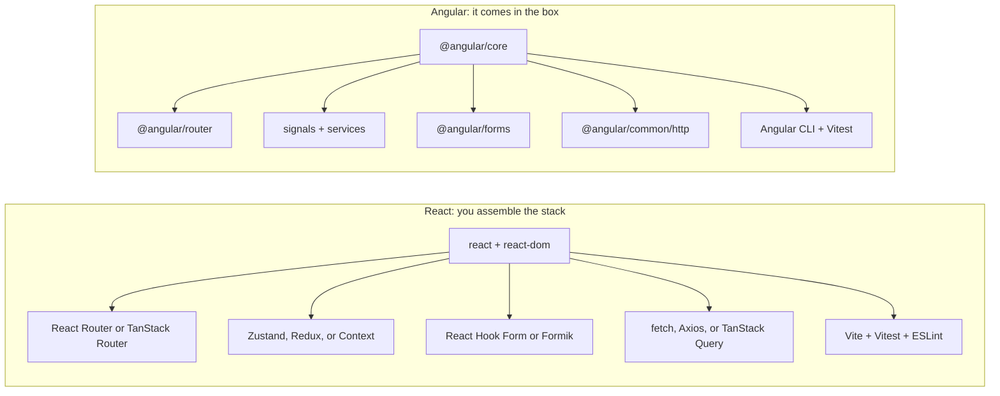
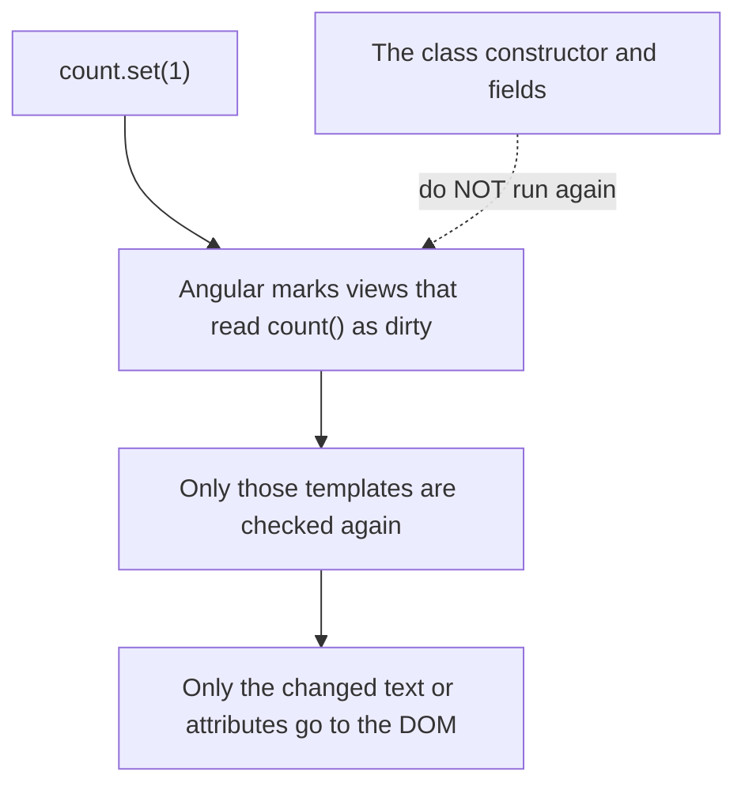
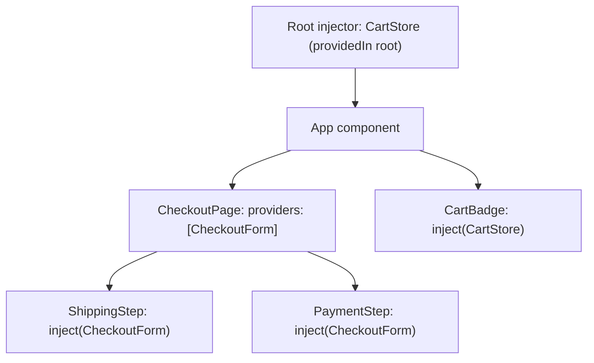

This is the third stop on my trip outside the React bubble. First it was [SvelteKit](/blog/nextjs-to-sveltekit), then [Vue](/blog/react-to-vue). Now it's **Angular**.

Angular has a reputation among React developers: "too heavy", "too much boilerplate", "classes and decorators everywhere". Some of that was true years ago. But modern Angular looks very different. It has signals, standalone components, and a new template syntax. Plenty of companies (banks, enterprise software, governments) still run on it, so there's a good chance you'll meet it at some point.

This post is **what I wish someone told me before opening my first Angular project**: the ideas that are actually new, and the React habits you need to unlearn. Every concept sits next to the React code you already know. 🅰️

> Versions in this post: **React 19** and **Angular 21**, using standalone components and signals. Angular ships a new major version every six months, so check [angular.dev](https://angular.dev) for anything newer. And one warning up front: **AngularJS** (1.x) is a completely different, dead framework. If a tutorial uses `$scope` or `ng-controller`, close the tab.

## Angular in one minute

- **React is a library, Angular is a framework.** React gives you components and lets you pick everything else. Angular comes with a router, forms, an HTTP client, dependency injection, testing, i18n, and a CLI, all from the same team.
- **TypeScript is not optional.** Every Angular project is TypeScript.
- **Components are classes** with a decorator (`@Component`). The template is HTML with Angular syntax, not JSX.
- **Signals** are the reactive state primitive. Think `useState` + `useMemo`, but with automatic dependency tracking.
- **Dependency injection (DI)** is how you share code and state. This is the biggest new idea for React developers.
- **RxJS** (Observables) shows up in the HTTP client, the router, and forms. You don't need to master it on day one, but you can't avoid it either.
- **It's opinionated.** There's usually one "Angular way" to do something. That's the point: a big team writes code that looks the same everywhere.

Starting a project:

```bash
npm install -g @angular/cli
ng new my-app
cd my-app
ng serve
```

The CLI asks a few questions (stylesheet format, SSR...). Pick CSS or SCSS, and skip SSR for now.

## The big picture

| Topic | React | Angular |
| --- | --- | --- |
| What it is | UI library | Full framework |
| Component | Function returning JSX | Class with `@Component` + HTML template |
| How the UI updates | Re-runs your component function | Signals tell Angular exactly which views changed |
| State | `useState` | `signal` |
| Computed values | `useMemo` (or just a variable) | `computed` |
| Side effects | `useEffect` | `effect`, lifecycle hooks |
| Props | Props object | `input()` |
| Child → parent | Callback props | `output()` |
| Form inputs | `value` + `onChange` | `[(ngModel)]` or Reactive Forms |
| `children` | `children` prop | `<ng-content />` |
| Shared logic & state | Custom hooks, Context, Zustand | Services + dependency injection |
| Data fetching | `fetch`, TanStack Query | `HttpClient` (returns Observables) |
| Routing | React Router (pick one) | `@angular/router` (built in) |
| Tooling | Vite, ESLint, your choice | Angular CLI (`ng`) |

## 1. The mindset: you're joining a framework

In React, a new project starts with decisions. Which router? Which state library? Which form library? How do I fetch data? Where do files go?

In Angular, most of those decisions are already made:



This changes how you work:

- **Use the built-in thing first.** Before you `npm install` a library, check whether Angular already does it. It usually does.
- **Follow the conventions.** The CLI generates files in a fixed shape. Don't fight it.
- **Updates are a team effort.** `ng update` migrates your code automatically between major versions. It works well because everyone uses the same pieces.

## 2. The mental model: signals, not re-renders

In React, your component function **runs again** on every state change. That's why you need `useMemo`, `useCallback`, and dependency arrays.

In Angular, the component class is created **once**. State lives in **signals**. A signal is a function: you call it to read the value, and you call `.set()` or `.update()` to change it. Angular remembers **which template reads which signal**, and only refreshes those views when the signal changes.



If you read my Vue post, this will sound familiar. Signals are very close to Vue's `ref`. The differences:

- You read a signal by **calling it**: `count()`, both in the class and in the template.
- You write with `count.set(5)` or `count.update((c) => c + 1)`. No `count++`.
- Like React, signals compare by reference. `items().push(x)` changes the array but **doesn't notify anyone**. Use `items.update((list) => [...list, x])`. Your React immutability habits still apply.

> You'll see **zone.js** and `ChangeDetectionStrategy.OnPush` in older projects. Before signals, Angular used zone.js to guess when something might have changed and then checked the whole tree. New projects in Angular 21 are **zoneless** by default and rely on signals instead.

## 3. Your first component

**React**

```tsx
// Counter.tsx
import { useState } from "react";

export function Counter({ start = 0 }: { start?: number }) {
  const [count, setCount] = useState(start);
  const double = count * 2;

  return (
    <button className="btn" onClick={() => setCount(count + 1)}>
      {count} (double: {double})
    </button>
  );
}
```

**Angular**

```ts
// counter.ts
import { Component, computed, input, linkedSignal } from "@angular/core";

@Component({
  selector: "app-counter",
  template: `
    <button class="btn" (click)="increment()">
      {{ count() }} (double: {{ double() }})
    </button>
  `,
  styles: `
    .btn {
      padding: 0.5rem 1rem;
    }
  `,
})
export class Counter {
  start = input(0);
  count = linkedSignal(() => this.start());
  double = computed(() => this.count() * 2);

  increment() {
    this.count.update((c) => c + 1);
  }
}
```

Let's go through it:

- **`@Component`** turns the class into a component. `selector` is the HTML tag you'll use: `<app-counter />`.
- **`template`** is the HTML. For bigger components, move it to a file with `templateUrl: "./counter.html"`. Same for styles with `styleUrl`.
- **`styles`** are scoped to this component by default, like CSS Modules without the setup.
- **`input(0)`** declares a prop with a default value. You read it with `this.start()`.
- **`linkedSignal`** is a signal whose starting value comes from another signal, and it resets when that signal changes. That's how you say "local state that starts from a prop".
- **`computed`** is `useMemo` without a dependency array.
- **`{{ count() }}`** is `{count}` in JSX. Note the `()`. Signals are always called, even in the template.
- **`(click)="increment()"`** is `onClick`. You write the **call**, with parentheses.
- It's `class`, not `className`. The template is plain HTML.

Using it from another component:

```ts
import { Component } from "@angular/core";
import { Counter } from "./counter";

@Component({
  selector: "app-root",
  imports: [Counter],
  template: `<app-counter [start]="5" />`,
})
export class App {}
```

Two things to notice:

- **`imports: [Counter]`**. A component must list every component, directive, and pipe its template uses. In React, the JavaScript `import` is enough. In Angular, you need both the `import` at the top **and** the entry in `imports`.
- **`[start]="5"`**. The square brackets mean "this is a JavaScript expression". More on that next.

## 4. Template syntax

JSX uses JavaScript for everything. Angular templates have their own syntax: **control flow blocks** (`@if`, `@for`) and **bindings** (`[ ]`, `( )`).

**React**

```tsx
<>
  {user ? <p>Hi, {user.name}</p> : <a href="/login">Log in</a>}

  <ul>
    {todos.length === 0 && <li>Nothing to do 🎉</li>}
    {todos.map((todo) => (
      <li key={todo.id} className={todo.done ? "done" : ""}>
        {todo.title}
      </li>
    ))}
  </ul>
</>
```

**Angular**

```html
@if (user(); as u) {
  <p>Hi, {{ u.name }}</p>
} @else {
  <a href="/login">Log in</a>
}

<ul>
  @for (todo of todos(); track todo.id) {
    <li [class.done]="todo.done">{{ todo.title }}</li>
  } @empty {
    <li>Nothing to do 🎉</li>
  }
</ul>
```

The cheat sheet:

| React (JSX) | Angular (template) |
| --- | --- |
| `{cond && <A />}` | `@if (cond) { <app-a /> }` |
| `{cond ? <A /> : <B />}` | `@if (cond) { ... } @else { ... }` |
| `{items.map(i => <li key={i.id}>...)}` | `@for (i of items; track i.id) { <li>...</li> }` |
| `switch` in a helper function | `@switch (status) { @case ("ok") { ... } }` |
| `const x = ...` before `return` | `@let x = ...;` in the template |
| `className={active ? "on" : ""}` | `[class.on]="active"` |
| `style={{ color }}` | `[style.color]="color"` |
| `onClick={save}` | `(click)="save()"` |
| `onKeyDown` + check `e.key === "Enter"` | `(keydown.enter)="save()"` |
| `disabled={isLoading}` | `[disabled]="isLoading()"` |
| `dangerouslySetInnerHTML` | `[innerHTML]="html"` (sanitized for you) |
| `{formatDate(date)}` | `{{ date \| date: "short" }}` (a **pipe**) |
| `<>...</>` (Fragment) | Not needed. Use `<ng-container>` in rare cases |

The three bracket rules are worth memorizing:

- **`[prop]="expr"`**: data goes **in**. `[count]="5"` passes the number `5`. `count="5"` passes the string `"5"`.
- **`(event)="handler()"`**: events come **out**. `$event` is the event object (or the emitted value).
- **`[(prop)]="signal"`**: both ways. People call it "banana in a box". 🍌

**Pipes** are new. A pipe formats a value right in the template: `{{ price | currency: "USD" }}`, `{{ name | uppercase }}`, `{{ createdAt | date: "mediumDate" }}`. Angular comes with the common ones, and you can write your own.

## 5. Inputs and outputs

Props work like React: data goes **down**. The difference is how a child talks back **up**. In React, you pass a callback. In Angular, the child declares an **output** and the parent listens with `( )`:

**React**

```tsx
function TodoItem({ todo, onRemove }: { todo: Todo; onRemove: (id: string) => void }) {
  return (
    <li>
      {todo.title}
      <button onClick={() => onRemove(todo.id)}>×</button>
    </li>
  );
}

<TodoItem todo={todo} onRemove={removeTodo} />;
```

**Angular**

```ts
// todo-item.ts
import { Component, input, output } from "@angular/core";

@Component({
  selector: "app-todo-item",
  template: `
    <li>
      {{ todo().title }}
      <button (click)="remove.emit(todo().id)">×</button>
    </li>
  `,
})
export class TodoItem {
  todo = input.required<Todo>();
  remove = output<string>();
}
```

```html
<app-todo-item [todo]="todo" (remove)="removeTodo($event)" />
```

- **`input.required<Todo>()`** is a prop with no default. Forget it in the parent and you get a compile error.
- **`output<string>()`** is an event that sends a `string`. The parent receives it as `$event`.
- Inputs are **read-only** signals. Like in React, don't change them in the child. Emit an output and let the parent update its own state.

For two-way binding on your own component, use **`model()`**. It's an input and an output in one:

```ts
// search-box.ts
import { Component, model } from "@angular/core";
import { FormsModule } from "@angular/forms";

@Component({
  selector: "app-search-box",
  imports: [FormsModule],
  template: `<input [(ngModel)]="query" placeholder="Search..." />`,
})
export class SearchBox {
  query = model("");
}
```

```html
<!-- `search` is a signal in the parent -->
<app-search-box [(query)]="search" />
```

In React, you'd write `<SearchBox value={search} onChange={setSearch} />` and wire both sides by hand.

## 6. `children` becomes content projection

In React, you render `children`. In Angular, you put `<ng-content />` where the children go. Want more than one "hole"? Use `select`:

**React**

```tsx
function Card({ title, footer, children }: Props) {
  return (
    <section className="card">
      <h2>{title}</h2>
      {children}
      <footer>{footer}</footer>
    </section>
  );
}
```

**Angular**

```ts
// card.ts
import { Component, input } from "@angular/core";

@Component({
  selector: "app-card",
  template: `
    <section class="card">
      <h2>{{ title() }}</h2>
      <ng-content />
      <footer><ng-content select="[card-footer]" /></footer>
    </section>
  `,
})
export class Card {
  title = input.required<string>();
}
```

```html
<app-card title="Hello">
  <p>This is the content.</p>
  <button card-footer>Save</button>
</app-card>
```

One catch: projected content is **always created**, even if the child hides it with `@if`. For "render this only when needed" or render-prop patterns, Angular uses `<ng-template>` with `ngTemplateOutlet`. You'll meet it in component libraries, and it's fine to skip it at first.

## 7. Dependency injection: the big new idea

This is the part React developers find strangest, and the part Angular developers love most.

In React, you share state and logic with custom hooks, Context, or a store like Zustand. In Angular, you write a **service**: a plain class marked `@Injectable`. Any component asks for it with **`inject()`**, and Angular hands over the instance.

**React (Context)**

```tsx
const CartContext = createContext<CartState | null>(null);

function CartProvider({ children }: { children: React.ReactNode }) {
  const [items, setItems] = useState<CartItem[]>([]);
  const add = (item: CartItem) => setItems((list) => [...list, item]);
  return <CartContext value={{ items, add }}>{children}</CartContext>;
}

function CartBadge() {
  const cart = useContext(CartContext)!;
  return <span>🛒 {cart.items.length}</span>;
}
```

**Angular (service + DI)**

```ts
// cart-store.ts
import { Injectable, computed, signal } from "@angular/core";

@Injectable({ providedIn: "root" })
export class CartStore {
  readonly items = signal<CartItem[]>([]);
  readonly total = computed(() =>
    this.items().reduce((sum, item) => sum + item.price, 0),
  );

  add(item: CartItem) {
    this.items.update((list) => [...list, item]);
  }
}
```

```ts
// cart-badge.ts
import { Component, inject } from "@angular/core";
import { CartStore } from "./cart-store";

@Component({
  selector: "app-cart-badge",
  template: `<span>🛒 {{ cart.items().length }}</span>`,
})
export class CartBadge {
  protected cart = inject(CartStore);
}
```

- **`providedIn: "root"`** means "one instance for the whole app". No `<Provider>` to wrap around anything.
- **`inject(CartStore)`** is like `useContext`, but it works with a class, so you get full types and no `null` check.
- A service with signals **is** your global store. For many apps, you don't need NgRx or anything else.

You can also give a service to just one part of the tree, by adding it to a component's `providers`. That's the same as placing a Context provider lower in the tree. Angular looks up from the component until it finds one:



Here, `ShippingStep` and `PaymentStep` share one `CheckoutForm`, which lives as long as `CheckoutPage` does. `CartBadge` gets the app-wide `CartStore`.

DI also makes testing easy. In a test, you swap the real service for a fake one, no mocking library needed:

```ts
TestBed.configureTestingModule({
  providers: [{ provide: CartStore, useValue: fakeCartStore }],
});
```

> Rule: `inject()` only works in an **injection context**: field initializers, the constructor, or functions called from them. Not inside a click handler or after an `await`. It's the same idea as "only call hooks at the top level".

## 8. Lifecycle and side effects

The component class is created once, so most setup just goes in field initializers or the constructor. For the rest:

| What you want | React | Angular |
| --- | --- | --- |
| Compute a value from other values | `useMemo` / a variable | `computed()` |
| Local state that resets when a prop changes | `key` trick or an effect | `linkedSignal()` |
| React to a value changing | `useEffect(() => {...}, [x])` | `effect(() => {...})` |
| Run once when the component starts | `useEffect(() => {...}, [])` | Constructor, or `ngOnInit` |
| Touch the DOM after it renders | `useLayoutEffect` / `useEffect` | `afterNextRender(() => {...})` |
| Clean up when it disappears | Return a function from `useEffect` | `inject(DestroyRef).onDestroy(...)` or `ngOnDestroy` |
| A DOM element ref | `useRef` + `ref={...}` | `viewChild("name")` + `#name` in the template |

An `effect` tracks every signal it reads, like Vue's `watchEffect`. No dependency array:

```ts
export class ThemeToggle {
  theme = signal<"light" | "dark">("light");

  constructor() {
    effect(() => {
      document.documentElement.dataset.theme = this.theme();
    });
  }
}
```

The same advice as React applies: **you probably don't need an effect.** If you're setting a signal inside an effect, use `computed` or `linkedSignal` instead. Effects are for syncing with the outside world: the DOM, `localStorage`, a third-party widget.

A DOM ref, for example, to focus an input:

```ts
import { Component, ElementRef, afterNextRender, viewChild } from "@angular/core";

@Component({
  selector: "app-search",
  template: `<input #box />`,
})
export class Search {
  box = viewChild.required<ElementRef<HTMLInputElement>>("box");

  constructor() {
    afterNextRender(() => this.box().nativeElement.focus());
  }
}
```

> You'll see classic lifecycle methods like `ngOnInit`, `ngOnChanges`, `ngAfterViewInit`, and `ngOnDestroy` in almost every existing codebase. They still work. Signals just make most of them unnecessary in new code.

## 9. Data fetching and RxJS

Angular's `HttpClient` doesn't return a Promise. It returns an **Observable**, from the RxJS library. You'll see RxJS in the router and forms too, so here's the minimum you need to know.

An Observable is like a Promise that can send **many values over time**, and that **does nothing until someone subscribes**.

| RxJS idea | React / JS equivalent |
| --- | --- |
| `Observable` | A Promise that can emit many values, and only starts when subscribed |
| `.subscribe(fn)` | `.then(fn)`, but you must unsubscribe |
| `.pipe(map(...), filter(...))` | Chaining array-like methods on a stream |
| `switchMap` | "Start a new request and cancel the previous one" |
| `debounceTime(300)` | `useDebounce` |
| `toSignal(obs$)` | Turn the stream into a signal (unsubscribes for you) |

Fetching a user whenever the `id` input changes:

**React**

```tsx
function UserCard({ id }: { id: string }) {
  const [user, setUser] = useState<User | null>(null);

  useEffect(() => {
    let ignore = false;
    fetch(`/api/users/${id}`)
      .then((res) => res.json())
      .then((data) => {
        if (!ignore) setUser(data);
      });
    return () => {
      ignore = true;
    };
  }, [id]);

  return user ? <p>{user.name}</p> : <p>Loading...</p>;
}
```

**Angular**

```ts
// user-card.ts
import { HttpClient } from "@angular/common/http";
import { Component, inject, input } from "@angular/core";
import { toObservable, toSignal } from "@angular/core/rxjs-interop";
import { switchMap } from "rxjs";

@Component({
  selector: "app-user-card",
  template: `
    @if (user(); as u) {
      <p>{{ u.name }}</p>
    } @else {
      <p>Loading...</p>
    }
  `,
})
export class UserCard {
  private http = inject(HttpClient);
  id = input.required<string>();

  user = toSignal(
    toObservable(this.id).pipe(
      switchMap((id) => this.http.get<User>(`/api/users/${id}`)),
    ),
  );
}
```

`switchMap` cancels the old request when `id` changes, so there's no race condition and no `ignore` flag. This is where RxJS shines.

Newer Angular versions also have **`httpResource`**, which skips RxJS for simple reads:

```ts
user = httpResource<User>(() => `/api/users/${this.id()}`);
// template: user.value(), user.isLoading(), user.error()
```

It re-fetches when `id()` changes, a bit like TanStack Query's `useQuery`. Check the docs for its status in your Angular version, since the resource APIs were introduced as experimental.

To use `HttpClient` at all, register it once in `app.config.ts`:

```ts
// app.config.ts
import { provideHttpClient } from "@angular/common/http";
import type { ApplicationConfig } from "@angular/core";
import { provideRouter } from "@angular/router";
import { routes } from "./app.routes";

export const appConfig: ApplicationConfig = {
  providers: [provideRouter(routes), provideHttpClient()],
};
```

## 10. Forms

Angular has two built-in ways to do forms, and you'll see both:

- **Template-driven forms** with `[(ngModel)]`. Good for small, simple forms. You saw it in the `SearchBox` above.
- **Reactive Forms**. The form lives in the class as a typed object, with validators. This is what most real apps use. Think React Hook Form, built in.

```ts
// signup.ts
import { Component, inject } from "@angular/core";
import { FormBuilder, ReactiveFormsModule, Validators } from "@angular/forms";

@Component({
  selector: "app-signup",
  imports: [ReactiveFormsModule],
  template: `
    <form [formGroup]="form" (ngSubmit)="submit()">
      <input formControlName="email" type="email" />
      @if (form.controls.email.touched && form.controls.email.invalid) {
        <p>Enter a valid email.</p>
      }

      <input formControlName="password" type="password" />

      <button [disabled]="form.invalid">Sign up</button>
    </form>
  `,
})
export class Signup {
  private fb = inject(FormBuilder);

  form = this.fb.nonNullable.group({
    email: ["", [Validators.required, Validators.email]],
    password: ["", [Validators.required, Validators.minLength(8)]],
  });

  submit() {
    console.log(this.form.getRawValue()); // { email: string; password: string }
  }
}
```

`(ngSubmit)` already prevents the page reload, so no `e.preventDefault()`.

> Angular 21 also introduced **Signal Forms**, a new signal-based forms API. It's experimental for now, so learn Reactive Forms first. That's what existing projects use.

## 11. Routing

The router is built in. Routes are a plain array, and pages can be lazy-loaded:

```ts
// app.routes.ts
import type { Routes } from "@angular/router";
import { Home } from "./home";
import { NotFound } from "./not-found";

export const routes: Routes = [
  { path: "", component: Home },
  {
    path: "users/:id",
    loadComponent: () => import("./user-page").then((m) => m.UserPage),
  },
  { path: "**", component: NotFound },
];
```

| React Router | Angular Router |
| --- | --- |
| `<Route path="..." element={...} />` | `{ path: "...", component: ... }` |
| `lazy()` | `loadComponent: () => import(...)` |
| `<Link to="/about">` | `<a routerLink="/about">` |
| `<NavLink>` | `routerLink` + `routerLinkActive="active"` |
| `<Outlet />` | `<router-outlet />` |
| `useParams()` | `input()` with `withComponentInputBinding()` |
| `useNavigate()` | `inject(Router).navigate([...])` |
| Loaders, protected route wrappers | `resolve`, `canActivate` guards |

That `withComponentInputBinding()` trick is nice: add it to `provideRouter(routes, withComponentInputBinding())`, and the `:id` route param arrives as `id = input<string>()` in your page component.

## 12. The CLI and project structure

You'll use the `ng` command every day:

| Command | What it does |
| --- | --- |
| `ng serve` | Start the dev server |
| `ng generate component todo-item` | Create a component (`ng g c` for short) |
| `ng generate service cart-store` | Create a service |
| `ng add @angular/material` | Install a library **and** configure it |
| `ng update` | Upgrade Angular and migrate your code |
| `ng test`, `ng build` | Run tests, build for production |

A fresh project looks like this:

```bash
src/
  main.ts           # bootstraps the app (like main.tsx)
  index.html
  styles.css        # global styles
  app/
    app.ts          # root component
    app.html
    app.css
    app.config.ts   # app-wide providers: router, HttpClient...
    app.routes.ts   # route list
```

Newer projects name files `todo-item.ts` with a class `TodoItem`. Older projects use `todo-item.component.ts` with a class `TodoItemComponent`. Same thing, different style guide era.

## 13. Your library stack

Go through your `package.json` with this table:

| You use in React | Use in Angular |
| --- | --- |
| React Router | Built in: `@angular/router` |
| Zustand, Redux | Services with signals, or [NgRx Signal Store](https://ngrx.io/guide/signals) |
| TanStack Query | `httpResource`, or `@tanstack/angular-query-experimental` |
| React Hook Form, Formik | Built in: Reactive Forms |
| shadcn/ui | [spartan/ui](https://www.spartan.ng) |
| Radix UI | [Angular CDK](https://material.angular.dev/cdk) (and Angular Aria) |
| MUI | [Angular Material](https://material.angular.dev) |
| Mantine, Chakra UI, Ant Design | [PrimeNG](https://primeng.org), NG-ZORRO |
| Next.js | Built-in SSR (`ng new --ssr`), or [Analog](https://analogjs.org) |
| react-i18next | `@angular/localize` (built in), Transloco, ngx-translate |
| lucide-react | `lucide-angular` |
| sonner | `ngx-sonner` |
| TanStack Table | `@tanstack/angular-table` |
| React Testing Library | `@testing-library/angular` |
| Vitest | Vitest (the default test runner in new Angular projects) |
| React DevTools | [Angular DevTools](https://angular.dev/tools/devtools) |

Anything that isn't tied to React (Zod, date-fns, Tailwind) works in Angular as-is.

## Gotchas that bite you in week one

1. **Forgetting `()` on signals.** `{{ count }}` instead of `{{ count() }}` doesn't show the value. Signals are functions. Read them by calling them, everywhere.
2. **Forgetting `[ ]`.** `[count]="5"` is a number, `count="5"` is a string. Same for `[disabled]`, `[items]`, anything that isn't a plain string.
3. **Writing `(click)="save"`.** Angular wants the **call**: `(click)="save()"`. It's the opposite of React's `onClick={save}`.
4. **Forgetting to add something to `imports`.** "`'app-todo-item' is not a known element`" or "`Can't bind to 'ngModel'`" means the component, `FormsModule`, or `RouterLink` is missing from the component's `imports` array.
5. **`NullInjectorError: No provider for X`.** You injected something nobody provides. Usually a missing `provideHttpClient()` in `app.config.ts`, or a service without `providedIn: "root"`.
6. **Inputs aren't ready in the constructor.** The parent sets inputs after the class is created. Use `computed`, `linkedSignal`, or `effect` to react to them, instead of copying `this.start()` into a field.
7. **Observables are lazy.** `this.http.get(...)` sends nothing until something subscribes. And subscribing twice sends **two** requests. Prefer `toSignal()` or the `async` pipe, which subscribe and unsubscribe for you.
8. **Mutating signal values.** `this.items().push(x)` won't update the UI. Use `this.items.update((list) => [...list, x])`.
9. **Old Angular is everywhere.** Most existing code (and tutorials) is older than signals. You need to be able to **read** both styles:

| Old style | Modern style |
| --- | --- |
| `@NgModule({ declarations: [...] })` | Standalone components with `imports: [...]` |
| `*ngIf="cond"`, `*ngFor="let x of xs"` | `@if (cond) {}`, `@for (x of xs; track x.id) {}` |
| `@Input() name: string;` | `name = input<string>()` |
| `@Output() remove = new EventEmitter<string>()` | `remove = output<string>()` |
| `constructor(private http: HttpClient) {}` | `private http = inject(HttpClient)` |
| `BehaviorSubject` in a service | `signal` in a service |
| zone.js + `OnPush` | Zoneless + signals |

## Where to start

1. **Do the [official "Learn Angular" tutorial](https://angular.dev/tutorials/learn-angular)** on angular.dev. It runs in the browser, so you don't need to install anything.
2. **Rebuild a small React component you know well**, like a todo list with a shared store. You'll touch signals, inputs/outputs, `@for`, and a service in one go.
3. **Install Angular DevTools** in your browser. It shows the component tree, inputs, and signal values live.
4. **Learn just enough RxJS**: `pipe`, `map`, `switchMap`, `debounceTime`, and `toSignal`. That covers most day-to-day code.

My takeaway: Angular asks you to learn more things up front. DI, decorators, RxJS, and the template syntax are all new. But in return, you stop making decisions. Every Angular project has the same router, the same forms, the same folder shape. Coming from React, where every codebase is a different combination of libraries, that's a surprisingly nice feeling.

And if you just came from my Vue post: signals will feel like home. 🅰️

Happy learning!

## Where to learn more

- [Learn Angular](https://angular.dev/tutorials/learn-angular): the official interactive tutorial, runs in the browser.
- [Angular Playground](https://angular.dev/playground): try snippets without installing anything.
- [Deborah Kurata on YouTube](https://www.youtube.com/@deborah_kurata): clear, beginner-friendly videos on signals and RxJS.
- [Learn RxJS](https://www.learnrxjs.io): every RxJS operator explained with small examples.

## References

- [Angular docs](https://angular.dev/overview), official
- [Learn Angular tutorial](https://angular.dev/tutorials/learn-angular)
- [Signals](https://angular.dev/guide/signals) and [linkedSignal](https://angular.dev/guide/signals/linked-signal), Angular docs
- [Control flow](https://angular.dev/guide/templates/control-flow) and [Pipes](https://angular.dev/guide/templates/pipes), Angular docs
- [Inputs](https://angular.dev/guide/components/inputs), [Outputs](https://angular.dev/guide/components/outputs), and [Content projection](https://angular.dev/guide/components/content-projection), Angular docs
- [Dependency injection](https://angular.dev/guide/di), Angular docs
- [Lifecycle](https://angular.dev/guide/components/lifecycle), Angular docs
- [HTTP client](https://angular.dev/guide/http) and [RxJS interop](https://angular.dev/ecosystem/rxjs-interop), Angular docs
- [Reactive forms](https://angular.dev/guide/forms/reactive-forms), Angular docs
- [Routing](https://angular.dev/guide/routing), Angular docs
- [Zoneless](https://angular.dev/guide/zoneless), Angular docs
- [Style guide](https://angular.dev/style-guide), Angular docs
- [You might not need an effect](https://react.dev/learn/you-might-not-need-an-effect), React docs
- [RxJS](https://rxjs.dev), official
