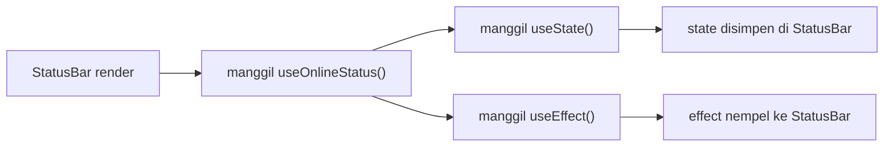
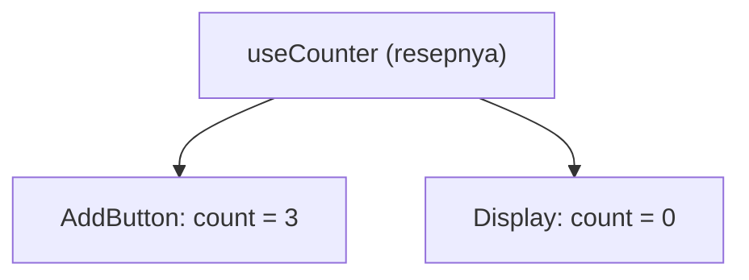

Cepat atau lambat, tiap codebase React bakal punya logika yang sama di tiga komponen berbeda. `useEffect` yang dengerin ukuran window. Pasangan `useState` + `useEffect` buat sinkron sama `localStorage`. Pola `fetch` plus loading plus error yang di-copy lalu diubah dikit tiap kali.

Jawaban standarnya: **"bikin custom hook aja."** Dan itu memang jawaban yang benar. Tapi custom hook punya beberapa aturan yang kelihatan asal-asalan sampai kamu tahu *kenapa* aturannya ada, plus beberapa salah kaprah yang bikin bug beneran:

- "Kalau dua komponen pakai `useCart()`, mereka berbagi keranjang yang sama." (**Nggak.**)
- "Bikin hook `useMount` ah, biar effect-nya enak dibaca." (**Jangan.**)
- "Semua fungsi helper sebaiknya jadi hook." (**Cuma kalau dia manggil hook.**)

Di tulisan ini kita bahas satu per satu:

1. Masalahnya: logika yang dobel
2. Custom hook itu sebenarnya apa
3. Kenapa hook punya aturan (dan kenapa prefix `use` penting)
4. Salah kaprah terbesar: hook berbagi logika, bukan state
5. Desain API hook yang enak dipakai
6. Bahan dasar yang lebih tepat: `useSyncExternalStore` dan `useEffectEvent`
7. Hook yang sebaiknya nggak usah dibikin
8. Testing custom hook
9. Kapan perlu bikin hook

> Contoh kodenya pakai **React 19** dan TypeScript. Di [tulisan debounce](/blog/debounce-search) kemarin kita udah bikin satu custom hook, `useDebouncedValue`. Tulisan ini ngejelasin konsep di baliknya.

## 1. Masalahnya: logika yang sama di dua tempat

Misalnya kita mau nampilin banner "Kamu lagi offline" di header, dan nge-disable tombol Simpan di form kalau internetnya putus. Dua komponen ini sama-sama perlu tahu browser lagi online atau nggak:

```tsx
function StatusBar() {
  const [isOnline, setIsOnline] = useState(true);

  useEffect(() => {
    const update = () => setIsOnline(navigator.onLine);
    window.addEventListener("online", update);
    window.addEventListener("offline", update);
    return () => {
      window.removeEventListener("online", update);
      window.removeEventListener("offline", update);
    };
  }, []);

  return isOnline ? null : <p role="alert">Kamu lagi offline</p>;
}

function SaveButton() {
  const [isOnline, setIsOnline] = useState(true);

  useEffect(() => {
    // ...9 baris yang persis sama lagi
  }, []);

  return <button disabled={!isOnline}>Simpan</button>;
}
```

Jalan sih, tapi:

- **Logikanya dobel.** Benerin bug di satu tempat, kamu harus inget yang satunya lagi.
- **Tujuan komponennya ketutupan.** `StatusBar` itu tugasnya *nampilin banner*. Event listener di `window` itu detail teknis yang harusnya nggak perlu dia pikirin.

Di JavaScript biasa, solusinya ya bikin fungsi. Di hook, solusinya... juga bikin fungsi.

## 2. Custom hook itu sebenarnya apa

Ini definisi lengkapnya:

> **Custom hook adalah fungsi yang namanya diawali `use` lalu huruf kapital, dan di dalamnya manggil hook lain.**

Jadi `useOnlineStatus` itu nama hook, tapi `user` atau `useless` bukan.

Udah, itu aja. Nggak ada registrasi, nggak ada API khusus, nggak ada wrapper. Kita pindahin logikanya:

```ts
// useOnlineStatus.ts
import { useEffect, useState } from "react";

export function useOnlineStatus() {
  const [isOnline, setIsOnline] = useState(true);

  useEffect(() => {
    const update = () => setIsOnline(navigator.onLine);
    window.addEventListener("online", update);
    window.addEventListener("offline", update);
    return () => {
      window.removeEventListener("online", update);
      window.removeEventListener("offline", update);
    };
  }, []);

  return isOnline;
}
```

Komponennya jadi:

```tsx
function StatusBar() {
  const isOnline = useOnlineStatus(); // [!code highlight]
  return isOnline ? null : <p role="alert">Kamu lagi offline</p>;
}

function SaveButton() {
  const isOnline = useOnlineStatus(); // [!code highlight]
  return <button disabled={!isOnline}>Simpan</button>;
}
```

Coba baca lagi dua komponen itu. Sekarang mereka bilang **apa** yang mereka butuhin ("user lagi online nggak?"), bukan **gimana** cara nyarinya. Itu keuntungan utama custom hook. Kode yang nggak dobel itu bagus, tapi *ngasih nama ke sebuah ide* itu jauh lebih bagus.

### Kok fungsi biasa bisa nyimpen state?

Bagian ini yang sering bikin bingung. `useOnlineStatus` itu fungsi biasa. Dia jalan, return boolean, selesai. Terus `isOnline` disimpen di mana di antara render?

Jawabannya: **bukan di hook-nya.** Pas `StatusBar` render, dia manggil `useOnlineStatus()`, yang manggil `useState()`. Dari sudut pandang React, `useState` itu dipanggil **oleh `StatusBar`**, selama `StatusBar` render. State-nya disimpen di instance komponen `StatusBar`.

Dengan kata lain, kalau isi hook-nya di-copy balik ke komponen, hasilnya persis sama:



React nggak kenal yang namanya custom hook. Custom hook cuma cara buat **ngerapiin panggilan hook yang dilakukan sebuah komponen.** Inget ini, karena semua pembahasan setelahnya berawal dari sini.

## 3. Kenapa hook punya aturan

Dua Aturan Hook (Rules of Hooks):

1. **Panggil hook cuma di level paling atas.** Bukan di dalam kondisi, loop, fungsi bersarang, atau blok `try`/`catch`, dan bukan setelah `return` lebih awal.
2. **Panggil hook cuma dari fungsi React.** Komponen atau custom hook lain.

### Kenapa harus di level atas?

Karena React nggak kenal hook kamu dari namanya. React kenal dari **urutan pemanggilannya**.

Tiap komponen render, React jalanin panggilan hook-nya satu per satu dan ngasih tiap panggilan "slot" berikutnya: panggilan pertama dapet slot 0, yang kedua slot 1, dan seterusnya. Di render berikutnya, React jalanin daftar itu lagi dengan urutan yang sama, terus ngasih tiap hook isi slot-nya.

```tsx
function Profile() {
  const [name] = useState("Budi"); // slot 0
  const [age] = useState(25); // slot 1
  const isOnline = useOnlineStatus(); // slot 2 & 3

  return <p>{name}, {age} {isOnline ? "🟢" : "⚪"}</p>;
}
```

Slot 2 dan 3 itu punya `useState` dan `useEffect` yang ada *di dalam* `useOnlineStatus`. Inget bagian 2: React nggak bisa lihat custom hook-nya, cuma hook yang dia panggil.

Sekarang kesalahan klasiknya, `return` lebih awal sebelum hook dipanggil:

```tsx
function Profile({ user }: { user: User | null }) {
  const [name] = useState(user?.name ?? ""); // slot 0
  if (!user) return <p>Silakan login</p>; // ❌ return kecepetan
  const isOnline = useOnlineStatus(); // slot 1 & 2, kadang-kadang

  return <p>{name} {isOnline ? "🟢" : "⚪"}</p>;
}
```

Ini yang dilihat React pas user logout:

| Slot | Render 1 (`user` ada) | Render 2 (`user` `null`) |
| --- | --- | --- |
| 0 | `useState` (name) | `useState` (name) |
| 1 | `useState` (online) | nggak dipanggil |
| 2 | `useEffect` (online) | nggak dipanggil |

Daftarnya tiba-tiba lebih pendek dari render sebelumnya, jadi React nggak bisa lagi nyocokin slot ke hook-nya dan langsung error: *"Rendered fewer hooks than expected. This may be caused by an accidental early return statement."* (React bahkan udah nebak penyebabnya.) Ini sebenarnya kasus yang masih untung. Kalau jumlahnya sama tapi urutannya berubah, misalnya dua `useState` yang tukeran tempat, React nggak bisa sadar, dan satu hook diam-diam dapet state punya hook lain.

Solusinya: panggil semua hook dulu, baru `return` lebih awal.

```tsx
function Profile({ user }: { user: User | null }) {
  const [name] = useState(user?.name ?? "");
  const isOnline = useOnlineStatus(); // [!code highlight]

  if (!user) return <p>Silakan login</p>;
  return <p>{name} {isOnline ? "🟢" : "⚪"}</p>;
}
```

Hook yang sama, urutan yang sama, tiap render. Itu aja aturannya.

### Kenapa harus pakai prefix `use`?

Karena custom hook itu "cuma fungsi", prefix-nya jadi **satu-satunya** cara tools bisa bedain dia dari fungsi biasa:

- **Linter** nentuin mana yang hook dari namanya. `react-hooks/rules-of-hooks` di ESLint nganggep semua fungsi `use` + huruf kapital sebagai hook dan ngecek dia cuma dipanggil di level atas (Biome punya pengecekan yang sama, `useHookAtTopLevel`, aktif secara default). Tanpa prefix, linter nggak bisa ngingetin soal `return` kecepetan di atas.
- **React Compiler** cuma ngoptimasi komponen dan hook, dan ngandelin konvensi nama ini buat bedain keduanya.
- **Yang baca kode** langsung tahu fungsi ini mungkin nyimpen state dan effect, dan harus ikut aturan hook.

Kebalikannya juga sama pentingnya: **kalau fungsinya nggak manggil hook apa pun, jangan dikasih nama `use…`.**

```ts
// ❌ Bukan hook. Nggak manggil hook apa pun.
function useFormatPrice(amount: number) {
  return new Intl.NumberFormat("id-ID", { style: "currency", currency: "IDR" }).format(amount);
}

// ✅ Fungsi biasa. Bisa dipanggil di mana aja, bahkan di dalam `if`.
function formatPrice(amount: number) {
  return new Intl.NumberFormat("id-ID", { style: "currency", currency: "IDR" }).format(amount);
}
```

Namain `useFormatPrice` cuma nambahin aturan hook tanpa alasan. Kamu jadi nggak bisa manggilnya secara kondisional atau di dalam callback `.map()`, dan linter bakal protes kalau dicoba.

## 4. Salah kaprah terbesar: hook berbagi logika, bukan state

Ini bug yang paling sering saya lihat. Ini hook counter:

```ts
function useCounter() {
  const [count, setCount] = useState(0);
  const increment = () => setCount((c) => c + 1);
  return { count, increment };
}
```

Dan dua komponen yang pakai:

```tsx
function AddButton() {
  const { increment } = useCounter();
  return <button onClick={increment}>+1</button>;
}

function Display() {
  const { count } = useCounter();
  return <p>Count: {count}</p>;
}
```

Klik tombolnya. `Display` tetap nampilin **0**. Selamanya.

### Kenapa?

Balik lagi ke bagian 2: state-nya nggak tinggal di hook, tapi di **komponen yang manggil hook itu**. `AddButton` punya slot `useState` sendiri. `Display` punya slot yang benar-benar terpisah. Hook itu resep. Tiap komponen masak versinya sendiri.



Biasanya memang itu yang kita mau. Dua form yang sama-sama pakai `useFormField()` jelas nggak boleh berbagi nilai. Tapi kalau kamu **memang** mau datanya dibagi, custom hook aja bukan alat yang tepat. Datanya harus tinggal di tempat yang bisa dilihat kedua komponen:

- **Angkat state-nya ke atas** (*lift state up*) ke parent yang sama, lalu oper lewat props.
- **Taruh di context.** Hook-nya tetap bisa jadi antarmuka yang enak:

```tsx
const CounterContext = createContext<{ count: number; increment: () => void } | null>(null);

export function CounterProvider({ children }: { children: React.ReactNode }) {
  const [count, setCount] = useState(0);
  const increment = () => setCount((c) => c + 1);
  return <CounterContext value={{ count, increment }}>{children}</CounterContext>;
}

export function useCounter() {
  const ctx = use(CounterContext);
  if (!ctx) throw new Error("useCounter harus dipakai di dalam <CounterProvider>"); // [!code highlight]
  return ctx;
}
```

- **Pakai external store** (Zustand, Jotai, TanStack Query buat data dari server, atau bikin sendiri pakai `useSyncExternalStore`, lihat bagian 6).

Perhatiin, `useOnlineStatus` di bagian 2 nggak kena masalah ini, karena tiap salinannya baca dari **sumber luar** yang sama: `navigator.onLine`. Tiap komponen punya state sendiri, tapi semuanya nyerminin kebenaran yang sama.

> Di React 19 kamu bisa render `<CounterContext>` langsung, nggak perlu `<CounterContext.Provider>`, dan bacanya pakai `use()`, nggak harus `useContext()`. Dua cara lama itu masih jalan kok.

## 5. Desain API hook yang enak dipakai

Custom hook itu API kecil. Beberapa kebiasaan bikin dia jauh lebih enak dipakai.

### Return tuple atau object?

- **Tuple** kalau isinya pas dua dan yang manggil pasti mau ganti namanya, kayak `useState`:

```ts
const [theme, setTheme] = useLocalStorage("theme", "light");
const [lang, setLang] = useLocalStorage("lang", "en");
```

- **Object** kalau isinya tiga atau lebih, atau yang manggil biasanya cuma butuh sebagian:

```ts
const { data, error, isLoading } = useProduct(id);
```

Tuple tiga isi kayak `[data, error, isLoading]` maksa tiap pemanggil inget urutannya, dan nulis `[, , isLoading]` kalau cuma butuh satu.

### Kasih tugas yang sempit dan spesifik

`useOnlineStatus` itu bagus. `useBrowser` yang ngembaliin status online, ukuran window, posisi scroll, dan user agent sekaligus itu nggak. Tiap komponen yang manggil harus bayar keempat listener itu, dan ikut re-render kalau *salah satu* berubah.

Namain hook sesuai **maknanya**, bukan **cara kerjanya**. `useChatRoom(roomId)` lebih baik dari `useWebSocketEffect(url)`, karena kalau nanti kamu ganti dari WebSocket ke Server-Sent Events, yang manggil nggak perlu diubah.

### Return fungsi yang stabil

Kalau hook kamu ngembaliin fungsi dan pemanggilnya naruh fungsi itu di dependency array sebuah effect, fungsi baru tiap render artinya effect-nya jalan ulang tiap render:

```ts
function useCart() {
  const [items, setItems] = useState<Item[]>([]);
  const addItem = (item: Item) => setItems((prev) => [...prev, item]); // fungsi baru tiap render
  return { items, addItem };
}
```

Kalau kamu pakai **React Compiler**, `addItem` udah di-memoize otomatis, karena Compiler juga nge-compile custom hook, bukan cuma komponen. (Dokumentasi React tetap nyebut `useCallback` sebagai jalan keluar kalau kamu butuh kontrol yang pas, misalnya buat nilai yang jadi dependency effect.) Kalau nggak pakai Compiler, bungkus fungsi yang di-return pakai `useCallback`:

```ts
const addItem = useCallback((item: Item) => {
  setItems((prev) => [...prev, item]);
}, []);
```

Functional update (`prev => ...`) itu yang bikin dependency array-nya bisa tetap kosong. `addItem` nggak perlu baca `items` langsung.

### Terima nilai yang bisa berubah, bukan cuma argumen "pas mount"

Hook harus ikut bereaksi kalau input-nya berubah. Bandingin:

```ts
// ❌ Nggak peduli roomId berubah setelah render pertama
useEffect(() => {
  const conn = connect(roomId);
  return () => conn.disconnect();
}, []);

// ✅ Reconnect tiap roomId berubah
useEffect(() => {
  const conn = connect(roomId);
  return () => conn.disconnect();
}, [roomId]);
```

Kalau hook nerima parameter, anggap aja suatu saat pemanggilnya bakal ngubah nilainya.

## 6. Bahan dasar yang lebih tepat

Ada dua hook yang bikin custom hook jauh lebih benar. Dua-duanya layak dikenal.

### `useSyncExternalStore` buat apa pun yang ada di luar React

`useOnlineStatus` kita punya bug yang halus. Dia mulai dari `useState(true)` dan cuma update kalau event `online` atau `offline` jalan. Kalau user buka halamannya **pas udah offline**, nggak ada event yang jalan, jadi hook-nya bilang "online" terus sampai koneksinya berubah lagi.

Tiap kali hook nyerminin sesuatu yang tinggal **di luar React** (API browser, `localStorage`, WebSocket, store pihak ketiga), ada hook yang memang dibikin khusus buat itu:

```ts
import { useSyncExternalStore } from "react";

function subscribe(callback: () => void) {
  window.addEventListener("online", callback);
  window.addEventListener("offline", callback);
  return () => {
    window.removeEventListener("online", callback);
    window.removeEventListener("offline", callback);
  };
}

export function useOnlineStatus() {
  return useSyncExternalStore(
    subscribe,
    () => navigator.onLine, // [!code highlight]
    () => true, // [!code highlight]
  );
}
```

Kamu kasih tahu React cara **subscribe** ke perubahan dan cara **baca nilai sekarang** (`navigator.onLine`), plus nilai yang dipakai waktu server rendering, karena di server nggak ada `navigator` (`true`). Sisanya diurus React: nilai awalnya udah benar dari render pertama, nggak perlu pasangan `useState` + `useEffect`, dan tetap konsisten waktu concurrent rendering.

Perhatiin `subscribe` dideklarasiin **di luar** hook. Kalau di dalam, dia jadi fungsi baru tiap render dan React bakal subscribe ulang terus.

Pola yang sama bisa dipakai buat media query:

```ts
export function useMediaQuery(query: string) {
  const subscribe = useCallback(
    (callback: () => void) => {
      const mql = window.matchMedia(query);
      mql.addEventListener("change", callback);
      return () => mql.removeEventListener("change", callback);
    },
    [query],
  );

  return useSyncExternalStore(
    subscribe,
    () => window.matchMedia(query).matches,
    () => false,
  );
}

// cara pakai
const isMobile = useMediaQuery("(max-width: 640px)");
```

Di sini `subscribe` bergantung ke `query`, jadi dia tinggal di dalam pakai `useCallback`. React cuma subscribe ulang kalau query-nya beneran berubah.

### `useEffectEvent` buat callback di dalam effect

Ini bentuk hook yang sering muncul: "lakuin sesuatu, terus panggil callback dari pemanggil pas itu terjadi."

```ts
function useInterval(callback: () => void, delay: number) {
  useEffect(() => {
    const id = setInterval(callback, delay);
    return () => clearInterval(id);
  }, [callback, delay]);
}
```

Masalahnya: pemanggil hampir selalu ngoper arrow function inline, yang jadi fungsi baru tiap render:

```tsx
useInterval(() => setSeconds((s) => s + 1), 1000);
```

Jadi effect-nya bongkar pasang interval tiap render. Kalau komponennya sering re-render, interval-nya bisa **nggak pernah jalan sama sekali**, karena keburu di-reset sebelum 1000ms lewat.

Kita mau effect-nya restart kalau `delay` berubah, tapi nggak kalau `callback` berubah. Kita cuma mau dia manggil callback **yang terbaru**. Itulah gunanya `useEffectEvent` (stabil sejak React 19.2):

```ts
import { useEffect, useEffectEvent } from "react";

function useInterval(callback: () => void, delay: number) {
  const onTick = useEffectEvent(callback); // [!code highlight]

  useEffect(() => {
    const id = setInterval(() => onTick(), delay);
    return () => clearInterval(id);
  }, [delay]); // [!code highlight]
}
```

`onTick` selalu manggil `callback` yang paling baru, tapi dia nggak "reaktif", jadi nggak masuk dependency array. Sebelum ada `useEffectEvent`, orang ngakalin ini manual pakai `useRef` yang di-update tiap render. Sekarang nggak perlu lagi.

> Beberapa aturan dari dokumentasi React: fungsi hasil `useEffectEvent` cuma boleh dipanggil **dari dalam effect** (jangan pas render), jangan dioper ke komponen atau hook lain, dan jangan pernah dimasukin ke dependency array. Identitasnya memang sengaja berubah tiap render. Dia juga bukan cara buat ngebungkam linter: pakai cuma buat logika yang beneran *event* dari effect, kayak `onTick` kita. Kamu butuh `eslint-plugin-react-hooks` v6 ke atas, kalau nggak linter bakal nyuruh kamu masukin `onTick` ke dependency.

## 7. Hook yang sebaiknya nggak usah dibikin

### Hook lifecycle: `useMount`, `useUpdateEffect`, `useEffectOnce`

```ts
// ❌
function useMount(fn: () => void) {
  useEffect(() => {
    fn();
  }, []);
}
```

Enak dibaca sih, tapi ini bawa balik pola pikir class component ("lakuin X pas mount") ke model yang dasarnya **sinkronisasi** ("jaga X tetap sinkron sama nilai-nilai ini"). Dan dia nyembunyiin dependency array dari linter: kalau `fn` baca props atau state, linter nggak bisa lagi ngasih tahu ada yang kelewat, jadi kamu dapet nilai basi tanpa peringatan.

Tulis `useEffect`-nya langsung, atau lebih baik lagi, bungkus pakai hook yang dinamain sesuai **tujuannya**: `useChatRoom(roomId)`, `usePageView(url)`, `useDocumentTitle(title)`.

### Hook buat hal yang nggak butuh effect sama sekali

```ts
// ❌ Effect + state cuma buat ngitung nilai
function useFullName(first: string, last: string) {
  const [fullName, setFullName] = useState("");
  useEffect(() => {
    setFullName(`${first} ${last}`);
  }, [first, last]);
  return fullName;
}
```

Ini render sekali dengan nama kosong, terus render lagi dengan nama yang benar. Nilai turunan cukup dihitung pas render:

```ts
// ✅ Bahkan bukan hook
const fullName = `${first} ${last}`;
```

Kalau ngitungnya berat, pakai `useMemo` (atau serahin ke Compiler). Sebelum bikin hook yang isinya effect, tanya dulu: ini beneran nyinkronin sesuatu **di luar** React? Kalau nggak, kemungkinan besar kamu nggak butuh effect.

### Bikin layer data fetching sendiri

Hook `useFetch` itu latihan yang bagus. Tapi versi yang layak production butuh caching, deduplikasi, pembatalan request, retry, refetch pas tab difokus lagi, dan penanganan race condition (lihat [tulisan debounce](/blog/debounce-search)). Itu semua udah dikerjain TanStack Query atau SWR. Jalan tengah yang enak: bungkus library-nya pakai hook yang spesifik ke domain kamu.

```ts
export function useProduct(id: string) {
  return useQuery({
    queryKey: ["product", id],
    queryFn: ({ signal }) => fetch(`/api/products/${id}`, { signal }).then((r) => r.json()),
  });
}
```

Komponen tinggal manggil `useProduct(id)` dan nggak perlu tahu query key atau URL-nya. Ini keuntungan "ngasih nama ke ide" yang sama kayak di bagian 2.

## 8. Testing custom hook

Hook cuma bisa jalan di dalam komponen, jadi buat ngetesnya butuh "wadah" kecil. `@testing-library/react` udah nyediain: `renderHook`.

```ts
import { act, renderHook } from "@testing-library/react";
import { expect, test } from "vitest";
import { useCounter } from "./useCounter";

test("menambah count", () => {
  const { result } = renderHook(() => useCounter());

  expect(result.current.count).toBe(0);

  act(() => result.current.increment()); // [!code highlight]

  expect(result.current.count).toBe(1);
});
```

Dua hal yang perlu diperhatiin:

- **Pakai `result.current`**, jangan di-destructure. Setelah re-render, `result.current` nunjuk ke nilai return yang terbaru. Kalau di-destructure di awal, yang kamu pegang itu nilai dari render pertama.
- **`act()`** ngebungkus apa pun yang ngubah state, biar React selesai re-render sebelum assertion berikutnya.

Buat ngetes apa yang terjadi kalau argumennya berubah, pakai `rerender`:

```ts
const { result, rerender } = renderHook(({ query }) => useMediaQuery(query), {
  initialProps: { query: "(max-width: 640px)" },
});

rerender({ query: "(min-width: 1024px)" });
```

Tapi kalau hook-nya cuma dipakai satu komponen, sering lebih simpel ngetesnya **lewat komponen itu** aja. Tes hook secara terpisah kalau dia dipakai bareng-bareng, atau kalau logikanya susah dijangkau lewat UI.

## 9. Kapan perlu bikin hook

Beberapa patokan kasar yang saya pakai:

- **Panggilan hook yang sama muncul di dua komponen atau lebih.** Kasus klasik.
- **Ada blok state + effect di satu komponen yang ngebahas satu ide.** Walaupun cuma dipakai sekali, mindahin ke `useChatRoom(roomId)` bikin komponennya kebaca kayak deskripsi, bukan buku manual.
- **Kamu lagi ngebungkus library** (data fetching, form, store) dan mau komponen bergantung ke nama yang *kamu* bikin, bukan nama dari library-nya.

Dan kapan **nggak** perlu:

- **Nggak manggil hook apa pun.** Jadiin fungsi biasa.
- **Namanya jadi kayak `useStuff` atau `useComponentLogic`.** Kalau kamu nggak bisa ngasih nama ke idenya, kemungkinan idenya memang belum ada. Biarin kodenya di komponen sampai konsepnya jelas.
- **Logika yang "dibagi" cuma dua baris.** Sedikit duplikasi lebih murah daripada abstraksi yang salah.

## Ringkasan

- **Custom hook itu cuma fungsi yang diawali `use` dan manggil hook lain.** Nggak ada sulap. State dan effect-nya milik komponen yang manggil.
- **Hook bergantung ke urutan pemanggilan**, makanya harus dipanggil di level atas, jangan di dalam kondisi atau loop.
- **Prefix `use` itu cara linter dan React Compiler ngenalin hook.** Jangan dipakai buat fungsi yang nggak manggil hook.
- **Hook berbagi logika, bukan state.** Tiap komponen yang manggil `useCounter()` dapet count sendiri. Buat data bersama, pakai lifted state, context, atau external store.
- **Desain API-nya:** tuple buat dua nilai, object buat lebih, tugas yang sempit, nama yang nunjukin *tujuan*, dan fungsi return yang stabil.
- **Pakai `useSyncExternalStore`** kalau nyerminin sesuatu di luar React, dan **`useEffectEvent`** buat callback yang dipanggil effect tapi nggak perlu bikin effect-nya jalan ulang.
- **Lewatin hook ala `useMount`** dan effect yang cuma buat ngitung nilai.

Lain kali kamu lihat kombinasi `useState` + `useEffect` yang sama di dua komponen, tarik keluar, kasih nama yang bagus, dan lihat dua komponen itu jadi lebih pendek dan lebih gampang dibaca. 🪝

## Referensi

- [Reusing Logic with Custom Hooks](https://react.dev/learn/reusing-logic-with-custom-hooks), dokumentasi React
- [Rules of Hooks](https://react.dev/reference/rules/rules-of-hooks), dokumentasi React
- [useSyncExternalStore](https://react.dev/reference/react/useSyncExternalStore), dokumentasi React
- [useEffectEvent](https://react.dev/reference/react/useEffectEvent), dokumentasi React
- [You Might Not Need an Effect](https://react.dev/learn/you-might-not-need-an-effect), dokumentasi React
- [React Compiler](https://react.dev/learn/react-compiler), dokumentasi React
- [renderHook](https://testing-library.com/docs/react-testing-library/api#renderhook), dokumentasi Testing Library
- [useHookAtTopLevel](https://biomejs.dev/linter/rules/use-hook-at-top-level/), dokumentasi Biome
