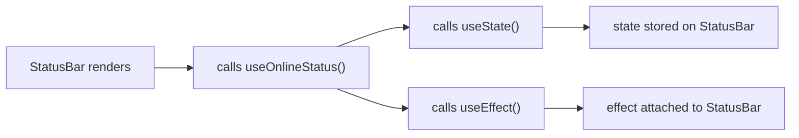
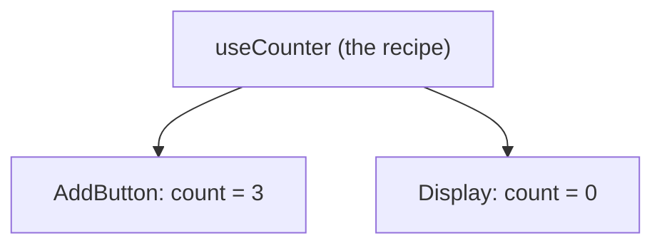

Sooner or later every React codebase grows the same piece of logic in three different components. A `useEffect` that listens to the window size. A `useState` + `useEffect` pair that syncs with `localStorage`. The same `fetch`-with-loading-and-error dance, copied and slightly modified each time.

The standard answer is **"extract a custom hook."** And that answer is right. But custom hooks come with a few rules that look arbitrary until you know *why* they exist, and a few misconceptions that cause real bugs:

- "If two components use `useCart()`, they share the same cart." (**They don't.**)
- "I'll make a `useMount` hook so effects read nicer." (**Please don't.**)
- "Every helper function should be a hook." (**Only if it calls hooks.**)

In this post we'll go step by step:

1. The problem: duplicated logic
2. What a custom hook actually is
3. Why hooks have rules (and why the `use` prefix matters)
4. The big misconception: hooks share logic, not state
5. Designing a good hook API
6. Better building blocks: `useSyncExternalStore` and `useEffectEvent`
7. Hooks you probably shouldn't write
8. Testing custom hooks
9. When to extract a hook

> The examples use **React 19** and TypeScript. In my [debounce post](/blog/debounce-search) we already wrote one custom hook, `useDebouncedValue`. This post explains the ideas behind it.

## 1. The problem: the same logic in two places

Say we want to show a "You're offline" banner in the header, and disable the Save button in a form when the network is down. Both components need to know whether the browser is online:

```tsx
function StatusBar() {
  const [isOnline, setIsOnline] = useState(true);

  useEffect(() => {
    const update = () => setIsOnline(navigator.onLine);
    window.addEventListener("online", update);
    window.addEventListener("offline", update);
    return () => {
      window.removeEventListener("online", update);
      window.removeEventListener("offline", update);
    };
  }, []);

  return isOnline ? null : <p role="alert">You're offline</p>;
}

function SaveButton() {
  const [isOnline, setIsOnline] = useState(true);

  useEffect(() => {
    // ...the exact same 9 lines again
  }, []);

  return <button disabled={!isOnline}>Save</button>;
}
```

It works, but:

- **The logic is duplicated.** Fix a bug in one copy and you have to remember the other.
- **The component is hiding its purpose.** `StatusBar` is about *showing a banner*. Event listeners on `window` are an implementation detail it shouldn't have to care about.

With regular JavaScript you'd extract a function. With hooks, the answer is... also to extract a function.

## 2. What a custom hook actually is

Here's the whole definition:

> **A custom hook is a function whose name starts with `use` followed by a capital letter, and that calls other hooks.**

So `useOnlineStatus` is a hook name, but `user` or `useless` isn't.

That's it. No registration, no special API, no wrapper. Let's move the logic out:

```ts
// useOnlineStatus.ts
import { useEffect, useState } from "react";

export function useOnlineStatus() {
  const [isOnline, setIsOnline] = useState(true);

  useEffect(() => {
    const update = () => setIsOnline(navigator.onLine);
    window.addEventListener("online", update);
    window.addEventListener("offline", update);
    return () => {
      window.removeEventListener("online", update);
      window.removeEventListener("offline", update);
    };
  }, []);

  return isOnline;
}
```

And the components become:

```tsx
function StatusBar() {
  const isOnline = useOnlineStatus(); // [!code highlight]
  return isOnline ? null : <p role="alert">You're offline</p>;
}

function SaveButton() {
  const isOnline = useOnlineStatus(); // [!code highlight]
  return <button disabled={!isOnline}>Save</button>;
}
```

Read those two components again. They now say **what** they need ("is the user online?"), not **how** to find out. That's the real win of a custom hook. Less duplication is nice, but *naming an idea* is better.

### Why can a plain function hold state?

This is the part that confuses people. `useOnlineStatus` is a normal function. It runs, returns a boolean, and is done. So where does `isOnline` live between renders?

The answer: **not in the hook.** When `StatusBar` renders, it calls `useOnlineStatus()`, which calls `useState()`. As far as React is concerned, `useState` was called **by `StatusBar`**, during `StatusBar`'s render. The state is stored on `StatusBar`'s component instance.

In other words, inlining the hook would give you exactly the same component:



A custom hook isn't a thing React knows about. It's just a way of **organizing the hook calls a component makes.** Keep that in mind, because everything else in this post follows from it.

## 3. Why hooks have rules

The two Rules of Hooks:

1. **Only call hooks at the top level.** Not inside conditions, loops, nested functions, or `try`/`catch` blocks, and not after an early `return`.
2. **Only call hooks from React functions.** Components or other custom hooks.

### Why the top level?

Because React doesn't know your hooks by name. It knows them by **call order**.

Every time a component renders, React walks through its hook calls one by one and gives each one the next "slot": the first call gets slot 0, the second gets slot 1, and so on. On the next render it walks the list again in the same order and hands each hook whatever is in its slot.

```tsx
function Profile() {
  const [name] = useState("Budi"); // slot 0
  const [age] = useState(25); // slot 1
  const isOnline = useOnlineStatus(); // slot 2 & 3

  return <p>{name}, {age} {isOnline ? "🟢" : "⚪"}</p>;
}
```

Slots 2 and 3 belong to the `useState` and `useEffect` *inside* `useOnlineStatus`. Remember section 2: React can't see the custom hook, only the hooks it calls.

Now the classic mistake, an early return before a hook:

```tsx
function Profile({ user }: { user: User | null }) {
  const [name] = useState(user?.name ?? ""); // slot 0
  if (!user) return <p>Please log in</p>; // ❌ early return
  const isOnline = useOnlineStatus(); // slot 1 & 2, sometimes

  return <p>{name} {isOnline ? "🟢" : "⚪"}</p>;
}
```

Here's what React sees when the user logs out:

| Slot | Render 1 (`user` exists) | Render 2 (`user` is `null`) |
| --- | --- | --- |
| 0 | `useState` (name) | `useState` (name) |
| 1 | `useState` (online) | not called |
| 2 | `useEffect` (online) | not called |

The list is suddenly shorter than last time, so React can't line slots up with hooks anymore and throws *"Rendered fewer hooks than expected. This may be caused by an accidental early return statement."* (React even guesses the cause for you.) That's actually the lucky case. If the count stays the same but the order changes, for example two `useState` calls that swap places, React can't tell, and one hook silently gets the other's state.

The fix: call every hook first, and only then return early.

```tsx
function Profile({ user }: { user: User | null }) {
  const [name] = useState(user?.name ?? "");
  const isOnline = useOnlineStatus(); // [!code highlight]

  if (!user) return <p>Please log in</p>;
  return <p>{name} {isOnline ? "🟢" : "⚪"}</p>;
}
```

Same hooks, same order, every render. That's the whole rule.

### Why the `use` prefix?

Since a custom hook is "just a function," the prefix is the **only** way tools can tell it apart from a normal one:

- **The linter** decides what counts as a hook by its name. ESLint's `react-hooks/rules-of-hooks` treats every `use` + capital letter function as a hook and checks it's only called at the top level (Biome has the same check as `useHookAtTopLevel`, on by default). Without the prefix, it can't warn you about the early return above.
- **The React Compiler** only optimizes components and hooks, and relies on the naming convention to know which is which.
- **Readers** know at a glance that this function may hold state and effects, and must follow the rules.

The flip side matters just as much: **if a function doesn't call any hooks, don't name it `use…`.**

```ts
// ❌ Not a hook. It calls no hooks.
function useFormatPrice(amount: number) {
  return new Intl.NumberFormat("id-ID", { style: "currency", currency: "IDR" }).format(amount);
}

// ✅ Just a function. Can be called anywhere, even inside an `if`.
function formatPrice(amount: number) {
  return new Intl.NumberFormat("id-ID", { style: "currency", currency: "IDR" }).format(amount);
}
```

Calling it `useFormatPrice` adds the rules of hooks for no reason. You can no longer call it conditionally or inside a `.map()` callback, and the linter will complain when you try.

## 4. The big misconception: hooks share logic, not state

This is the bug I see most often. Here's a counter hook:

```ts
function useCounter() {
  const [count, setCount] = useState(0);
  const increment = () => setCount((c) => c + 1);
  return { count, increment };
}
```

And two components using it:

```tsx
function AddButton() {
  const { increment } = useCounter();
  return <button onClick={increment}>+1</button>;
}

function Display() {
  const { count } = useCounter();
  return <p>Count: {count}</p>;
}
```

Click the button. `Display` still shows **0**. Forever.

### Why?

Go back to section 2: the state doesn't live in the hook, it lives in **the component that called it**. `AddButton` has its own `useState` slot. `Display` has a completely separate one. The hook is a recipe. Each component cooks its own copy.



That's usually what you want. Two forms both using `useFormField()` should definitely not share their values. But when you **do** want shared data, a custom hook alone is the wrong tool. You need the data to live somewhere both components can see:

- **Lift the state up** to a common parent and pass it down as props.
- **Put it in context.** The hook can still be the nice interface:

```tsx
const CounterContext = createContext<{ count: number; increment: () => void } | null>(null);

export function CounterProvider({ children }: { children: React.ReactNode }) {
  const [count, setCount] = useState(0);
  const increment = () => setCount((c) => c + 1);
  return <CounterContext value={{ count, increment }}>{children}</CounterContext>;
}

export function useCounter() {
  const ctx = use(CounterContext);
  if (!ctx) throw new Error("useCounter must be used inside <CounterProvider>"); // [!code highlight]
  return ctx;
}
```

- **Use an external store** (Zustand, Jotai, TanStack Query for server data, or your own with `useSyncExternalStore`, see section 6).

Notice that `useOnlineStatus` from section 2 doesn't have this problem, because each copy reads from the same **outside source**: `navigator.onLine`. Each component has its own state, but they all mirror the same truth.

> React 19 lets you render `<CounterContext>` directly instead of `<CounterContext.Provider>`, and read it with `use()` instead of `useContext()`. Both older forms still work.

## 5. Designing a good hook API

A custom hook is a small API. A few habits make it much nicer to use.

### Return a tuple or an object?

- **Tuple** when there are exactly two things and callers will want to rename them, like `useState`:

```ts
const [theme, setTheme] = useLocalStorage("theme", "light");
const [lang, setLang] = useLocalStorage("lang", "en");
```

- **Object** when there are three or more things, or callers usually only need some of them:

```ts
const { data, error, isLoading } = useProduct(id);
```

A three-item tuple like `[data, error, isLoading]` forces every caller to remember the order, and to write `[, , isLoading]` when they only want one.

### Give it a narrow, specific job

`useOnlineStatus` is good. `useBrowser` that returns online status, window size, scroll position, and the user agent is not. Every component that calls it pays for all four listeners, and re-renders when *any* of them changes.

Name hooks after **what they mean**, not **how they work**. `useChatRoom(roomId)` is better than `useWebSocketEffect(url)`, because if you later switch from WebSockets to Server-Sent Events, the callers don't have to change.

### Return stable functions

If your hook returns a function and a caller puts it in an effect's dependency array, a new function on every render means the effect re-runs on every render:

```ts
function useCart() {
  const [items, setItems] = useState<Item[]>([]);
  const addItem = (item: Item) => setItems((prev) => [...prev, item]); // new function every render
  return { items, addItem };
}
```

If you use the **React Compiler**, it memoizes `addItem` for you, because it compiles custom hooks as well as components. (The React docs still keep `useCallback` as an escape hatch when you need exact control, for example over a value used as an effect dependency.) Without the Compiler, wrap returned functions in `useCallback`:

```ts
const addItem = useCallback((item: Item) => {
  setItems((prev) => [...prev, item]);
}, []);
```

The functional update (`prev => ...`) is what lets the dependency array stay empty. `addItem` never needs to read `items` directly.

### Accept values, not just "on mount" arguments

A hook should react when its inputs change. Compare:

```ts
// ❌ Ignores roomId changes after the first render
useEffect(() => {
  const conn = connect(roomId);
  return () => conn.disconnect();
}, []);

// ✅ Reconnects when roomId changes
useEffect(() => {
  const conn = connect(roomId);
  return () => conn.disconnect();
}, [roomId]);
```

If a hook takes a parameter, assume the caller will change it at some point.

## 6. Better building blocks

Two hooks make custom hooks noticeably more correct. Both are worth knowing.

### `useSyncExternalStore` for anything outside React

Our `useOnlineStatus` has a subtle bug. It starts with `useState(true)` and only updates when an `online` or `offline` event fires. If the user loads the page **while already offline**, no event fires, so the hook says "online" until the connection changes again.

Whenever a hook mirrors something that lives **outside React** (browser APIs, `localStorage`, a WebSocket, a third-party store), there's a hook made exactly for that:

```ts
import { useSyncExternalStore } from "react";

function subscribe(callback: () => void) {
  window.addEventListener("online", callback);
  window.addEventListener("offline", callback);
  return () => {
    window.removeEventListener("online", callback);
    window.removeEventListener("offline", callback);
  };
}

export function useOnlineStatus() {
  return useSyncExternalStore(
    subscribe,
    () => navigator.onLine, // [!code highlight]
    () => true, // [!code highlight]
  );
}
```

You give React how to **subscribe** to changes and how to **read the current value** (`navigator.onLine`), plus the value to use during server rendering, where there's no `navigator` (`true`). React handles the rest: the initial value is correct on the first render, there's no `useState` + `useEffect` dance, and it stays consistent during concurrent rendering.

Note that `subscribe` is declared **outside** the hook. If it were declared inside, it would be a new function every render and React would resubscribe every time.

The same pattern works for a media query:

```ts
export function useMediaQuery(query: string) {
  const subscribe = useCallback(
    (callback: () => void) => {
      const mql = window.matchMedia(query);
      mql.addEventListener("change", callback);
      return () => mql.removeEventListener("change", callback);
    },
    [query],
  );

  return useSyncExternalStore(
    subscribe,
    () => window.matchMedia(query).matches,
    () => false,
  );
}

// usage
const isMobile = useMediaQuery("(max-width: 640px)");
```

Here `subscribe` depends on `query`, so it lives inside with `useCallback`. React only resubscribes when the query actually changes.

### `useEffectEvent` for callbacks inside effects

Here's a common hook shape: "do something, and call the caller's callback when it happens."

```ts
function useInterval(callback: () => void, delay: number) {
  useEffect(() => {
    const id = setInterval(callback, delay);
    return () => clearInterval(id);
  }, [callback, delay]);
}
```

The problem: callers almost always pass an inline arrow function, which is new on every render:

```tsx
useInterval(() => setSeconds((s) => s + 1), 1000);
```

So the effect tears down and restarts the interval on every render. If the component re-renders often, the interval may **never fire at all**, because it keeps getting reset before 1000ms pass.

We want the effect to restart when `delay` changes, but not when `callback` changes. We just want it to call the **latest** callback. That's what `useEffectEvent` (stable since React 19.2) is for:

```ts
import { useEffect, useEffectEvent } from "react";

function useInterval(callback: () => void, delay: number) {
  const onTick = useEffectEvent(callback); // [!code highlight]

  useEffect(() => {
    const id = setInterval(() => onTick(), delay);
    return () => clearInterval(id);
  }, [delay]); // [!code highlight]
}
```

`onTick` always calls the newest `callback`, but it isn't "reactive", so it doesn't belong in the dependency array. Before `useEffectEvent`, people did this by hand with a `useRef` that they updated on every render. Now you don't have to.

> A few rules from the React docs: only call the function returned by `useEffectEvent` **from inside effects** (never during render), don't pass it to other components or hooks, and never put it in a dependency array. Its identity changes on every render on purpose. It's also not a way to silence the linter: use it only for logic that really is an *event* fired from the effect, like our `onTick`. You need `eslint-plugin-react-hooks` v6 or newer, otherwise the linter will ask you to add `onTick` as a dependency.

## 7. Hooks you probably shouldn't write

### Lifecycle hooks: `useMount`, `useUpdateEffect`, `useEffectOnce`

```ts
// ❌
function useMount(fn: () => void) {
  useEffect(() => {
    fn();
  }, []);
}
```

It reads nicely, but it brings back class-component thinking ("do X on mount") into a model that's built around **synchronization** ("keep X in sync with these values"). And it hides the dependency array from the linter: if `fn` reads props or state, the linter can no longer tell you they're missing, so you get stale values with no warning.

Write the `useEffect` directly, or better, wrap it in a hook named after its **purpose**: `useChatRoom(roomId)`, `usePageView(url)`, `useDocumentTitle(title)`.

### Hooks for things that don't need effects at all

```ts
// ❌ An effect + state just to compute a value
function useFullName(first: string, last: string) {
  const [fullName, setFullName] = useState("");
  useEffect(() => {
    setFullName(`${first} ${last}`);
  }, [first, last]);
  return fullName;
}
```

This renders once with an empty name, then again with the right one. Derived values should be computed during render:

```ts
// ✅ Not even a hook
const fullName = `${first} ${last}`;
```

If it's expensive, `useMemo` (or let the Compiler handle it). Before writing a hook with an effect, ask: is this actually syncing with something **outside** React? If not, you probably don't need the effect.

### A home-made data fetching layer

A `useFetch` hook is a great learning exercise. But a production-quality one needs caching, deduplication, request cancellation, retries, refetch on focus, and race condition handling (see the [debounce post](/blog/debounce-search)). That's what TanStack Query or SWR already do. A good middle ground: wrap the library in a domain-specific hook.

```ts
export function useProduct(id: string) {
  return useQuery({
    queryKey: ["product", id],
    queryFn: ({ signal }) => fetch(`/api/products/${id}`, { signal }).then((r) => r.json()),
  });
}
```

Components call `useProduct(id)` and never see the query key or the URL. That's the same "name the idea" win from section 2.

## 8. Testing custom hooks

Hooks can only run inside a component, so testing one needs a small harness. `@testing-library/react` ships one: `renderHook`.

```ts
import { act, renderHook } from "@testing-library/react";
import { expect, test } from "vitest";
import { useCounter } from "./useCounter";

test("increments the count", () => {
  const { result } = renderHook(() => useCounter());

  expect(result.current.count).toBe(0);

  act(() => result.current.increment()); // [!code highlight]

  expect(result.current.count).toBe(1);
});
```

Two things to notice:

- **`result.current`**, not a destructured value. After a re-render, `result.current` points to the latest return value. If you destructure at the top, you're holding the value from the first render.
- **`act()`** wraps anything that updates state, so React finishes re-rendering before your next assertion.

To test what happens when an argument changes, use `rerender`:

```ts
const { result, rerender } = renderHook(({ query }) => useMediaQuery(query), {
  initialProps: { query: "(max-width: 640px)" },
});

rerender({ query: "(min-width: 1024px)" });
```

That said, if a hook is only used by one component, it's often simpler to test **through that component** instead. Test the hook on its own when it's shared, or when it has logic that's awkward to reach through the UI.

## 9. When to extract a hook

Some rough rules I use:

- **The same hook calls appear in two or more components.** Classic case.
- **A component has a block of state + effects that's about one idea.** Even if it's used once, moving it into `useChatRoom(roomId)` makes the component read like a description instead of a manual.
- **You're wrapping a library** (data fetching, forms, a store) and want components to depend on *your* names, not the library's.

And when **not** to:

- **It doesn't call any hooks.** Make it a normal function.
- **You'd need a name like `useStuff` or `useComponentLogic`.** If you can't name the idea, there probably isn't one yet. Keep the code in the component until a clear concept shows up.
- **The "shared" logic is two lines.** A little duplication is cheaper than the wrong abstraction.

## Summary

- **A custom hook is just a function that starts with `use` and calls other hooks.** There's no magic. Its state and effects belong to the component that calls it.
- **Hooks rely on call order**, which is why they must be called at the top level, never inside conditions or loops.
- **The `use` prefix is how the linter and the React Compiler recognize hooks.** Don't use it on functions that don't call hooks.
- **Hooks share logic, not state.** Each component that calls `useCounter()` gets its own count. For shared data, use lifted state, context, or an external store.
- **Design the API:** tuple for two values, object for more, a narrow job, a name that describes the *purpose*, and stable returned functions.
- **Reach for `useSyncExternalStore`** when mirroring something outside React, and **`useEffectEvent`** for callbacks your effects call but shouldn't react to.
- **Skip `useMount`-style hooks** and effects that only compute values.

Next time you see the same `useState` + `useEffect` combo in two components, pull it out, give it a good name, and watch both components get shorter and easier to read. 🪝

## References

- [Reusing Logic with Custom Hooks](https://react.dev/learn/reusing-logic-with-custom-hooks), React docs
- [Rules of Hooks](https://react.dev/reference/rules/rules-of-hooks), React docs
- [useSyncExternalStore](https://react.dev/reference/react/useSyncExternalStore), React docs
- [useEffectEvent](https://react.dev/reference/react/useEffectEvent), React docs
- [You Might Not Need an Effect](https://react.dev/learn/you-might-not-need-an-effect), React docs
- [React Compiler](https://react.dev/learn/react-compiler), React docs
- [renderHook](https://testing-library.com/docs/react-testing-library/api#renderhook), Testing Library docs
- [useHookAtTopLevel](https://biomejs.dev/linter/rules/use-hook-at-top-level/), Biome docs
