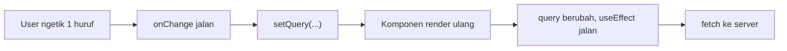
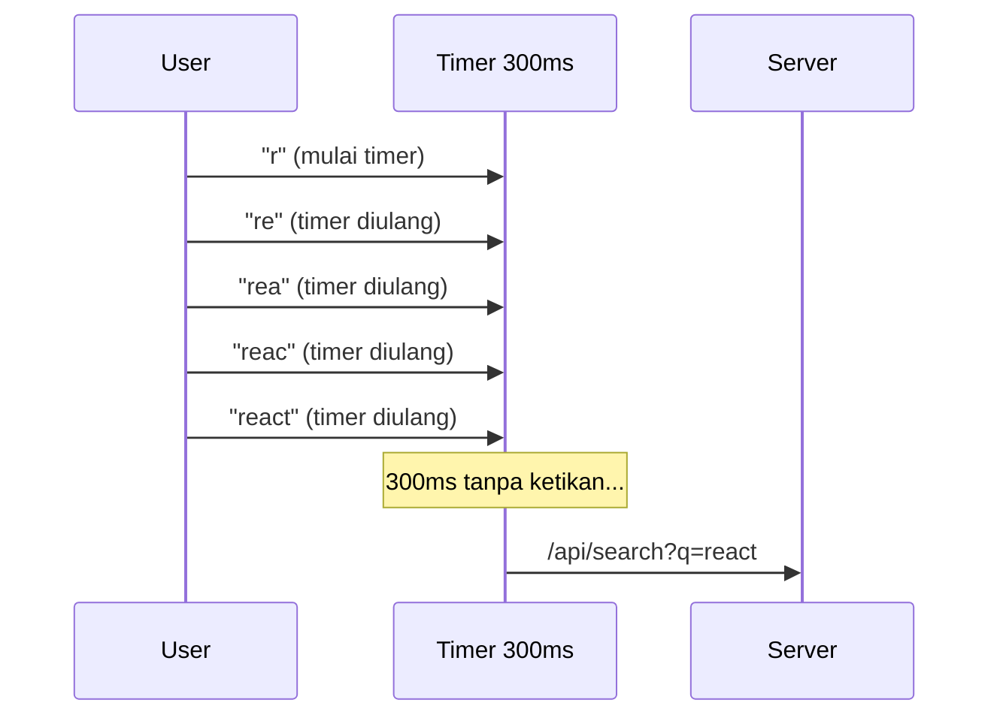
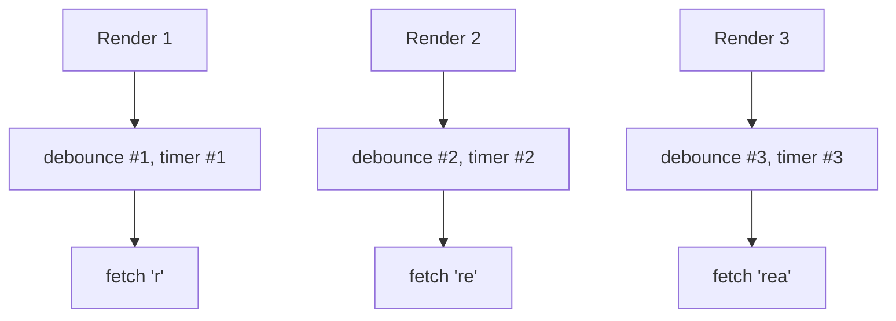
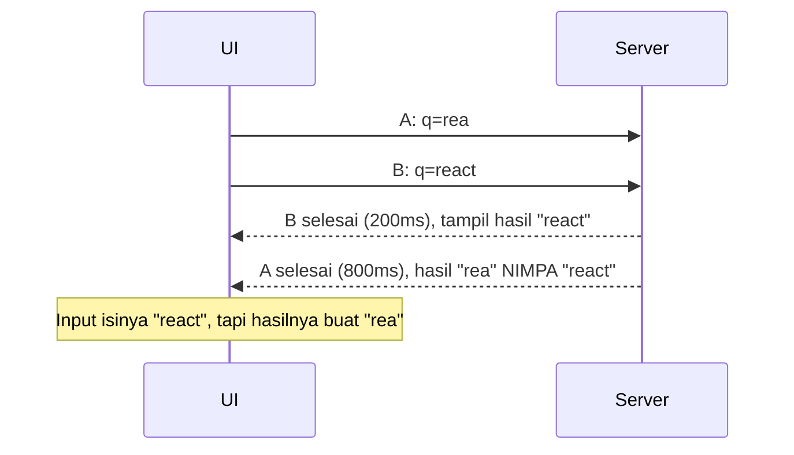

Hampir semua aplikasi punya kolom search. Kelihatannya gampang: user ngetik, kita panggil API, hasilnya ditampilin. Tapi begitu dipakai beneran, mulai muncul keanehan. Server kebanjiran request, hasil search kedip-kedip, dan kadang yang tampil malah hasil dari kata kunci **lama** yang udah kamu ketik lewat.

Solusi yang paling sering disebut adalah **debounce**. Masalahnya, banyak tutorial cuma ngasih potongan kode tanpa jelasin *kenapa* masalahnya muncul dan *kenapa* kode itu bisa jadi solusinya. Akibatnya, begitu debounce-nya salah taruh, dia diam-diam nggak ngefek dan nggak ada yang sadar.

Di tulisan ini kita bahas satu per satu:

1. Kenapa kolom search tanpa debounce itu boros
2. Debounce itu sebenarnya ngapain
3. Bikin fungsi `debounce` sendiri, biar paham isinya
4. Kenapa debounce di React sering **gagal diam-diam**
5. Race condition: masalah yang **nggak** diselesain debounce
6. Versi lengkap yang siap dipakai, plus versi TanStack Query
7. Debounce vs throttle vs `useDeferredValue`

> Contoh kodenya pakai **React 19** dan TypeScript. Tapi konsepnya berlaku di framework apa pun. Kalau kamu udah baca [tulisan Angular](/blog/angular-for-react-developers) kemarin, `debounceTime` di RxJS ngerjain persis hal ini.

## 1. Masalahnya: satu huruf, satu request

Ini kolom search versi paling polos:

```tsx
function Search() {
  const [query, setQuery] = useState("");
  const [results, setResults] = useState<Product[]>([]);

  useEffect(() => {
    fetch(`/api/search?q=${encodeURIComponent(query)}`)
      .then((res) => res.json())
      .then(setResults);
  }, [query]);

  return <input value={query} onChange={(e) => setQuery(e.target.value)} />;
}
```

Sekarang user ngetik `react`. Yang terjadi:

| Ketikan | `query` | Request yang dikirim |
| --- | --- | --- |
| `r` | `"r"` | `/api/search?q=r` |
| `e` | `"re"` | `/api/search?q=re` |
| `a` | `"rea"` | `/api/search?q=rea` |
| `c` | `"reac"` | `/api/search?q=reac` |
| `t` | `"react"` | `/api/search?q=react` |

**Lima request**, padahal yang user mau cuma satu: hasil buat `react`. Empat sisanya langsung dibuang.

### Kenapa bisa begitu?

Karena `onChange` di input dipanggil **tiap kali isinya berubah**, alias tiap kamu ngetik satu huruf. Urutannya begini:



React nggak salah apa-apa. Kita sendiri yang nyuruh "tiap `query` berubah, panggil API". Masalahnya, **`query` berubah jauh lebih sering dari yang sebenarnya kita perluin.**

Orang ngetik itu cepat. Jeda antar ketikan biasanya cuma sekitar 100–200ms, jadi satu kata aja bisa ngirim sampai sepuluh request dalam sedetik. Kalikan dengan ribuan user, hasilnya:

- **Server dan database kerja keras** ngitung hasil yang langsung dibuang
- **Biaya naik** kalau API-nya bayar per request (search service, AI, maps, dll.)
- **Kena rate limit** dari API pihak ketiga
- **UI kedip-kedip**, karena hasilnya ganti terus tiap huruf
- **Hasil bisa ketukar urutannya** (dibahas di bagian 5, dan ini yang paling licik)

## 2. Debounce itu apa?

Debounce artinya: **"Tunggu user berhenti dulu, baru jalan."**

Analogi yang paling pas menurut saya: **pintu lift.** Pintu lift nggak langsung nutup begitu ada orang masuk. Dia nunggu beberapa detik. Kalau ada orang lain masuk sebelum waktunya habis, hitungannya **diulang dari awal**. Pintu baru nutup kalau udah beberapa detik nggak ada yang masuk lagi.

Debounce juga begitu. Tiap ketikan baru bikin **timer-nya mulai lagi dari nol**. Fungsinya baru dijalanin setelah user berhenti ngetik selama, misalnya, 300ms.



Hasilnya: **lima ketikan, satu request.** Request itu juga pakai nilai terakhir, yang memang dicari user.

> Nama "debounce" asalnya dari elektronika. Waktu ditekan, kontak di tombol fisik sebenarnya "memantul" (*bounce*) beberapa kali dalam hitungan milidetik, jadi satu tekanan bisa kebaca berkali-kali. Rangkaian *debounce* menyaring pantulan itu supaya cuma kebaca sekali. Idenya sama: sinyal yang datang beruntun dianggap satu.

## 3. Bikin `debounce` sendiri

Sebenarnya bisa aja langsung pakai `lodash.debounce`. Tapi isinya cuma beberapa baris, dan kalau kamu paham isinya, nanti kamu bakal ngerti kenapa debounce bisa gagal.

```ts
function debounce<Args extends unknown[]>(
  fn: (...args: Args) => void,
  delay: number,
) {
  let timer: ReturnType<typeof setTimeout> | undefined; // [!code highlight]

  return (...args: Args) => {
    clearTimeout(timer); // [!code highlight]
    timer = setTimeout(() => fn(...args), delay); // [!code highlight]
  };
}
```

Cara pakainya:

```ts
const search = debounce((q: string) => console.log("cari:", q), 300);

search("r");
search("re");
search("react");
// ...300ms kemudian, cuma muncul sekali: "cari: react"
```

### Kenapa kode sependek ini bisa jalan?

Ada tiga hal yang kerja bareng:

**1. `setTimeout` artinya "nanti", bukan "sekarang".** Pas kamu panggil `setTimeout(fn, 300)`, JavaScript nggak nunggu 300ms. Dia cuma nitip ke browser: "300ms lagi, masukin `fn` ke antrian ya." Habis itu kodenya langsung lanjut. Browser lalu ngasih semacam nomor tiket (ID timer), yang kita simpan di `timer`.

**2. `clearTimeout` buat ngebatalin titipan.** Selama 300ms-nya belum lewat, titipannya masih bisa dibatalin pakai ID-nya. Kalau dibatalin, `fn` nggak akan pernah jalan.

**3. Closure bikin `timer` tetap ada di antara panggilan.** Variabel `timer` cuma dibuat **sekali**, pas `debounce(...)` dipanggil. Fungsi yang di-return "inget" variabel itu. Jadi semua panggilan `search(...)` baca dan nulis ke **`timer` yang sama.**

Kalau digabung: tiap panggilan baru **ngebatalin titipan sebelumnya**, lalu **nitip yang baru**. Yang beneran sampai dijalanin cuma titipan terakhir.

> Poin nomor 3 itu kuncinya. Debounce cuma jalan kalau **semua panggilan pakai instance yang sama**, yang nyimpen `timer` yang sama. Ingat-ingat ini, karena justru poin ini yang bikin debounce "rusak" di React (bagian berikutnya).

### Tambahan: `cancel` dan `flush`

Di aplikasi beneran, biasanya kamu butuh dua hal lagi:

- **`cancel`**: batalin panggilan yang masih nunggu. Misalnya pas komponen di-unmount, biar nggak ada `fetch` yang jalan buat komponen yang udah nggak ada.
- **`flush`**: jalanin sekarang juga tanpa nunggu. Misalnya pas user tekan Enter. Udah jelas dia mau search, ngapain ditunda 300ms lagi?

```ts
function debounce<Args extends unknown[]>(
  fn: (...args: Args) => void,
  delay: number,
) {
  let timer: ReturnType<typeof setTimeout> | undefined;
  let lastArgs: Args | undefined;

  const debounced = (...args: Args) => {
    lastArgs = args;
    clearTimeout(timer);
    timer = setTimeout(() => {
      lastArgs = undefined;
      fn(...args);
    }, delay);
  };

  debounced.cancel = () => {
    clearTimeout(timer);
    lastArgs = undefined;
  };

  debounced.flush = () => {
    if (!lastArgs) return;
    const args = lastArgs;
    debounced.cancel();
    fn(...args);
  };

  return debounced;
}
```

## 4. Jebakan di React: debounce yang gagal diam-diam

Ini kesalahan yang **paling sering** saya temui. Kodenya kelihatan benar, nggak ada error, tapi debounce-nya nggak ngefek sama sekali:

```tsx
function Search() {
  const [query, setQuery] = useState("");

  // ❌ Dibuat ulang tiap render
  const search = debounce((q: string) => fetchResults(q), 300);

  return (
    <input
      value={query}
      onChange={(e) => {
        setQuery(e.target.value);
        search(e.target.value);
      }}
    />
  );
}
```

Coba ketik `react`, terus lihat tab Network. Request-nya **tetap lima**, cuma semuanya telat 300ms.

### Kenapa?

Inget poin nomor 3 tadi: debounce butuh **satu instance** yang nyimpen satu `timer`. Sekarang lihat apa yang terjadi di React:

1. User ngetik `r`. `search` (instance **#1**) dipanggil, timer **#1** mulai.
2. `setQuery` bikin komponen **render ulang**. Fungsi `Search()` dijalanin lagi dari atas.
3. Baris `const search = debounce(...)` jalan lagi. Sekarang ada instance **#2**, dengan `timer` **baru yang masih kosong**.
4. User ngetik `e`. Yang dipanggil instance **#2**. Dia manggil `clearTimeout` ke timer miliknya sendiri, yang masih kosong. **Timer #1 nggak kesentuh**, soalnya ada di closure instance #1.
5. Begitu terus. Tiap huruf punya timer sendiri yang nggak pernah dibatalin.



Jadi bukan debounce-nya yang rusak. **Komponen React itu fungsi yang dijalanin ulang tiap render**, dan semua variabel di dalamnya dibuat baru. Termasuk debounce kita.

Bisa sih "ditambal" pakai `useMemo` atau `useRef` biar instance-nya stabil. Tapi itu bawa masalah baru: fungsinya bisa nangkep props/state versi lama (*stale closure*), dan kamu harus inget `cancel` pas unmount. Ada cara yang lebih bersih.

### Solusinya: yang di-debounce itu **nilai**, bukan fungsi

Daripada nge-debounce *panggilan fetch*, yang kita debounce *nilai `query`*-nya. Kita bikin `debouncedQuery`, yang baru ikut berubah setelah `query` nggak berubah lagi selama 300ms. Lalu `fetch` cukup bergantung ke `debouncedQuery`.

```ts
// useDebouncedValue.ts
import { useEffect, useState } from "react";

export function useDebouncedValue<T>(value: T, delay = 300) {
  const [debounced, setDebounced] = useState(value);

  useEffect(() => {
    const id = setTimeout(() => setDebounced(value), delay);
    return () => clearTimeout(id); // [!code highlight]
  }, [value, delay]);

  return debounced;
}
```

### Kenapa yang ini jalan, padahal juga dibuat ulang tiap render?

Rahasianya ada di **fungsi cleanup** (`return () => clearTimeout(id)`).

React punya aturan: **sebelum effect jalan lagi, cleanup dari effect sebelumnya dijalanin dulu.** Jadi:

1. `value` jadi `"r"`. Effect jalan, timer A mulai.
2. `value` jadi `"re"`. React jalanin **cleanup lama dulu**, timer A dibatalin. Baru effect baru jalan, timer B mulai.
3. `value` jadi `"react"`. Cleanup batalin timer B, timer C mulai.
4. 300ms nggak ada perubahan. Timer C jalan, `setDebounced("react")`.

Di sini **React yang nyimpen ID timer sebelumnya** dan selalu ngebatalinnya buat kita. Kita nggak perlu repot nyimpen instance. Bonusnya, pas komponen di-unmount, cleanup juga jalan, jadi nggak ada timer yang nyangkut.

Cara pakainya:

```tsx
function Search() {
  const [query, setQuery] = useState("");
  const debouncedQuery = useDebouncedValue(query, 300);

  useEffect(() => {
    // jalan cuma sekali setelah user berhenti ngetik
    fetchResults(debouncedQuery);
  }, [debouncedQuery]);

  return <input value={query} onChange={(e) => setQuery(e.target.value)} />;
}
```

Perhatiin ada **dua state**:

- `query` buat input. Ini **harus langsung berubah** tiap ketikan. Kalau input-nya ikut di-debounce, hurufnya bakal muncul telat dan rasanya kayak keyboard nge-lag.
- `debouncedQuery` buat hal yang mahal (request ke server).

Bonus: dua state ini bisa dibandingin buat nampilin indikator "lagi nunggu user selesai ngetik":

```tsx
const isTyping = query !== debouncedQuery;
```

## 5. Race condition: yang **nggak** diselesain debounce

Oke, request udah jauh berkurang. Tapi ada satu bug yang masih bisa muncul, dan debounce **sama sekali nggak** bisa nyegah bug ini.

Bayangin skenario ini:

1. User ngetik `rea`, terus berhenti sebentar (lebih dari 300ms). Request **A** (`q=rea`) dikirim.
2. User lanjut ngetik `ct`. 300ms kemudian, request **B** (`q=react`) dikirim.
3. Request A kebetulan lambat (`rea` cocok sama banyak data, atau jaringannya lagi jelek). B selesai duluan.
4. Hasil B tampil ✅. Terus A selesai dan **nimpa hasil B** ❌.



### Kenapa bisa begitu?

Karena **request jaringan nggak dijamin selesai sesuai urutan dikirim.** Tiap request jalan sendiri-sendiri. Cepat-lambatnya tergantung ukuran data, beban server, cache, sampai sinyal HP user. Kode kita tadi pokoknya "ada respons, tampilin", tanpa ngecek respons itu masih relevan atau nggak.

Debounce cuma ngurangin **jumlah** request. Selama masih ada kemungkinan dua request jalan barengan, urutannya tetap bisa ketukar. Debounce bikin kejadiannya lebih jarang, jadi **makin susah ketemu pas testing** dan baru nongol di production.

### Solusinya: batalin request lama pakai `AbortController`

Tiap kali `debouncedQuery` berubah, request sebelumnya udah nggak relevan. Jadi batalin aja. Tempat yang pas lagi-lagi di **cleanup effect**:

```tsx
useEffect(() => {
  const controller = new AbortController();

  fetch(`/api/search?q=${encodeURIComponent(debouncedQuery)}`, {
    signal: controller.signal, // [!code highlight]
  })
    .then((res) => res.json())
    .then(setResults)
    .catch((err) => {
      if (err.name === "AbortError") return; // dibatalin sengaja, bukan error
      console.error(err);
    });

  return () => controller.abort(); // [!code highlight]
}, [debouncedQuery]);
```

Pas `debouncedQuery` berubah dari `rea` ke `react`, React jalanin cleanup, request A di-`abort()`. Promise-nya di-reject dengan `AbortError`, jadi `setResults` buat A **nggak pernah jalan.** Masalah selesai.

Kita dapat dua keuntungan sekaligus:

- **Benar**: hasil lama nggak mungkin nimpa hasil baru.
- **Hemat**: browser beneran mutus koneksinya, jadi bandwidth nggak kebuang buat respons yang nggak dipakai.

> Kalau kamu pakai library yang nggak dukung `AbortSignal`, pakai flag sederhana: `let ignore = false;` di effect, `return () => { ignore = true; }` di cleanup, terus cek `if (!ignore) setResults(data)`. Request-nya tetap jalan, tapi hasilnya diabaikan. Pola ini juga yang dicontohin di dokumentasi React.

## 6. Versi lengkap

Sekarang kita gabungin semuanya, plus beberapa detail yang bikin search-nya enak dipakai:

- **Baru search kalau minimal 2 huruf.** Hasil buat `a` biasanya nggak berguna dan berat buat server.
- **`trim()`** biar `"react "` dan `"react"` dianggap sama.
- **Status yang jelas**: idle, loading, success, error.
- **Enter langsung search** tanpa nunggu debounce.
- **Pengumuman buat screen reader** pas jumlah hasil berubah.

```tsx
// Search.tsx
import { useEffect, useState } from "react";
import { useDebouncedValue } from "./useDebouncedValue";

type Product = { id: string; name: string };
type State =
  | { status: "idle" }
  | { status: "loading" }
  | { status: "success"; results: Product[] }
  | { status: "error" };

const MIN_LENGTH = 2;

export function Search() {
  const [query, setQuery] = useState("");
  const [submitted, setSubmitted] = useState<string | null>(null);
  const debouncedQuery = useDebouncedValue(query.trim(), 300);
  const [state, setState] = useState<State>({ status: "idle" });

  // Enter = pakai nilai sekarang, lewatin debounce
  const term = submitted ?? debouncedQuery;
  const isTyping = submitted === null && query.trim() !== debouncedQuery;

  useEffect(() => {
    if (term.length < MIN_LENGTH) {
      setState({ status: "idle" });
      return;
    }

    const controller = new AbortController();
    setState({ status: "loading" });

    fetch(`/api/search?q=${encodeURIComponent(term)}`, {
      signal: controller.signal,
    })
      .then((res) => {
        if (!res.ok) throw new Error(`HTTP ${res.status}`);
        return res.json() as Promise<Product[]>;
      })
      .then((results) => setState({ status: "success", results }))
      .catch((err) => {
        if (err.name !== "AbortError") setState({ status: "error" });
      });

    return () => controller.abort();
  }, [term]);

  return (
    <search>
      <form
        onSubmit={(e) => {
          e.preventDefault();
          setSubmitted(query.trim());
        }}
      >
        <input
          type="search"
          value={query}
          onChange={(e) => {
            setQuery(e.target.value);
            setSubmitted(null); // balik ke mode debounce
          }}
          placeholder="Cari produk..."
          aria-label="Cari produk"
        />
      </form>

      <p role="status">
        {isTyping || state.status === "loading"
          ? "Mencari..."
          : state.status === "success"
            ? `${state.results.length} hasil`
            : state.status === "error"
              ? "Gagal memuat hasil. Coba lagi."
              : null}
      </p>

      {state.status === "success" && (
        <ul>
          {state.results.map((p) => (
            <li key={p.id}>{p.name}</li>
          ))}
        </ul>
      )}
    </search>
  );
}
```

Beberapa catatan:

- **`role="status"`** bikin screen reader ngebacain teks itu tiap berubah, tanpa motong apa yang lagi dibaca. User yang nggak bisa lihat layar jadi tahu search-nya udah selesai dan dapat berapa hasil. Ini juga alasan bagus buat debounce: tanpa debounce, screen reader bakal ngumumin "12 hasil... 8 hasil... 3 hasil..." tiap huruf.
- **Elemen `<search>`** adalah elemen HTML khusus buat area pencarian. Artinya sama dengan `<div role="search">`.
- **`trim()` dilakuin sebelum debounce**, jadi nambah spasi di ujung nggak mancing request baru.

## 7. Versi TanStack Query (rekomendasi buat project beneran)

Kode di atas bagus buat ngerti cara kerjanya. Tapi di project beneran saya lebih milih [TanStack Query](https://tanstack.com/query), karena race condition, pembatalan request, cache, dan status loading udah diurusin semua.

```tsx
import { keepPreviousData, useQuery } from "@tanstack/react-query";

async function searchProducts(q: string, signal: AbortSignal) {
  const res = await fetch(`/api/search?q=${encodeURIComponent(q)}`, { signal });
  if (!res.ok) throw new Error(`HTTP ${res.status}`);
  return res.json() as Promise<Product[]>;
}

export function Search() {
  const [query, setQuery] = useState("");
  const term = useDebouncedValue(query.trim(), 300);

  const { data, isFetching, isError } = useQuery({
    queryKey: ["search", term],
    queryFn: ({ signal }) => searchProducts(term, signal),
    enabled: term.length >= 2,
    placeholderData: keepPreviousData,
    staleTime: 60_000,
  });

  // ...
}
```

Kenapa ini lebih enak:

- **Race condition hilang dengan sendirinya.** Hasil disimpan per `queryKey`. Yang tampil selalu data milik `["search", term]` yang sedang aktif. Respons telat buat `rea` masuk ke cache `["search", "rea"]`, bukan ke layar.
- **`signal` dari TanStack Query** otomatis di-abort kalau query-nya udah nggak dipakai.
- **Cache.** User ngetik `react`, hapus jadi `rea`, terus ketik lagi `react`? `react` yang kedua langsung diambil dari cache, tanpa request.
- **`keepPreviousData`** bikin hasil lama tetap tampil sambil nunggu yang baru, jadi list-nya nggak kedip jadi kosong tiap kali ganti kata kunci.

Perhatiin **debounce-nya tetap kita pakai.** TanStack Query nggak nge-debounce. Tanpa `useDebouncedValue`, dia tetap bakal mulai request buat tiap huruf (walaupun yang lama dibatalin). Keduanya saling ngelengkapin: debounce ngatur *seberapa sering kita nanya*, TanStack Query ngatur *jawaban mana yang dipakai*.

## 8. Bonus: simpan kata kunci di URL

Kalau hasil search bisa dibagiin atau di-bookmark (`/products?q=react`), simpan kata kuncinya di URL. Di sini juga pakai nilai yang **udah di-debounce**, dan pakai `replace`, bukan `push`:

```tsx
"use client";
import { usePathname, useRouter, useSearchParams } from "next/navigation";

// di dalam komponen Search, `term` = nilai yang udah di-debounce
const router = useRouter();
const pathname = usePathname();
const searchParams = useSearchParams();

useEffect(() => {
  const params = new URLSearchParams(searchParams);
  if (term) params.set("q", term);
  else params.delete("q");
  router.replace(`${pathname}?${params}`, { scroll: false });
}, [term]);
```

Kenapa `replace`? Kalau pakai `push`, tiap kata kunci jadi satu entri di history browser. Pas user tekan Back, dia harus mundur lewat `react`, `reac`, `rea`... satu per satu. Dengan debounce + `replace`, history-nya tetap bersih.

## 9. Debounce vs throttle vs `useDeferredValue`

Tiga hal ini sering ketuker, padahal gunanya beda.

| Aspek | Debounce | Throttle | `useDeferredValue` |
| --- | --- | --- | --- |
| Kapan jalan | Setelah user **berhenti** selama X ms | Paling banyak **sekali tiap** X ms, walaupun user belum berhenti | Secepat mungkin, tapi dengan prioritas lebih rendah dari ketikan |
| Ada jeda tetap? | Ada | Ada | **Nggak ada**, ngikutin kecepatan device |
| Ngurangin request? | **Iya** | Iya | **Nggak** |
| Cocok buat | Search ke API, autosave, validasi username | Scroll, resize, drag, posisi mouse | Filter/render list besar **di client** |

**Throttle** cocok kalau kamu butuh update rutin *selama* aksinya berlangsung. Contohnya infinite scroll: kamu mau ngecek posisi scroll tiap 200ms selama user nge-scroll, bukan nunggu dia berhenti. Kalau scroll-nya di-debounce, data berikutnya baru dimuat setelah user berhenti, padahal dia mungkin udah dari tadi sampai di bawah.

**`useDeferredValue`** dari React itu **bukan debounce.** Dia nggak nunda pakai timer. Dia cuma bilang ke React: "render input-nya duluan, render bagian yang pakai nilai ini belakangan, dan kalau ada ketikan baru, buang render yang lama." Di laptop kencang, nilainya hampir langsung ikut. Di HP yang lemot, otomatis lebih telat.

Artinya:

- **Masalahnya CPU** (misalnya filter 10.000 item yang udah ada di browser dan render-nya berat): pakai `useDeferredValue`.
- **Masalahnya jaringan/server** (tiap ketikan = request): pakai **debounce**. `useDeferredValue` nggak ngurangin jumlah request sama sekali, soalnya nilai deferred-nya tetap ngikutin tiap ketikan.

```tsx
// Filter di client: useDeferredValue
const deferredQuery = useDeferredValue(query);
const filtered = useMemo(
  () => allProducts.filter((p) => p.name.includes(deferredQuery)),
  [deferredQuery],
);
```

## 10. Berapa ms yang pas?

Nggak ada angka sakti, tapi ini patokan saya:

- **150–250ms**: search lokal atau API yang cepat dan murah. Kerasa instan.
- **300–400ms**: default yang aman buat kebanyakan search ke server.
- **500ms ke atas**: API yang mahal atau lambat (AI, geocoding, API berbayar). Kerasa agak telat, jadi wajib ada indikator "Mencari...".

Kalau terlalu kecil, debounce-nya hampir nggak ngefek: jeda antar ketikan sering lebih panjang dari delay-nya, jadi tiap huruf tetap ngirim request. Kalau terlalu besar, search-nya kerasa lemot. Kalau ragu, mulai dari **300ms**, lalu coba sendiri di HP.

## 11. Ngetes debounce

Nunggu 300ms beneran di test itu lambat dan nggak stabil. Pakai **fake timer**, biar waktu bisa "dimajuin" manual:

```ts
// debounce.test.ts
import { afterEach, beforeEach, expect, test, vi } from "vitest";
import { debounce } from "./debounce";

beforeEach(() => vi.useFakeTimers());
afterEach(() => vi.useRealTimers());

test("cuma jalan sekali, dengan nilai terakhir", () => {
  const fn = vi.fn();
  const search = debounce(fn, 300);

  search("r");
  search("re");
  search("react");

  vi.advanceTimersByTime(299);
  expect(fn).not.toHaveBeenCalled(); // belum 300ms

  vi.advanceTimersByTime(1);
  expect(fn).toHaveBeenCalledOnce();
  expect(fn).toHaveBeenCalledWith("react");
});
```

Cek di 299ms itu penting. Cek ini mastiin fungsinya **nggak jalan kecepetan**, bukan cuma "akhirnya jalan".

## Ringkasan

- **Kenapa perlu debounce?** `onChange` jalan tiap huruf. Tanpa debounce, satu kata = banyak request yang hampir semuanya dibuang.
- **Cara kerjanya:** tiap panggilan baru membatalkan timer sebelumnya (`clearTimeout`) dan mulai timer baru. Yang jalan cuma yang terakhir.
- **Jebakan di React:** `debounce(...)` di badan komponen dibuat ulang tiap render, jadi tiap huruf punya timer sendiri dan nggak ada yang dibatalin. **Debounce nilainya** pakai `useDebouncedValue`, biar cleanup effect yang batalin timer.
- **Input tetap pakai state biasa yang langsung berubah.** Cuma kerjaan yang mahal yang pakai nilai debounce.
- **Debounce nggak nyelesain race condition.** Respons bisa datang nggak urut. Batalin request lama pakai `AbortController` di cleanup, atau pakai TanStack Query.
- **Debounce ≠ throttle ≠ `useDeferredValue`.** Debounce buat "tunggu user selesai", throttle buat "update rutin selama aksi", `useDeferredValue` buat render berat di client.

Lain kali bikin kolom search, coba buka tab Network sambil ngetik. Kalau tiap huruf muncul satu request, sekarang kamu udah tahu kenapa dan gimana cara benerinnya. 🔍

## Referensi

- [setTimeout()](https://developer.mozilla.org/en-US/docs/Web/API/Window/setTimeout) dan [clearTimeout()](https://developer.mozilla.org/en-US/docs/Web/API/Window/clearTimeout), MDN
- [AbortController](https://developer.mozilla.org/en-US/docs/Web/API/AbortController), MDN
- [Elemen `<search>`](https://developer.mozilla.org/en-US/docs/Web/HTML/Element/search) dan [role `status`](https://developer.mozilla.org/en-US/docs/Web/Accessibility/ARIA/Roles/status_role), MDN
- [Synchronizing with Effects: fetching data](https://react.dev/learn/synchronizing-with-effects#fetching-data), dokumentasi React
- [useDeferredValue](https://react.dev/reference/react/useDeferredValue), dokumentasi React
- [Query cancellation](https://tanstack.com/query/latest/docs/framework/react/guides/query-cancellation) dan [Paginated queries (`placeholderData`)](https://tanstack.com/query/latest/docs/framework/react/guides/paginated-queries), dokumentasi TanStack Query
- [Fake timers](https://vitest.dev/guide/mocking/timers), dokumentasi Vitest
- [Debouncing and Throttling Explained Through Examples](https://css-tricks.com/debouncing-throttling-explained-examples/), CSS-Tricks
