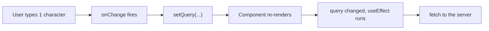
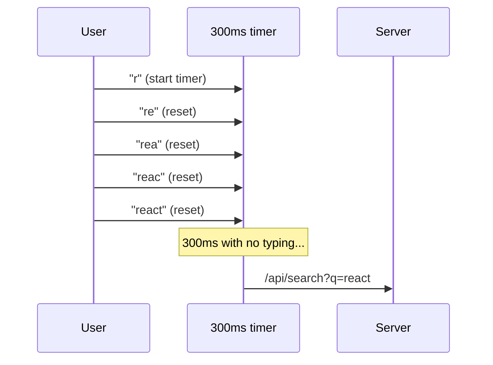
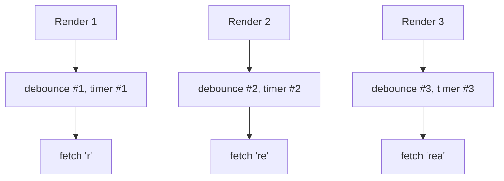
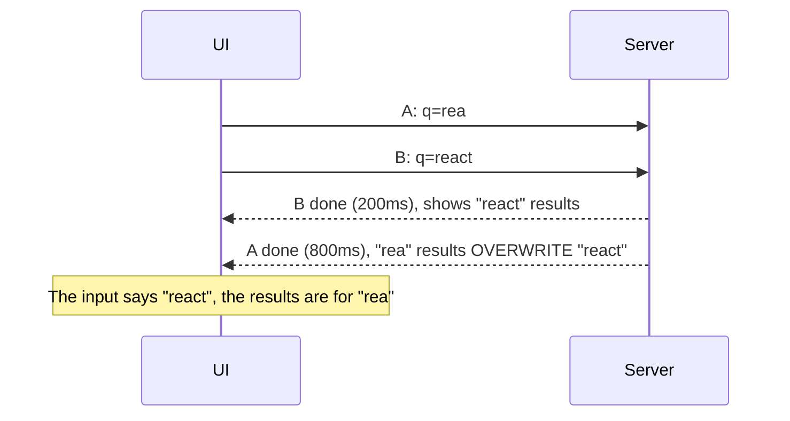

Almost every app has a search box. It looks simple: the user types, you call an API, you show the results. Then real users show up and strange things happen. The server gets flooded with requests, the results flicker, and sometimes the list on screen belongs to a search term the user **already typed past**.

The fix everyone mentions is **debouncing**. The trouble is that most tutorials hand you a snippet without explaining *why* the problem happens or *why* the snippet fixes it. So when the debounce ends up in the wrong place, it quietly stops working and nobody notices.

In this post we'll go step by step:

1. Why a search box without debounce is wasteful
2. What debounce actually does
3. Writing `debounce` yourself, so you know what's inside
4. Why debounce in React often **fails silently**
5. Race conditions: the bug debounce **doesn't** fix
6. A complete, production-ready version, plus a TanStack Query version
7. Debounce vs throttle vs `useDeferredValue`

> The examples use **React 19** and TypeScript, but the ideas apply to any framework. If you read my [Angular post](/blog/angular-for-react-developers), this is exactly what RxJS's `debounceTime` does.

## 1. The problem: one keystroke, one request

Here's the most naive search box:

```tsx
function Search() {
  const [query, setQuery] = useState("");
  const [results, setResults] = useState<Product[]>([]);

  useEffect(() => {
    fetch(`/api/search?q=${encodeURIComponent(query)}`)
      .then((res) => res.json())
      .then(setResults);
  }, [query]);

  return <input value={query} onChange={(e) => setQuery(e.target.value)} />;
}
```

Now the user types `react`. Here's what happens:

| Keystroke | `query` | Request sent |
| --- | --- | --- |
| `r` | `"r"` | `/api/search?q=r` |
| `e` | `"re"` | `/api/search?q=re` |
| `a` | `"rea"` | `/api/search?q=rea` |
| `c` | `"reac"` | `/api/search?q=reac` |
| `t` | `"react"` | `/api/search?q=react` |

**Five requests**, when the user only wanted one: the results for `react`. The other four get thrown away.

### Why does this happen?

Because an input's `onChange` fires **every time its value changes**, which means on every keystroke. The chain looks like this:



React isn't doing anything wrong. We literally told it "whenever `query` changes, call the API." The problem is that **`query` changes far more often than we need it to.**

People type fast. The gap between keystrokes is usually around 100–200ms, so a single word can send up to ten requests a second. Multiply that by thousands of users and you get:

- **A busy server and database** computing results that are thrown away immediately
- **Higher bills** if the API charges per request (search services, AI, maps, etc.)
- **Rate limits** from third-party APIs
- **Flickering UI**, because the results change on every character
- **Results arriving out of order** (covered in section 5, and the sneakiest of the lot)

## 2. What is debouncing?

Debouncing means: **"Wait until the user stops, then run."**

The best analogy I know is **an elevator door.** It doesn't close the moment someone steps in. It waits a few seconds. If someone else steps in before time runs out, the countdown **starts over**. The door only closes once nobody has stepped in for a few seconds.

Debounce works the same way. Every new keystroke **resets the timer to zero**. The function only runs once the user has been quiet for, say, 300ms.



The result: **five keystrokes, one request.** And it uses the latest value, which is the one the user actually wanted.

> The name comes from electronics. A physical button doesn't make one clean contact when pressed. It *bounces* several times within a few milliseconds, so one press can read as many. A *debounce* circuit filters out those bounces so the press registers once. Same idea: many signals close together count as one.

## 3. Writing `debounce` yourself

You could just use `lodash.debounce`. But it's only a few lines, and knowing what's inside is what lets you spot why it breaks later.

```ts
function debounce<Args extends unknown[]>(
  fn: (...args: Args) => void,
  delay: number,
) {
  let timer: ReturnType<typeof setTimeout> | undefined; // [!code highlight]

  return (...args: Args) => {
    clearTimeout(timer); // [!code highlight]
    timer = setTimeout(() => fn(...args), delay); // [!code highlight]
  };
}
```

Using it:

```ts
const search = debounce((q: string) => console.log("searching:", q), 300);

search("r");
search("re");
search("react");
// ...300ms later, logged only once: "searching: react"
```

### Why does such short code work?

Three things work together:

**1. `setTimeout` means "later", not "now".** When you call `setTimeout(fn, 300)`, JavaScript doesn't wait 300ms. It asks the browser: "in 300ms, put `fn` in the queue." Then your code keeps going. The browser hands back a ticket number (the timer ID), which we keep in `timer`.

**2. `clearTimeout` takes it back.** Until the 300ms are up, you can cancel the scheduled call using that ID. Once cancelled, `fn` never runs.

**3. A closure keeps `timer` alive between calls.** The `timer` variable is created **once**, when `debounce(...)` is called. The returned function "remembers" it. So every call to `search(...)` reads and writes **the same `timer`.**

Put together: every new call **cancels the previous scheduled run** and **schedules a new one**. Only the last one survives long enough to actually run.

> Point 3 is the key. Debounce only works if **every call goes through the same instance**, holding the same `timer`. Remember that, because it's exactly what breaks in React in the next section.

### Extras: `cancel` and `flush`

In real apps you often need two more things:

- **`cancel`**: drop a pending call. For example when a component unmounts, so no `fetch` fires for a component that's gone.
- **`flush`**: run it right now without waiting. For example when the user presses Enter. They clearly want to search, so why delay it 300ms?

```ts
function debounce<Args extends unknown[]>(
  fn: (...args: Args) => void,
  delay: number,
) {
  let timer: ReturnType<typeof setTimeout> | undefined;
  let lastArgs: Args | undefined;

  const debounced = (...args: Args) => {
    lastArgs = args;
    clearTimeout(timer);
    timer = setTimeout(() => {
      lastArgs = undefined;
      fn(...args);
    }, delay);
  };

  debounced.cancel = () => {
    clearTimeout(timer);
    lastArgs = undefined;
  };

  debounced.flush = () => {
    if (!lastArgs) return;
    const args = lastArgs;
    debounced.cancel();
    fn(...args);
  };

  return debounced;
}
```

## 4. The React trap: debounce that fails silently

This is the mistake I see **most often**. The code looks right, there are no errors, and yet nothing is debounced:

```tsx
function Search() {
  const [query, setQuery] = useState("");

  // ❌ Recreated on every render
  const search = debounce((q: string) => fetchResults(q), 300);

  return (
    <input
      value={query}
      onChange={(e) => {
        setQuery(e.target.value);
        search(e.target.value);
      }}
    />
  );
}
```

Type `react` and watch the Network tab. You **still get five requests**. Each one just goes out 300ms late.

### Why?

Remember point 3: debounce needs **one instance** holding one `timer`. Now look at what React does:

1. The user types `r`. `search` (instance **#1**) is called and timer **#1** starts.
2. `setQuery` makes the component **re-render**. The `Search()` function runs again from the top.
3. The line `const search = debounce(...)` runs again. Now there's instance **#2**, with a **brand-new, empty `timer`**.
4. The user types `e`. Instance **#2** is called. It runs `clearTimeout` on its own timer, which is empty. **Timer #1 is untouched**, because it lives in instance #1's closure.
5. And so on. Every keystroke gets its own timer that nobody ever cancels.



So debounce itself isn't broken. **A React component is a function that runs again on every render**, and every variable inside it is created fresh. Including our debounced function.

You can patch this with `useMemo` or `useRef` to keep the instance stable. But that brings new problems: the function can capture old props or state (*stale closures*), and you have to remember to `cancel` on unmount. There's a cleaner way.

### The fix: debounce the **value**, not the function

Instead of debouncing the *fetch call*, debounce the *`query` value*. We create a `debouncedQuery` that only updates once `query` has stopped changing for 300ms, and the fetch depends only on `debouncedQuery`.

```ts
// useDebouncedValue.ts
import { useEffect, useState } from "react";

export function useDebouncedValue<T>(value: T, delay = 300) {
  const [debounced, setDebounced] = useState(value);

  useEffect(() => {
    const id = setTimeout(() => setDebounced(value), delay);
    return () => clearTimeout(id); // [!code highlight]
  }, [value, delay]);

  return debounced;
}
```

### Why does this one work, even though it also runs every render?

The secret is the **cleanup function** (`return () => clearTimeout(id)`).

React has a rule: **before an effect runs again, it first runs the previous effect's cleanup.** So:

1. `value` becomes `"r"`. The effect runs and timer A starts.
2. `value` becomes `"re"`. React **runs the old cleanup first**, cancelling timer A. Then the new effect runs and timer B starts.
3. `value` becomes `"react"`. The cleanup cancels timer B, and timer C starts.
4. Nothing changes for 300ms. Timer C fires: `setDebounced("react")`.

Here **React holds on to the previous timer ID for us** and cancels it every time. We don't need to keep an instance around. As a bonus, the cleanup also runs on unmount, so no timer is left dangling.

Using it:

```tsx
function Search() {
  const [query, setQuery] = useState("");
  const debouncedQuery = useDebouncedValue(query, 300);

  useEffect(() => {
    // runs only once the user stops typing
    fetchResults(debouncedQuery);
  }, [debouncedQuery]);

  return <input value={query} onChange={(e) => setQuery(e.target.value)} />;
}
```

Notice there are **two pieces of state**:

- `query` drives the input. It **must update immediately** on every keystroke. If you debounce the input itself, characters show up late and it feels like the keyboard is lagging.
- `debouncedQuery` drives the expensive work (requests to the server).

Bonus: comparing the two gives you a "waiting for the user to finish typing" indicator for free:

```tsx
const isTyping = query !== debouncedQuery;
```

## 5. Race conditions: what debounce **doesn't** fix

Requests are way down now. But there's one bug left, and debounce does **nothing** to protect you from it.

Picture this:

1. The user types `rea` and pauses for a moment (more than 300ms). Request **A** (`q=rea`) is sent.
2. The user types `ct`. 300ms later, request **B** (`q=react`) is sent.
3. Request A happens to be slow (`rea` matches lots of rows, or the network hiccups). B finishes first.
4. B's results show up ✅. Then A finishes and **overwrites B's results** ❌.



### Why does this happen?

Because **network requests aren't guaranteed to finish in the order they were sent.** Each request is independent. How long it takes depends on the response size, server load, caching, even the user's phone signal. Our code says "when a response arrives, show it", without checking whether that response is still relevant.

Debounce only reduces **how many** requests you send. As long as two requests can be in flight at the same time, they can still arrive out of order. Debounce makes it rarer, which makes it **harder to catch in testing**, so it only shows up in production.

### The fix: cancel the old request with `AbortController`

Whenever `debouncedQuery` changes, the previous request is no longer relevant, so cancel it. And again, the perfect place is the **effect cleanup**:

```tsx
useEffect(() => {
  const controller = new AbortController();

  fetch(`/api/search?q=${encodeURIComponent(debouncedQuery)}`, {
    signal: controller.signal, // [!code highlight]
  })
    .then((res) => res.json())
    .then(setResults)
    .catch((err) => {
      if (err.name === "AbortError") return; // cancelled on purpose, not an error
      console.error(err);
    });

  return () => controller.abort(); // [!code highlight]
}, [debouncedQuery]);
```

When `debouncedQuery` changes from `rea` to `react`, React runs the cleanup and request A is `abort()`ed. Its promise rejects with an `AbortError`, so `setResults` for A **never runs.** Problem solved.

You get two wins at once:

- **Correctness**: an old response can never overwrite a newer one.
- **Efficiency**: the browser actually drops the connection, so no bandwidth is wasted on a response nobody will use.

> If you're using a library that doesn't support `AbortSignal`, use a simple flag: `let ignore = false;` in the effect, `return () => { ignore = true; }` as the cleanup, then `if (!ignore) setResults(data)`. The request still completes, but its result is ignored. This is the pattern the React docs show too.

## 6. The complete version

Now let's put it all together, plus a few details that make search pleasant to use:

- **Require at least 2 characters.** Results for `a` are rarely useful and heavy on the server.
- **`trim()`** so `"react "` and `"react"` count as the same search.
- **Clear status**: idle, loading, success, error.
- **Enter searches immediately** without waiting for the debounce.
- **Screen reader announcements** when the result count changes.

```tsx
// Search.tsx
import { useEffect, useState } from "react";
import { useDebouncedValue } from "./useDebouncedValue";

type Product = { id: string; name: string };
type State =
  | { status: "idle" }
  | { status: "loading" }
  | { status: "success"; results: Product[] }
  | { status: "error" };

const MIN_LENGTH = 2;

export function Search() {
  const [query, setQuery] = useState("");
  const [submitted, setSubmitted] = useState<string | null>(null);
  const debouncedQuery = useDebouncedValue(query.trim(), 300);
  const [state, setState] = useState<State>({ status: "idle" });

  // Enter = use the current value, skip the debounce
  const term = submitted ?? debouncedQuery;
  const isTyping = submitted === null && query.trim() !== debouncedQuery;

  useEffect(() => {
    if (term.length < MIN_LENGTH) {
      setState({ status: "idle" });
      return;
    }

    const controller = new AbortController();
    setState({ status: "loading" });

    fetch(`/api/search?q=${encodeURIComponent(term)}`, {
      signal: controller.signal,
    })
      .then((res) => {
        if (!res.ok) throw new Error(`HTTP ${res.status}`);
        return res.json() as Promise<Product[]>;
      })
      .then((results) => setState({ status: "success", results }))
      .catch((err) => {
        if (err.name !== "AbortError") setState({ status: "error" });
      });

    return () => controller.abort();
  }, [term]);

  return (
    <search>
      <form
        onSubmit={(e) => {
          e.preventDefault();
          setSubmitted(query.trim());
        }}
      >
        <input
          type="search"
          value={query}
          onChange={(e) => {
            setQuery(e.target.value);
            setSubmitted(null); // back to debounced mode
          }}
          placeholder="Search products..."
          aria-label="Search products"
        />
      </form>

      <p role="status">
        {isTyping || state.status === "loading"
          ? "Searching..."
          : state.status === "success"
            ? `${state.results.length} results`
            : state.status === "error"
              ? "Couldn't load results. Try again."
              : null}
      </p>

      {state.status === "success" && (
        <ul>
          {state.results.map((p) => (
            <li key={p.id}>{p.name}</li>
          ))}
        </ul>
      )}
    </search>
  );
}
```

A few notes:

- **`role="status"`** makes screen readers announce the text whenever it changes, without interrupting what they're reading. Users who can't see the screen learn that the search finished and how many results came back. It's also another good reason to debounce: without it, a screen reader would announce "12 results... 8 results... 3 results..." on every keystroke.
- **The `<search>` element** is an HTML element made for search areas. It means the same as `<div role="search">`.
- **`trim()` happens before the debounce**, so adding a trailing space doesn't trigger a new request.

## 7. The TanStack Query version (what I'd use in a real project)

The code above is great for understanding how it works. In a real project I'd reach for [TanStack Query](https://tanstack.com/query), because it already handles race conditions, cancellation, caching, and loading state.

```tsx
import { keepPreviousData, useQuery } from "@tanstack/react-query";

async function searchProducts(q: string, signal: AbortSignal) {
  const res = await fetch(`/api/search?q=${encodeURIComponent(q)}`, { signal });
  if (!res.ok) throw new Error(`HTTP ${res.status}`);
  return res.json() as Promise<Product[]>;
}

export function Search() {
  const [query, setQuery] = useState("");
  const term = useDebouncedValue(query.trim(), 300);

  const { data, isFetching, isError } = useQuery({
    queryKey: ["search", term],
    queryFn: ({ signal }) => searchProducts(term, signal),
    enabled: term.length >= 2,
    placeholderData: keepPreviousData,
    staleTime: 60_000,
  });

  // ...
}
```

Why this is nicer:

- **Race conditions disappear on their own.** Results are stored per `queryKey`. What's on screen is always the data for the current `["search", term]`. A late response for `rea` lands in the `["search", "rea"]` cache entry, not on screen.
- **TanStack Query's `signal`** is aborted automatically when the query is no longer used.
- **Caching.** The user types `react`, deletes back to `rea`, then types `react` again? The second `react` comes straight from the cache, no request needed.
- **`keepPreviousData`** keeps the old results visible while the new ones load, so the list doesn't flash empty every time the term changes.

Notice that **we still debounce.** TanStack Query doesn't debounce for you. Without `useDebouncedValue`, it would still start a request for every keystroke (even if it cancels the old ones). The two complement each other: debounce controls *how often you ask*, the query controls *which answer you use*.

## 8. Bonus: keep the search term in the URL

If search results should be shareable or bookmarkable (`/products?q=react`), put the term in the URL. Use the **debounced** value here too, and use `replace`, not `push`:

```tsx
"use client";
import { usePathname, useRouter, useSearchParams } from "next/navigation";

// inside the Search component, `term` = the debounced value
const router = useRouter();
const pathname = usePathname();
const searchParams = useSearchParams();

useEffect(() => {
  const params = new URLSearchParams(searchParams);
  if (term) params.set("q", term);
  else params.delete("q");
  router.replace(`${pathname}?${params}`, { scroll: false });
}, [term]);
```

Why `replace`? With `push`, every term becomes its own entry in the browser history. The user hits Back and has to step through `react`, `reac`, `rea`... one at a time. Debounce plus `replace` keeps history clean.

## 9. Debounce vs throttle vs `useDeferredValue`

These three get mixed up a lot, but they solve different problems.

| Aspect | Debounce | Throttle | `useDeferredValue` |
| --- | --- | --- | --- |
| When it runs | After the user **stops** for X ms | At most **once every** X ms, even while the user keeps going | As soon as possible, at a lower priority than typing |
| Fixed delay? | Yes | Yes | **No**, it adapts to the device |
| Fewer requests? | **Yes** | Yes | **No** |
| Good for | Search APIs, autosave, username checks | Scroll, resize, drag, mouse position | Filtering or rendering big lists **on the client** |

**Throttle** fits when you need regular updates *while* something is happening. Take infinite scroll: you want to check the scroll position every 200ms while the user scrolls, not wait until they stop. Debounce the scroll and new items only load once the user stops, possibly long after they hit the bottom.

React's **`useDeferredValue` is not debounce.** It doesn't wait on a timer. It tells React: "render the input first, render whatever uses this value later, and if a new keystroke arrives, throw away the stale render." On a fast laptop the value catches up almost instantly. On a slow phone it lags more, automatically.

Which means:

- **If the problem is CPU** (say, filtering 10,000 items already in the browser and rendering is slow): use `useDeferredValue`.
- **If the problem is the network or server** (every keystroke = a request): use **debounce**. `useDeferredValue` doesn't reduce requests at all, since the deferred value still follows every keystroke.

```tsx
// Client-side filtering: useDeferredValue
const deferredQuery = useDeferredValue(query);
const filtered = useMemo(
  () => allProducts.filter((p) => p.name.includes(deferredQuery)),
  [deferredQuery],
);
```

## 10. How many milliseconds?

There's no magic number, but here are my rules of thumb:

- **150–250ms**: local search or a fast, cheap API. Feels instant.
- **300–400ms**: a safe default for most server-side search.
- **500ms and up**: expensive or slow APIs (AI, geocoding, paid APIs). It feels a bit delayed, so a "Searching..." indicator is a must.

Too short and the debounce barely helps: if the gap between keystrokes is longer than the delay, every keystroke still sends a request. Too long and search feels sluggish. When in doubt, start at **300ms** and try it yourself on a phone.

## 11. Testing debounce

Waiting a real 300ms in tests is slow and flaky. Use **fake timers** so you can move time forward by hand:

```ts
// debounce.test.ts
import { afterEach, beforeEach, expect, test, vi } from "vitest";
import { debounce } from "./debounce";

beforeEach(() => vi.useFakeTimers());
afterEach(() => vi.useRealTimers());

test("runs once, with the last value", () => {
  const fn = vi.fn();
  const search = debounce(fn, 300);

  search("r");
  search("re");
  search("react");

  vi.advanceTimersByTime(299);
  expect(fn).not.toHaveBeenCalled(); // not 300ms yet

  vi.advanceTimersByTime(1);
  expect(fn).toHaveBeenCalledOnce();
  expect(fn).toHaveBeenCalledWith("react");
});
```

The 299ms check matters. It proves the function **doesn't fire too early**, not just that it eventually fires.

## Summary

- **Why debounce?** `onChange` fires on every keystroke. Without debounce, one word means many requests, nearly all of them thrown away.
- **How it works:** each new call cancels the previous timer (`clearTimeout`) and starts a new one. Only the last call runs.
- **The React trap:** `debounce(...)` in a component body is recreated on every render, so every keystroke gets its own timer and nothing is cancelled. **Debounce the value** with `useDebouncedValue` and let the effect cleanup cancel the timer.
- **Keep the input on immediate state.** Only the expensive work uses the debounced value.
- **Debounce doesn't fix race conditions.** Responses can arrive out of order. Cancel stale requests with `AbortController` in the cleanup, or use TanStack Query.
- **Debounce ≠ throttle ≠ `useDeferredValue`.** Debounce is "wait until the user is done", throttle is "update regularly during an action", `useDeferredValue` is for heavy client-side rendering.

Next time you build a search box, open the Network tab while you type. If every character sends a request, you now know why, and how to fix it. 🔍

## References

- [setTimeout()](https://developer.mozilla.org/en-US/docs/Web/API/Window/setTimeout) and [clearTimeout()](https://developer.mozilla.org/en-US/docs/Web/API/Window/clearTimeout), MDN
- [AbortController](https://developer.mozilla.org/en-US/docs/Web/API/AbortController), MDN
- [The `<search>` element](https://developer.mozilla.org/en-US/docs/Web/HTML/Element/search) and [the `status` role](https://developer.mozilla.org/en-US/docs/Web/Accessibility/ARIA/Roles/status_role), MDN
- [Synchronizing with Effects: fetching data](https://react.dev/learn/synchronizing-with-effects#fetching-data), React docs
- [useDeferredValue](https://react.dev/reference/react/useDeferredValue), React docs
- [Query cancellation](https://tanstack.com/query/latest/docs/framework/react/guides/query-cancellation) and [Paginated queries (`placeholderData`)](https://tanstack.com/query/latest/docs/framework/react/guides/paginated-queries), TanStack Query docs
- [Fake timers](https://vitest.dev/guide/mocking/timers), Vitest docs
- [Debouncing and Throttling Explained Through Examples](https://css-tricks.com/debouncing-throttling-explained-examples/), CSS-Tricks
